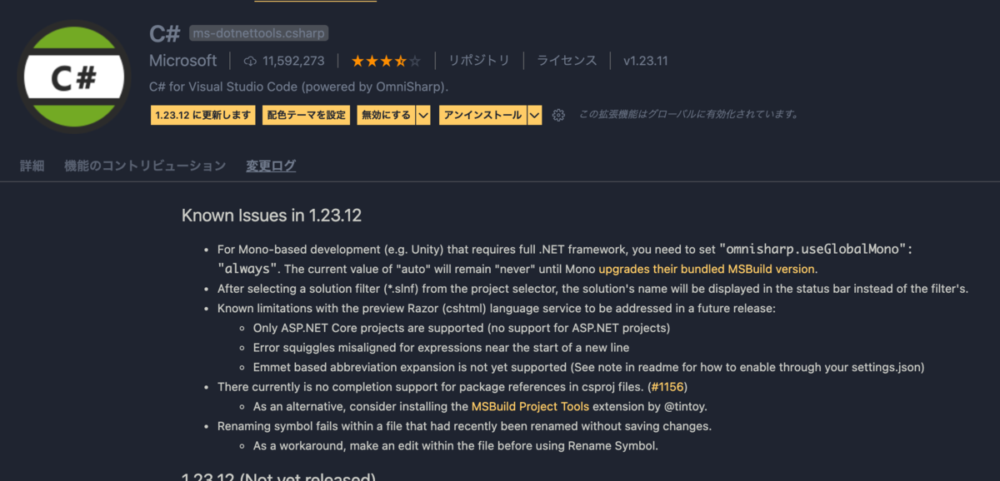

MacのvscodeでUnity C#の補完が効かなくなったので原因を探りました。

## 起こっていたこと

環境は、 mac OS は `big sur`, unity は `2019.4.25f` です。

vscode の Omnisharp Log を見てみると、大きく2つのエラーが発生していました。

-   Could not load file or assembly 'Microsoft.CodeAnalysis.Workspaces ...
    
-   OmniSharp server load timed out. Use the 'omnisharp.projectLoadTimeout' setting to override the default delay (one minute).
    

どうやら読み込めていないモジュールがあり、読み込みのタイムアウトが起こっているようです。

## 解決

まず2つ目のエラーに着目して、 `omnisharp.projectLoadTimeout` の時間をデフォルトの60秒よりも長い設定にしても変わらずでした。

最終的に、vscode の拡張の `C# for Visual Studio Code` のバージョンを最新の `1.23.12` から `1.23.11` に戻すことで直りました。

必要な assembly がなかった関係でロードのタイムアウトが起こっていたようです。
