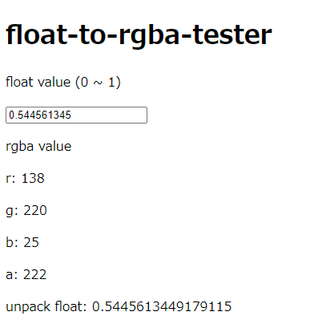

デモはこちらにおきました。

デモ [https://takumifukasawa.github.io/float-to-rgba-tester/](https://takumifukasawa.github.io/float-to-rgba-tester/)

リポジトリ [GitHub - takumifukasawa/float-to-rgba-tester: float to rgba tester](https://github.com/takumifukasawa/float-to-rgba-tester)



* * *

こちらが計算部分のjavascriptのソースになります。

```javascript
class FloatPacker {
    static packToRGBA(num) {
        const rawR = num * 255;
        const r = Math.floor(rawR);
        const rawG = (rawR - r) * 255;
        const g = Math.floor(rawG);
        const rawB = (rawG - g) * 255;
        const b = Math.floor(rawB);
        const rawA = (rawB - b) * 255;
        const a = Math.floor(rawA);
        return { r, g, b, a };
    }
    static unpackToFloat({ r, g, b, a }) {
        return r / 255 + g / (255 * 255) + b / (255 * 255 * 255) + a / (255 * 255 * 255 * 255);
    }
}

// usage example
const { r, g, b, a } = FloatPackage.packToRGBA(0.87185264);
const unpackedFloat = FloatPackage.unpackToFloat({ r, g, b, a });
```

## 概要

jpgやpngなど、普段使うことの多いテクスチャの形式ではRGBAの各チャンネルの表現できる値は8bitなので0~255までの256段階になります。

そのため、VATなど頂点シェーダーであらかじめ用意されたデータをテクスチャから読み込んで取り扱うときは、0~255の256段階でしか使うことができません。

しかし、頂点シェーダーでは0.5145や5.4514など、floatな値を使いたい場面があり、256段階では精度が足りないことがほとんどです。

浮動小数点テクスチャを扱うことができればその限りではないのですが、jpgやpngなどの 8bit x 4 = 32bit/pixel なテクスチャの場合は、浮動小数点的をそのままチャンネルに詰めることができません。チャンネルごとに32bitであればもちろんそのまま浮動小数点を入れることができるのですが、8bitだと浮動小数点を入れるにはbit数が足らないからですね。

そのため、<strong>浮動小数点をとある変換式にかけることでRGBAの 8bit x 4 の形式に変換し、多少誤差があるものの 8bit x 4 = 32bit/pixel から浮動小数点に直す方法をとることで、浮動小数点を 8bit x 4 = 32bit/pixel な形式のテクスチャに格納することができます。</strong>

ただし、0~1の間であることが条件になります。

## 変換

まず、`0.87185264`という値があるとします。

この数値に 255 をかけて、整数部分のみ切り出します。 これがRチャンネルに入る要素になります。

```
0.87185264 * 255 = 222.3224232 => 222
```

次に、先ほどの小数部分のみを切り出し、再度255をかけて整数部分のみをきりだします。 これがGチャンネルに入る要素になります。

```
0.3224232 * 255 = 82.217916 => 82
```

これを残りのB,Aチャンネル分の2回繰り返します。

```
0.217916 * 255 = 55.56858 => 55
0.56858 * 255 = 144.9879 => 144
```

最終的に `R=222, G=82, B=55, A=144` という数値が得られました。

それでは、0~1の浮動小数点に復元してみましょう これまでは、255をかけて整数部分を切り出すことをしていたので、この逆の計算をしていきます。

```
(222 / 255) + (82 / (255 ^ 2)) + (55 / (255 ^ 3)) + (144 / (255 ^ 4)) = 0.8718526397663572
```

最終的に、差分は `0.8718526397663572 - 0.87185264 = -2.336428e-10` となりました。

この程度の差であれば、場面によってはほぼ誤差に近いと捉えることもできそうです。

* * *

参考

[packing a float into a A8R8G8B8 texture (shader)](https://www.gamedev.net/forums/topic/442138-packing-a-float-into-a-a8r8g8b8-texture-shader/)
