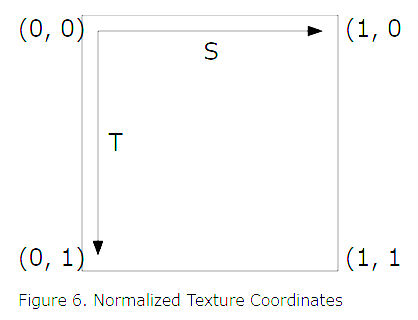
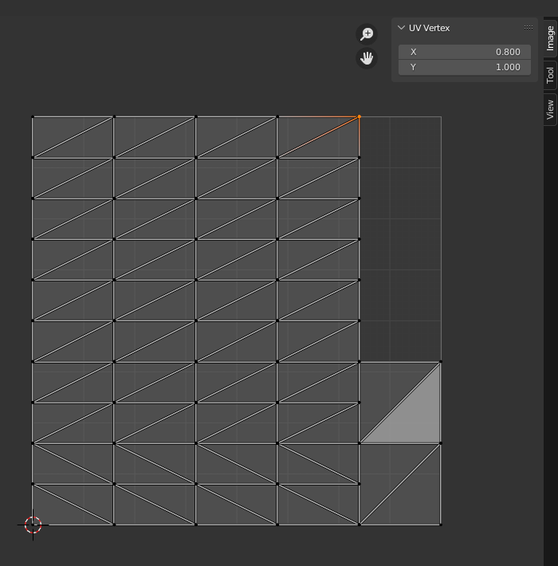

GLTFのUV座標系について知識不足だったので、メモを残しておきたいと思います。

* * *

結論、GLTF自体のフォーマットでは以下の図のようにUV座標は<strong>左上が原点（左上が(0,0)で右下が(1,1)）</strong>に設定されています。



※画像は下記URLの図をスクショしたもの

[glTF™ 2.0 Specification](https://registry.khronos.org/glTF/specs/2.0/glTF-2.0.html#images)

普段html,jsを触っている感覚からすると自然な感覚かなと思います。

* * *

しかし、「あえてWebGLのUVの原点が左下になるように設計・実装している」場合には問題が発生します。具体的には、`gl.pixelStorei(gl.UNPACK_FLIP_Y_WEBGL, true);` を呼んでいるときです。

まず、画像データを何かしらの方法で読み込む（fetchなど）と座標系の原点は左上になります。 一方、Blenderなどの各種DCCツールでは以下のように `UVの座標系の原点を左下` にしているケースが大半だと思います。つまり、Yが反転した状態になっているのです。

```
(0, 1) ---- (1, 1)
   |           |
   |           |
(0, 0) ---- (1, 0)
```

↓ Blender の UVエディタウインドウのスクショ



* * *

しかし、WebGLでは `gl.pixelStorei(gl.UNPACK_FLIP_Y_WEBGL, true);` を呼ぶことによって左下を原点とすることができます。

個人的には各種DCCツールに合わせて左下に原点を持ってきた方がわかりやすいと思っていてこの UNPACK... の指定は入れるようにしているのですが、GLTFをパースしているときに「UVのY軸がなぜか逆だな」と思って調べてみると、そもそもGLTFでは左上が原点になっていた、と気がついた経緯でした。

最終的には以下のような実装にまとまりました。

-   左下を原点とするために `gl.pixelStorei(gl.UNPACK_FLIP_Y_WEBGL, true);` は指定する
-   GLTFからUVを読み込む際、Yを反転させてからBufferにデータを送る
