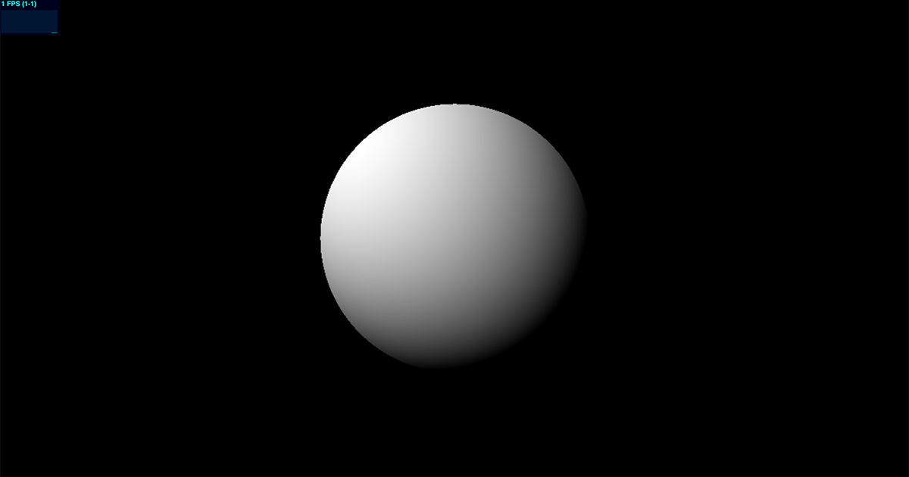
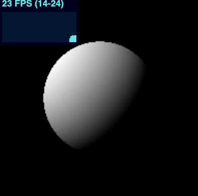
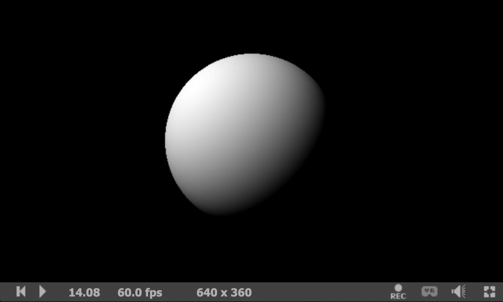

## はじめに

<strong>ブラウザでレイマーチングを行うには、WebGLを使ってシェーダーで書くのが一般的なやり方かと思います。</strong>むしろ、高いFPSを実現するにはそれ以外の方法は実質難しいはずです。具体的には、描画したい範囲に板ポリを貼りそのマテリアルにレイマーチングを行うシェーダーを割り当てる方法です。

ピクセルごとに複数回レイを飛ばしてシーンを構築するような処理そのものは、負荷は大きいですがGPUの得意とするところで、CPUで1ピクセルずつ順番に計算するよりも圧倒的に高速だからです。

ただ、<strong>処理速度は遅くなりますがCPUでは実現できないという訳ではありません。</strong>負荷はともかくとして、レイマーチングそのものはあくまでも手法で、処理自体はGPUでもCPUでも実現そのものは出来るはず・・・と思っていたのですが、どのぐらい負荷に差が出るのかまでは予測できなかったので、実際にやってみました。

## 作ったもの

1.  CPU版: CanvasのContext2Dでレイマーチングしたデモ
2.  GPU版: シェーダーでレイマーチングしたデモ

比較のためにこの2つを作ってみました。見た目は同じです。球にディレクショナルライトが当たり、ライトの位置が回転するように動いています。



## 環境

-   Mac 15-inch
-   プロセッサ: 3.1Ghz Intel Core i7
-   グラフィックス: Intel HD Graphics 630 1536MB

## CPU版

### デモ

Typescriptで書いてみました。Context2Dを使っています。

ベクトルや行列周りの処理は、今回のデモで必要になる最低限の計算を自分で作ってみました。

<div class="embed" data-embed-src="https://codepen.io/takumifukasawa/embed/JjoGMPb?default-tab=js%2Cresult&amp;theme-id=dark" style="height: 265px"><button type="button" aria-label="Canvas2D Raymarching を読み込む">▶</button><a href="https://codepen.io/takumifukasawa/pen/JjoGMPb" target="_blank" rel="noopener">Canvas2D Raymarching</a></div>

### コード

HTML

```html
<canvas id="canvas" width="200" height="200"></canvas>
```

CSS

```css
canvas {
  display: block;
}
```

Javascript

```typescript
const ITERATION_NUM: number = 16;
const NORMAL_EPS: number = 0.0001;
const STOP_THRESHOLD: number = 0.0001;

//---------------------------------------------------------------
// utils
//---------------------------------------------------------------

function clamp(x: number, a: number, b: number): number {
  return Math.min(Math.max(x, a), b);
}

//---------------------------------------------------------------
// vector
//---------------------------------------------------------------

class Vector2 {
  x: number;
  y: number;
  constructor(x: number, y: number) {
    this.x = x;
    this.y = y;
  }
}

class Vector3 {
  x: number;
  y: number;
  z: number;
  constructor(x: number, y: number, z: number): Vector3 {
    this.x = x;
    this.y = y;
    this.z = z;
    return this;
  }
  get magnitude(): number {
    return Math.sqrt(this.x * this.x + this.y * this.y + this.z * this.z);
  }
  static magnitude(Vector3: v): number {
    return Math.sqrt(v.x * v.x + v.y * v.y + v.z * v.z);
  }
  get normalized(): Vector3 {
    const mag = this.magnitude;
    return new Vector3(
      this.x / mag,
      this.y / mag,
      this.z / mag
    );
  }
  static normalize(v: Vector3): Vector3 {
    const mag = v.magnitude;
    return new Vector3(
      v.x / mag,
      v.y / mag,
      v.z / mag
    );
  }
  normalize(): Vector3 {
    const mag = this.magnitude;
    return new Vector3(
      this.x / mag,
      this.y / mag,
      this.z / mag
    );
  }
  static sub(a: Vector3, b: Vector3): Vector3 {
    return new Vector3(
      a.x - b.x,
      a.y - b.y,
      a.z - b.z
    );
  }
  static dot(a: Vector3, b: Vector3): number {
    return a.x * b.x + a.y * b.y + a.z * b.z;
  }
  static cross(a: Vector3, b: Vector3): Vector3 {
    return new Vector3(
      a.y * b.z - a.z * b.y,
      a.z * b.x - a.x * b.z,
      a.x * b.y - a.y * b.x
    );
  }
  static add(v1: Vector3, v2: Vector3): Vector3 {
    return new Vector3(
      v1.x + v2.x,
      v1.y + v2.y,
      v1.z + v2.z,
    );
  }
  static mul(v: Vector3, m: number): Vector3 {
    return new Vector3(
      v.x * m,
      v.y * m,
      v.z * m
    );
  }
}

//---------------------------------------------------------------
// mat3
//---------------------------------------------------------------

class Mat3 {
  elem: number[3][3];
  constructor(row1: Vector3, row2: Vector3, row3: Vector3) {
    this.elem = [
      [ row1.x, row1.y, row1.z ],
      [ row2.x, row2.y, row2.z ],
      [ row3.x, row3.y, row3.z ],
    ];
  }
  mul(v3: Vector3): Vector3 {
    return new Vector3(
      this.elem[0][0] * v3.x + this.elem[0][1] * v3.y + this.elem[0][2] * v3.z,
      this.elem[1][0] * v3.x + this.elem[1][1] * v3.y + this.elem[1][2] * v3.z,
      this.elem[2][0] * v3.x + this.elem[2][1] * v3.y + this.elem[2][2] * v3.z
    );
  }
}

//---------------------------------------------------------------
// color
//---------------------------------------------------------------

class Color {
  r: number;
  g: number;
  b: number;
  a: number;
  constructor(r: number, g: number, b: number, a: number = 255) {
    this.r = r;
    this.g = g;
    this.b = b;
    this.a = a;
  }
  add(color: Color): void {
    this.r = clamp(this.r + color.r, 0, 255);
    this.g = clamp(this.g + color.g, 0, 255);
    this.b = clamp(this.b + color.b, 0, 255);
    this.a = clamp(this.a + color.a, 0, 255);
  }
}

//---------------------------------------------------------------
// raymarch block
//---------------------------------------------------------------

function scene(p: Vector3): number {
  return p.magnitude - 1;
}

function getCamera(ro: Vector3, rd: Vector3): Mat3 {
  const dir = Vector3.sub(rd, ro);
  const forward: Vector3 = dir.normalized;
  const right: Vector3 = Vector3.cross(forward, new Vector3(0, 1, 0));
  const up: Vector3 = Vector3.cross(right, forward);
  return new Mat3(right, up, forward);
}

function getNormal(p: Vector3): Vector3 {
  const e: Vector2 = new Vector2(NORMAL_EPS, 0);
  const n: Vector3 = new Vector3(
    scene(Vector3.add(p, new Vector3(e.x, e.y, e.y))) - scene(Vector3.sub(p, new Vector3(e.x, e.y, e.y))),
    scene(Vector3.add(p, new Vector3(e.y, e.x, e.y))) - scene(Vector3.sub(p, new Vector3(e.y, e.x, e.y))),
    scene(Vector3.add(p, new Vector3(e.y, e.y, e.x))) - scene(Vector3.sub(p, new Vector3(e.y, e.y, e.x)))
  );
  return n.normalized;
}

function raymarch(u: number, v: number): Color {
  const time = performance.now() / 1000, // [s]
  const uv: Vector2 = new Vector2(u, v);
  const ro: Vector3 = new Vector3(
    Math.cos(time) * 5,
    0,
    Math.sin(time) * 5
  );
  const target: Vector3 = new Vector3(0, 0, 0);
  const fov: number = 1.5;
  const camera: Mat3 = getCamera(ro, target);
  const rd: Vector3 = camera.mul(new Vector3(uv.x, uv.y, fov).normalized);
  
  let depth: number = 0;
  let dist: number = 0;
  
  // raymarch
  for(let i: number = 0; i < ITERATION_NUM; i++) {
    dist = scene(Vector3.add(ro, Vector3.mul(rd, depth)));
    if(dist < STOP_THRESHOLD) {
      break;
    }
    depth += dist;
  }
  
  // no hit
  if(dist >= STOP_THRESHOLD) {
    return new Color(0, 0, 0, 255);
  }
 
  // hit
  const color: Color = new Color(0, 0, 0, 255);
  const position: Vector3 = Vector3.add(ro, Vector3.mul(rd, depth));
  const normal: Vector3 = getNormal(position);
  const lightPos: Vector3 = new Vector3(-1, 1, 1);
  const lambert: float = Math.max(0, Vector3.dot(normal, lightPos.normalized));
  const surfaceColor: Vector3 = Vector3.mul(new Vector3(255, 255, 255), lambert);
  color.add(new Color(
    surfaceColor.x,
    surfaceColor.y,
    surfaceColor.z
  ));

  return color;
}

//---------------------------------------------------------------
// main block
//---------------------------------------------------------------

const canvas = document.getElementById('canvas');
const ctx = canvas.getContext('2d');

const width: number = canvas.offsetWidth;
const height: number = canvas.offsetHeight;

const stats = new Stats();
stats.domElement.style.position = 'fixed';
stats.domElement.style.top = '0px';
stats.domElement.style.left = '0px';
document.body.appendChild(stats.domElement);

function draw() {
  stats.begin();
  
  const imageData = ctx.createImageData(width, height);
  const data = imageData.data;
  for(let y = 0; y < height; y++) {
    for(let x = 0; x < width; x++) {
      const w = x;
      // flip y
      const h = height - y;
      const i = (x + y * width) * 4;
      const coord: Vector2 = new Vector2(w, h);
      const resolution: Vector2 = new Vector2(width, height);
      const color: Color = raymarch(
        (coord.x - width * .5) / Math.min(width, height),
        (coord.y - height * .5) / Math.min(width, height)
      );
      data[i    ] = color.r;
      data[i + 1] = color.g;
      data[i + 2] = color.b;
      data[i + 3] = color.a;
    }
  }

  ctx.putImageData(imageData, 0, 0);
  
  stats.end();
  
  requestAnimationFrame(draw);
}

requestAnimationFrame(draw);
```

## GPU版

せっかくなのでシェーダーで動作するコードも書いてみました。

こちらはShaertoyでのデモになります。

### デモ

[Shadertoy](https://www.shadertoy.com/view/3tGXzd)

### コード

```c
#define EPS .0001
#define NORMAL_EPS .0001

const float stopThreshold = .0001;

float scene(vec3 p) {
    return length(p) - 1.;
}

mat3 camera(vec3 o, vec3 t) {
    vec3 forward = normalize(t - o);
    vec3 right = cross(forward, vec3(0., 1., 0.));
    vec3 up = cross(right, forward);
    return mat3(right, up, forward);
}

vec3 getNormal(vec3 p) {
    vec2 e = vec2(NORMAL_EPS, 0);
    return normalize(
        vec3(
            scene(p + e.xyy) - scene(p - e.xyy),
            scene(p + e.yxy) - scene(p - e.yxy),
            scene(p + e.yyx) - scene(p - e.yyx)
        )
    );
}

void mainImage(out vec4 fragColor, in vec2 fragCoord) {
    vec2 uv = (fragCoord.xy - iResolution.xy * .5) / min(iResolution.x, iResolution.y);
    
    vec3 ro = vec3(
        cos(iTime) * 5.,
        0.,
        sin(iTime) * 5.
    );
    vec3 target = vec3(0.);
    float fov = 1.5;
    
    vec3 rd = camera(ro, target) * normalize(vec3(uv, fov));
    
    // raymarching
    float depth = 0.;
    float dist = 0.;
    for(int i = 0; i < 64; i++) {
        dist = scene(ro + rd * depth);
        if(dist < stopThreshold) {
            break;
        }
        depth += dist;
    }
    
    // no hit
    if(dist >= stopThreshold) {
        fragColor = vec4(vec3(0.), 1.);
        return;
    }
    
    vec3 color = vec3(0.);
   
    vec3 position = ro + rd * depth;
    vec3 normal = getNormal(position);
    
    // directional lighting
    vec3 lightPos = vec3(-1., 1., 1.);
    float lambert = max(0., dot(normal, normalize(lightPos)));
    color += lambert * vec3(1.);    
    
    fragColor = vec4(color, 1.);
}
```

## 比較

CPU版をGPU版と同じ条件にするとFPSが1ぐらいしか出なかったので解像度などを下げました。

-   CPU版
    -   レイを進める最大回数: 16回
    -   解像度\[px\]: 200 x 200
    -   FPS: 20FPS前後



-   GPU版
    -   レイを進める最大回数: 64回
    -   解像度\[px\]: 640 x 360
    -   FPS: ほぼ60FPS



## 結果

やはりレイマーチングそのものはCPUでも実現はできましたが、処理速度はGPUには到底及ばないぐらいの差が開きました。

## 参考

[Inigo Quilez :: fractals, computer graphics, mathematics, shaders, demoscene and more](https://www.iquilezles.org/index.html)
