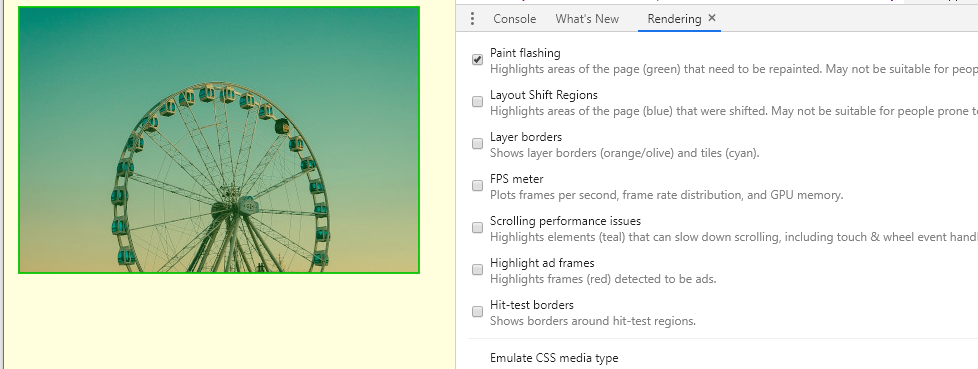
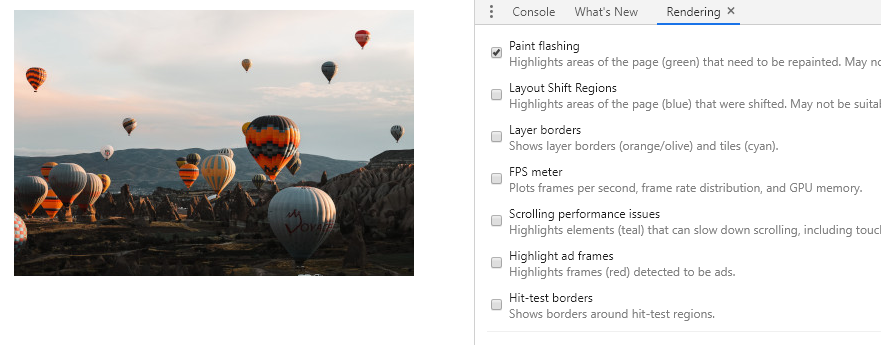

※内容は以前書いたこちらの記事と同じでさらに文章に校正を加えたものになります。jsdo.itをデモとして使っていたのですがjsdo.itがクローズになってデモが動作しなくなったのでデモをcodepenに移したためです。

[CSSスプライトアニメーションをGPUレンダリングさせる - Qiita](https://qiita.com/takumifukasawa/items/7463d9fa48aced1cf3cb)

## スプライトアニメーションと再描画

CSSでスプライト画像の連番アニメーションを実装する場合、background-positionをずらす方法を使っていました。しかし、同じ画面内でサイズの大きい画像のスプライトアニメーションをいくつも動かしたい場面があり、パフォーマンスがネックになりました。

実際、<strong>background-positionのcss animationはGPUレンダリングではないので再描画処理が走ってしまいます。</strong>chromeのデバッガーツールで`Rendering`の`Paint Flashing`を見ると、このように再描画処理が走っているのがわかります。



```sass
@keyframes sprite-image {
  0% {
    background-position: 0 0;
  }
  100% {
    background-position: 0 -1064px;
  }
}

.sprite {
  width: 400px;
  height: 266px;
  margin: 15px;
  background-image: url(https://user-images.githubusercontent.com/947953/77824893-2f663480-7149-11ea-873b-9fda24fe1022.jpg);
  background-size: 400px 1064px;
  animation: sprite-image 1s steps(4) infinite;    
}
```

## css transformを使うことで再描画を防ぐ

そこでGPU処理が適用されるcss transformを使った方法を試してみました。**before要素の大きさをスプライト画像と同じ大きさにし、背景にスプライト画像をあて、animationでtransformを操作する**ことにより、background-positionの時と同じDOM構造のままcssを変更するのみで実現できました。

先ほどと同じようにchromeのデバッガーツールを見てみると、再描画が走っていないことがわかります。この方法によって、background-positionを使った時よりも描画負荷を軽減することができました。



こちらがデモになります。

<div class="embed" data-embed-src="https://codepen.io/takumifukasawa/embed/mdJaKjV?default-tab=css%2Cresult&amp;theme-id=dark" style="height: 265px"><button type="button" aria-label="【CSS】Sprite Animation by GPU Rendering を読み込む">▶</button><a href="https://codepen.io/takumifukasawa/pen/mdJaKjV" target="_blank" rel="noopener">【CSS】Sprite Animation by GPU Rendering</a></div>

↓ cssの抜粋です。

```sass
@keyframes sprite-image {
  0% {
    transform: translate(0, 0);
  }
  100% {
    transform: translate(0, -100%);
  }
}

.sprite {
  overflow: hidden;
  width: 400px;
  height: 266px;
  margin: 15px;

  // animationでtransformのtranslateを動かす
  &:before {
    content: "";
    display: block;
    width: 400px;
    height: 1064px;
    background-image: url(https://user-images.githubusercontent.com/947953/77824893-2f663480-7149-11ea-873b-9fda24fe1022.jpg);
    background-size: 400px 1064px;
    animation: sprite-image 1s steps(4) infinite;
  }
}
```
