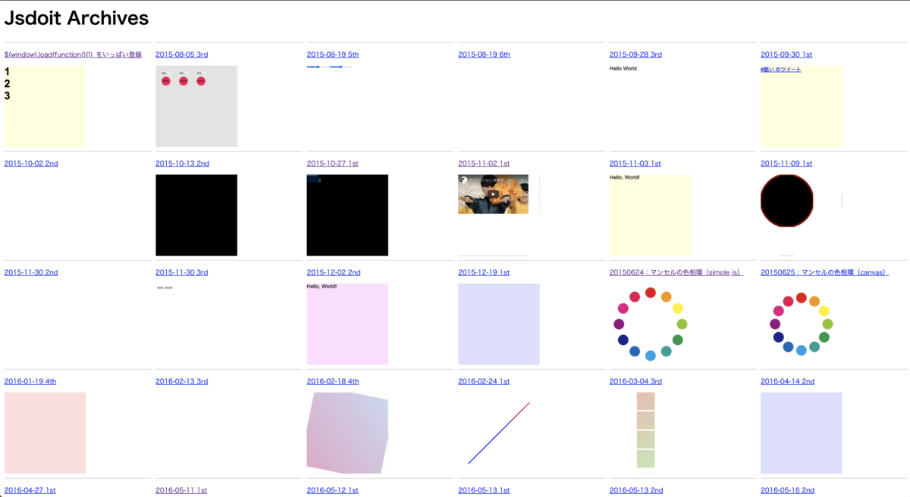

1年半ほど前にクローズになった、jsdoitというソースコード共有サービスがあります。

サービスが稼働している時は500以上のコードを上げていて、サービスクローズ前に全てのコードをローカルに落として個人のgoogle driveに保管していたのですが、パッと見返したいコードなどがあるため、git管理をしてgithub-pagesで見られるように移行しました。

[Jsdoit Archives](https://takumifukasawa.github.io/jsdoitArchives/)



各ソースコードのOGP対応もさせてみました。

[\[2016.2.4\] サカナクションの「夜の踊り子」カバー風 - js do it](https://takumifukasawa.github.io/jsdoitArchives/codes/24051356-2aa6-52bf-976e-4f7dc8817a38/)

いざ作業に取り掛かると、知らなかったツール・使ってみたいと思っていたツールに触れることができたのでよい機会でした。

せっかくなので、移行までの簡単なフローと、便利だと思ったツールを書いていこうと思います。

## jsdoitのファイル群

jsdoitからソースをダウンロードするとhtml,js,cssのファイルが格納されています。 ただ、画像や動画、音声などのアセットは含まれていませんでした。

[https://github.com/takumifukasawa/jsdoitArchives/tree/master/src/archives/%5B2016.2.4%5D%20%E3%82%B5%E3%82%AB%E3%83%8A%E3%82%AF%E3%82%B7%E3%83%A7%E3%83%B3%E3%81%AE%E3%80%8C%E5%A4%9C%E3%81%AE%E8%B8%8A%E3%82%8A%E5%AD%90%E3%80%8D%E3%82%AB%E3%83%90%E3%83%BC%E9%A2%A8](https://github.com/takumifukasawa/jsdoitArchives/tree/master/src/archives/%5B2016.2.4%5D%20%E3%82%B5%E3%82%AB%E3%83%8A%E3%82%AF%E3%82%B7%E3%83%A7%E3%83%B3%E3%81%AE%E3%80%8C%E5%A4%9C%E3%81%AE%E8%B8%8A%E3%82%8A%E5%AD%90%E3%80%8D%E3%82%AB%E3%83%90%E3%83%BC%E9%A2%A8)

## 移行フロー

大まかな流れはこちらです。全てnodeのスクリプトを書いています。

[https://github.com/takumifukasawa/jsdoitArchives/tree/master/batches](https://github.com/takumifukasawa/jsdoitArchives/tree/master/batches)

```
1. ソースコードのパース・変換
  - 画像など切れているリンクの置き換え
  - opg用のmetaタグ挿入
2. サムネイル生成
  - アーカイブ一覧ページのhtml用の画像（465x465）
  - ogp画像（1200x630）
3. アーカイブ一覧ページのhtml生成
```

## 使用ツール・サービス

### unpkg

リンクの置き換えに関して、jsdoitのサーバーにアップされていたライブラリのリンクは全て置き換えていく必要があるので、 可能な限り洗い出し、正規表現で検知・置き換えをしていきました。

ライブラリに関しては、動くデモを作るために可能な限りコードを書いた当時のバージョンを使っていきたい意図がありました。 主要ライブラリだと何かしらのcdnに上がっているのですが、ライブラリに依存するライブラリは見つからない場合があります。 threejsのOrbitControlsはまさにそのパターンです。バージョンが異なるとエラーが出て動かない場合があります。

unpkgはnpmのバージョンごとにコンテンツを配信してくれているサービスです。 threejsや関連モジュールはunpkgを参照するようにリンクを変換し、各ライブラリのバージョンを揃えることができました。

[UNPKG](https://unpkg.com/)

### node-html-parser

ダウンロードしたhtmlの中にはogp向けのmetaタグは入っていなかったので、ogp用のmetaタグは全て新規追加していく必要がありました。

htmlそのものはテキストファイルなので、htmlファイルを読み込んでもdocument.appendChildなどのnodeベースで要素を追加していくことができないため、どう変換するのがよいか考えながらツールを探した結果こちらが便利でした。

[node-html-parser](https://www.npmjs.com/package/node-html-parser)

htmlの中身をパースしてquerySelectorを用い要素にアクセスすることができるインターフェースになっている & 文字列への変換メソッドが生えている点が便利で、以下のような形でogp用のmetaタグを追加していきました。

```javascript
import { parse } from 'node-html-parser';

...

// htmlファイルを読み込む
const htmlContent = fs.readFileSync( ... );

// htmlファイルの内容をパースし、head要素を取得
const root = parse(htmlContent);
const head = root.querySelector("head");

// headの中身を文字列にしてキャッシュ
const headText = head.toString();

// ogp向けのmetaを後続に追加
headText += "<meta ...  />";
...

// headの中身を置き換え
head.set_content(haadText);

// htmlファイルを書き込み
fs.writeFileSync( ... );
```

### puppeteer

画像キャプチャはheadlessブラウザのpuppeteerを使いました。

[https://pptr.dev/](https://pptr.dev/)

公式のサンプルを引用させていただくと以下のようなコードのみで画像キャプチャをしてくれます。 headlessブラウザを使ったことがなかったのでよい機会になりました。

```javascript
const puppeteer = require('puppeteer');

(async () => {
  const browser = await puppeteer.launch();
  const page = await browser.newPage();
  await page.goto('https://example.com');
  await page.screenshot({ path: 'example.png' });

  await browser.close();
})();
```

#### 余談

playwrightも流行っているみたいです。

[Fast and reliable end-to-end testing for modern web apps | Playwright](https://playwright.dev/)

* * *

9割方は、ひとまず動くところまで機械的に変換することができました。 残りは手動になりそうですが、見つけ次第整えていきたいと思います。
