先日、LeapMotionを入手しました。LeapMotionはざっくり言うと手を検出するデバイスです。VR向けのコントローラーとして使われることもあるみたいです。

[Leap Motion Developer](https://developer.leapmotion.com/)

これまで LeapMotion を使ったことがなかったので、いろいろ遊んでみることにしました。UE4とNiagaraとの連携をやってみます。今回は、1秒ごとに手の形に応じてパーティクルを表示する機能を作ってみます。

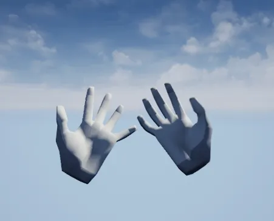

> UE4のNiagaraとLeapMotionを連携させてみた。手の形に応じてパーティクルを発生させる。[#UE4](https://twitter.com/hashtag/UE4?src=hash&ref_src=twsrc%5Etfw) [#leapmotion](https://twitter.com/hashtag/leapmotion?src=hash&ref_src=twsrc%5Etfw) [pic.twitter.com/E6mr6RdS9F](https://t.co/E6mr6RdS9F)
> 
> — takumifukasawa (@takumifukasawa) [2020年2月24日](https://twitter.com/takumifukasawa/status/1231896536298086400?ref_src=twsrc%5Etfw)

サンプルはこちらにアップしました。

[takumifukasawa/UE4LeapMotionFX](https://github.com/takumifukasawa/UE4LeapMotionFX)

## 環境

-   Windows10
-   UE4.23.1

## LeapMotionの導入

### 1\. PC

#### ツールのインストール

まず、LeapMotionのsetupを行う必要があります。こちらからセットアップツールをダウンロード → 中に入っているセットアップ用のファイルを開き、インストールを進めます。

[Desktop Setup — Leap Motion Developer](https://developer.leapmotion.com/setup/desktop)

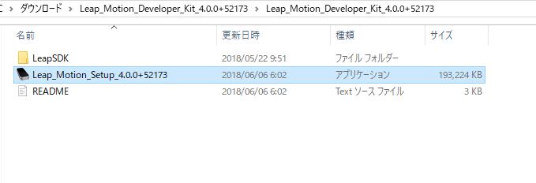

#### 起動確認

インストールしたら、LeapMotionが問題なく起動するかを確認してみます。

インストールされた`LeapControlPanel`をダブルクリックすると、LeapMotionのコントロールパネルが有効になります。 インストールの場所などを特にカスタマイズしなかった場合はおそらく `C:\Program Files\Leap Motion\Core Services` に入っているはずです。

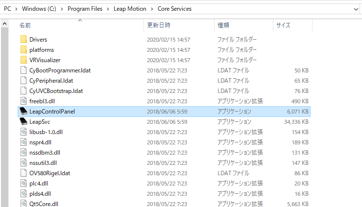

有効になると、タスクバーにこのようなアイコンが表示されます。右クリックして`ビジュアライザー`を開くと、手を検出したボーンのビジュアライズアプリが立ち上がります。

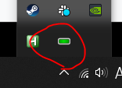

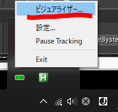

これで、LeapMotionが無事にPCで扱える状態になりました。 余談ですが、ビジュアライズアプリのアイコンを見るどうやらUnityで作られているようですね。

### 2\. UE4

#### LeapMotion のプラグインを有効化

UE4でLeapMotionを使う場合、Pluginsから有効にするだけでLeapMotionを使う準備ができます。有効にしたら再起動が必要です。

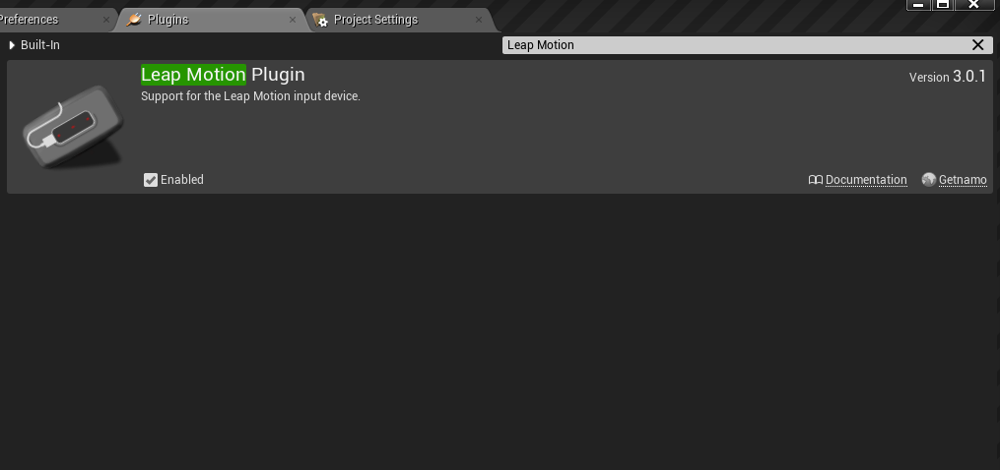

#### Niagara のプラグインを有効化

NiagaraはUE4の新しいVFXツールで、立ち位置的にはこれまでのCascadeパーティクルに変わるとされています。

[ナイアガラ エディタ](https://docs.unrealengine.com/ja/Engine/Niagara/index.html)

Niagaraを使うには、 `Niagara` と `Niagara Extra` を有効化にし、こちらもエディターを再起動する必要があります。Niagaraは扱いとしてはまだβ版のようですね。

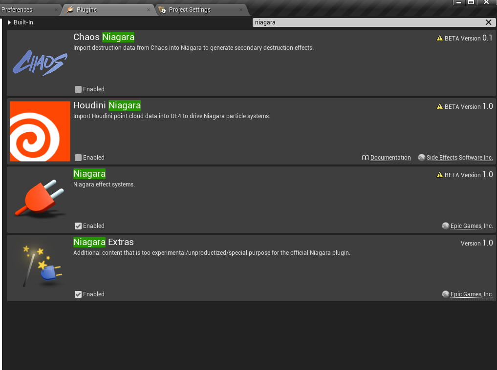

## Niagaraの作業

任意のSkeletalMeshからパーティクルを発生させるアセットを作成していきます。両手から発生させたいので、**パーティクルのアセットは1つにし、SkeletalMeshを差し替えることのできるような構造**になっているのがよさそうです。Niagara の実装はこちらを参考にさせていただきました。

<button type="button" aria-label="YouTube Ad6ABt_Vd5Y を読み込む">▶</button><a href="https://www.youtube.com/watch?v=Ad6ABt_Vd5Y" target="_blank" rel="noopener">YouTube Ad6ABt_Vd5Y</a>

### Niagara System, Niagara Emitter を作成

Niagaraアセットの構成はこちらの記事がとてもわかりやすく解説してくださっています。

[Niagaraの入門(2) Niagaraの構成 - カニミソの備忘録](http://crabpunch.hatenablog.com/entry/2018/07/22/095242)

今回は、Niagara System と Niagara Emitter の2つのアセットを使っていきます。それぞれ `FX_HandParticleSystem`, `FX_SurfaceParticle` と名付けました。

Niagara Emitter で SkeletalMesh からパーティクルを発生させる機能をつくり、Niagara System から Niagara Emitter の SkeletalMesh を指定できるように設定を変更していきます。

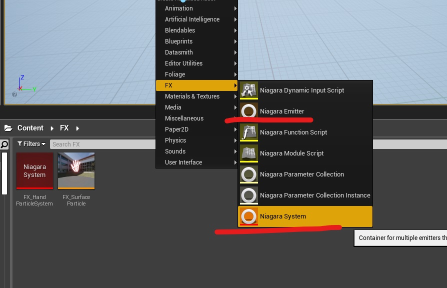

Niagara のアセットを作る際にテンプレートを選ぶことができるのですが、Niagara System の方はテンプレートなしで、Niagara Emitter は Simple Sprite Burst テンプレートを使用します。

↓ Niagara System 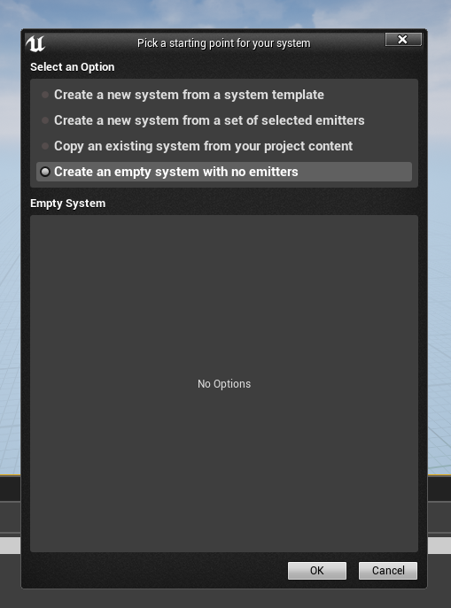

↓ Niagara Emitter 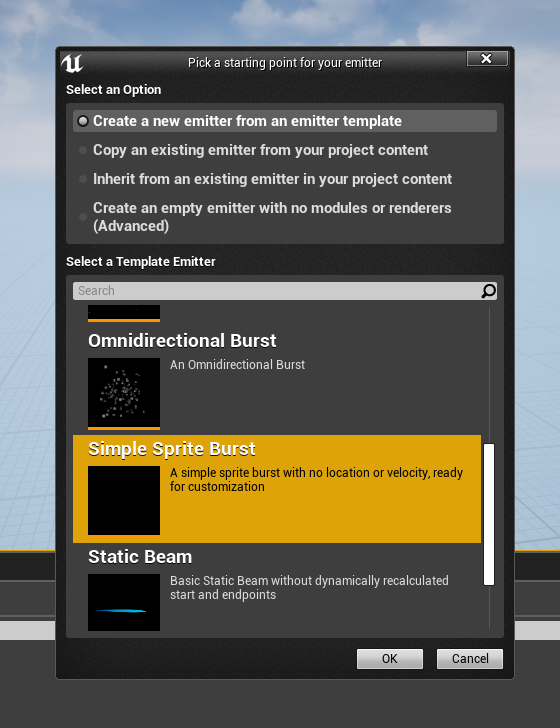

### Niagara Emitter: SkeletalMesh からパーティクルを発生させる

先ほど作った Niagara Emitter は、モジュールを足したり消したりして以下のような構成にしました。重要なものをピックアップしていきたいと思います。

ポイントは **Spawn Burst Instanteneous** と **Initialize Mesh Reproduction Sprite** です。

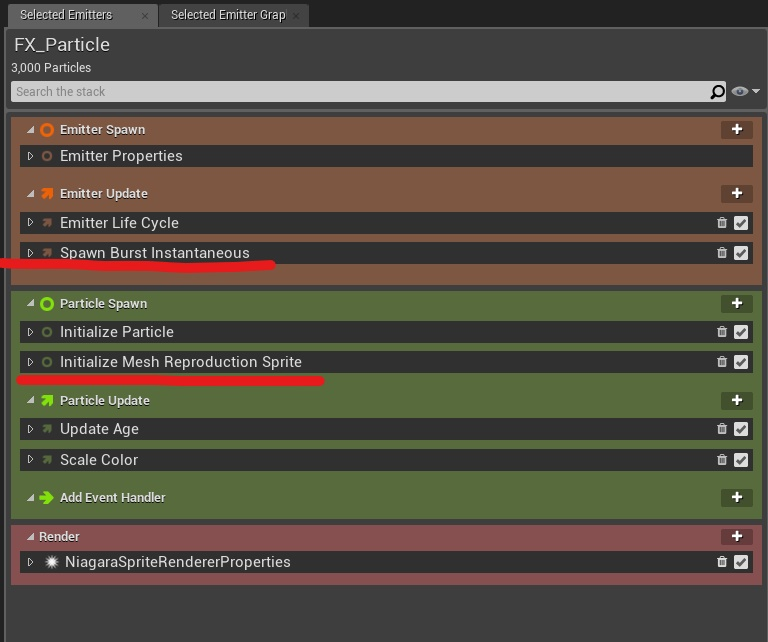

`Spawn Burst Instanteneous` でパーティクル発生時に一定個数のパーティクルを発生させます。今回は `Spawn Count` を3000とし、`Emitter Life Cycle` の `NextLoopDuration` を 1としました。これで、1秒間隔で3000個発生させるパーティクルとなります。また、 `Initialize Particle` の `LifeTime` も1秒以内に収まるようにします。

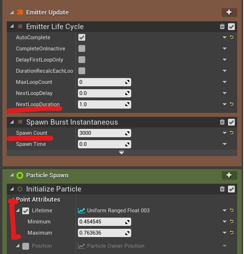

いよいよメッシュの表面からパーティクルを発生させる部分に入ります。`Initialize Mesh Reproduction Sprite` モジュールを追加すると、SkeletalMesh の表面からパーティクルを発生させることができます。ここに手のメッシュを指定するのですが、これは LeapMotion のプラグインを有効化すると、そのフォルダの中に入っています。

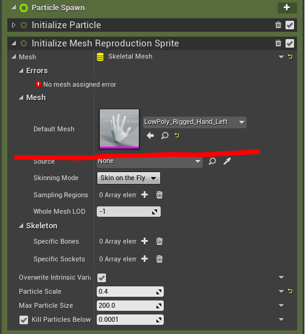

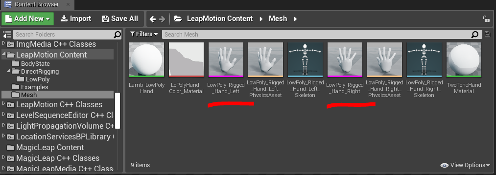

ここまでの作業で、手の形からパーティクルが発生されるようになりました。

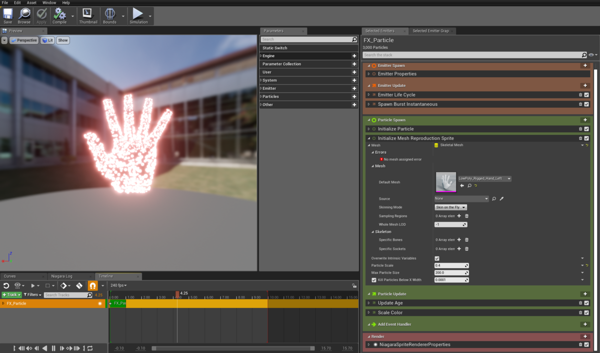

### Niagara System: SkeletalMesh の指定

つづいて Niagara System で SkeletalMesh を自由に変更できるようにしていきます。変更可能にしておくことにより NiagaraSystem 1つでいくつもの SkeletalMesh に対応させることができます。

始めに作った Niagara System を開き、Track から先ほどの Niagara Emitter を追加します。

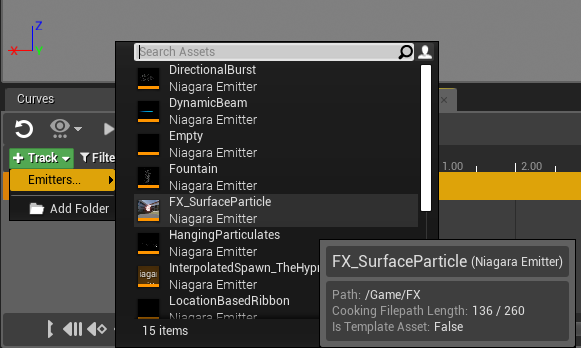

`User`の中に`SkeletalMesh`型の変数を追加します。ここでは`User.SkeletalMesh`と命名しました。次に、追加した変数を `Initialize Mesh Reproduction Sprite` の `Mesh` にドラッグします。すると、紫の鎖のようなマークとともに `SkeletalMesh` から `User.SkeletalMesh` に切り替わったかと思います。これで、発生源の SkeletalMesh を 変数から参照できるようになりました。

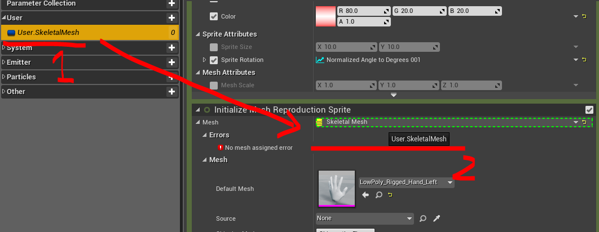

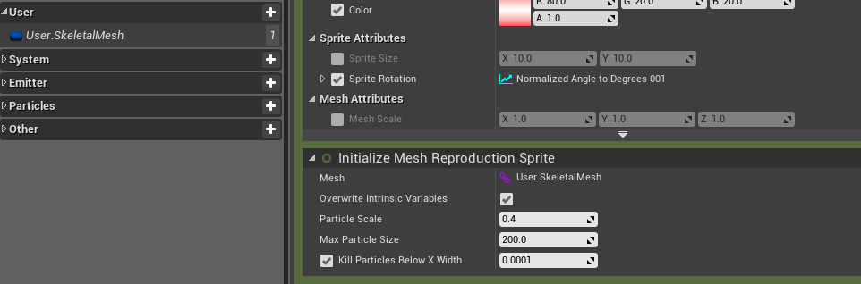

## LeapMotion を扱う Actor を作成

ここでは、手の動きと Niagara を連携させる処理を作っていきます。具体的な処理は実際にダウンロードして中身を見ていただければと思います。この Actor は`BP_LeapDesktopActor`と命名しました。

そもそも UE4 上で LeapMotion による手の動きと SkeletalMesh の連動は、手の SkeletalMesh に設定した Animation のインスタンスに対して 毎フレームごとに手の動きを更新する構造になっているようです。

Actor を作るにあたって、LeapMotion と手の動きを連携しつつ、手の表示もし、エフェクトと連携も行う Actor を Level 上に配置するだけで使えるようになることが再利用のしやすさ的にも理想なのですが、一つ問題があります。

それは、手のアニメーションと Niagara を連携させるためには、**Level に配置した Niagara System の SkeletalMesh の Source に Actor を指定する** 必要があること。具体的にはここです。

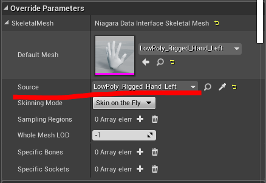

その理由から SkeletalMesh Actor を Level 上に配置することが必須となったため、このような中身にしました。大きなポイントは3つです。

1.  手の動きを反映させる SkeletalMesh Component は Actor に追加したままで、非表示にしておく
2.  代わりに、手を表示する SkeletalMesh Actor を Level 上で配置する
3.  変数で SkeletalMesh を受け取るようにし、Blueprint内で その SkeletalMesh の Animation を更新する

これで、Level 上に SkeletalMesh Actor を置きつつ手の動きを Niagara に連携させることを実現しました。

Event Graph 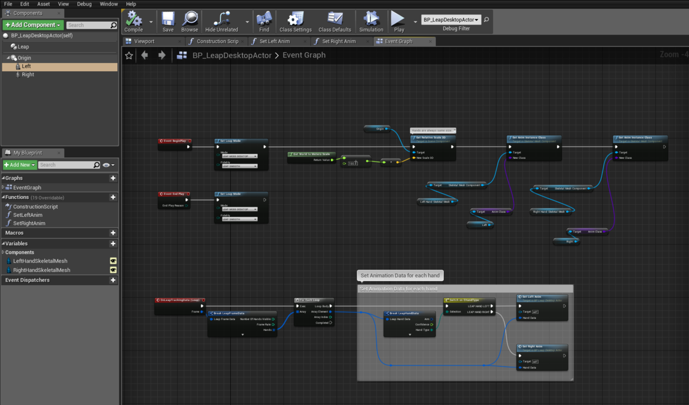

アニメーション更新メソッド（右手） 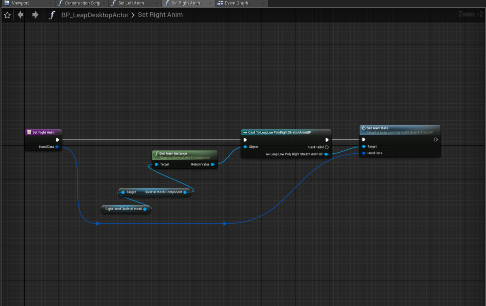

## Level に配置

LeapMotion を取り扱う Actor を配置し、子に Niagara System のアセットと SkeletalMesh を配置します。エフェクトと手の位置を合わせるため、position や rotation をゼロにしておきます。

注意点は親の Actor の rotation で、LeapMotion のデバイスの位置や向きに応じて回転を合わせます。

また、Niagara の `Override Parameters` で手ごとの `Default Mesh` と `Source` を指定します。

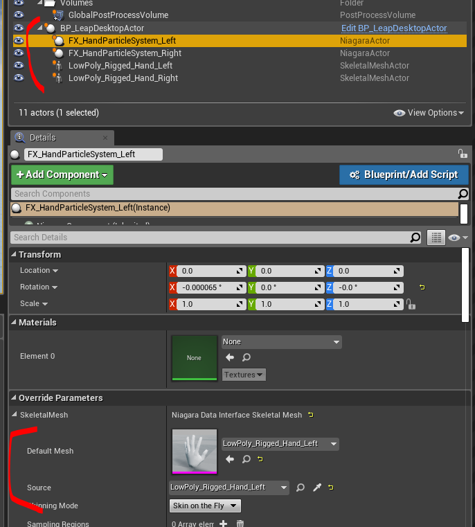

## 完成

あとは好きなように色やサイズなどを調整します。

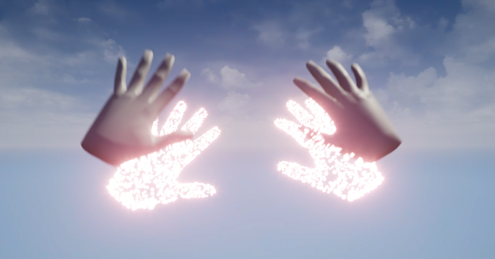

## 注意点

<strong>GPUパーティクルを有効にするとなぜかパーティクルが表示されなくなります。</strong>そのため現状CPUパーティクルのみ有効です。 他のSkeletalMeshでは問題なく動いたので、Niagaraの設定などを深堀りする必要がありそうです。こちらは調査中です。

## 参考

[Niagaraの入門(2) Niagaraの構成 - カニミソの備忘録](http://crabpunch.hatenablog.com/entry/2018/07/22/095242)

[https://www.youtube.com/watch?v=Ad6ABt\_Vd5Y](https://www.youtube.com/watch?v=Ad6ABt_Vd5Y)
