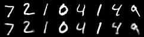
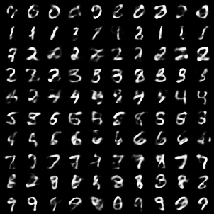

以前こちらの記事を書きました。

[【機械学習】VAEの仕組みを公式サンプルから理解する - takumifukasawa’s blog](/blog/learning-vae-sample/)

最終的には「たくさんの画像を元に、画像を滑らかに補間させる方法」を目指していて、その過程でVAEとCVAEという手法を知りました。今回はCVAEの理解を進めるのが目的です。CVAEはConditional Variational Autoencoderの略です。

VAEの公式サンプルがこちらです。いくつか編集することでCVAE対応することができます。

[examples/vae/main.py at main · pytorch/examples](https://github.com/pytorch/examples/blob/main/vae/main.py)

まずVAEの公式サンプルを出力した画像はこちらです。10回学習が回った後に出力された画像です。



こちらは公式サンプルをCVAE化して出力された画像です。1行ずつ0~9までの数字が並んでいます。後述するのですが、「ラベル」という概念により「MNISTのどの数字か」を指定して出力することができるようになります。



※ 本文中の画像は上記サンプルおよびCVAE改造版から出力した画像です。つまり、MNIST データセットで学習したVAE,CVAEの出力画像となります。

## コードを編集する

※ 本文中のコードは PyTorch公式のサンプル（ライセンス: BSD-3-Clause）からの引用で、日本語のコメントは自分が入れています。

こちらのリポジトリに自分がコメントを書いたソースの全文が含まれています。  
[https://github.com/takumifukasawa/vae-cvae-practice:url](https://github.com/takumifukasawa/vae-cvae-practice:url)

### CVAEクラス

VAEクラスを編集し、CVAE対応をします。  
<strong>CVAEは一言でまとめると「ヒントを渡すことができるVAE」というイメージになります。このヒントはラベルと呼ばれます。</strong>

特に大きな変更は「情報を入れる箱」のサイズを変えている部分です。 `self.fc1` などで `+10` をしているのですが、これはラベルを格納するためです。MNISTで0~9の数字を取り扱うので10個分追加します。

```python
class CVAE(nn.Module):
  def __init__(self):
    super(CVAE, self).__init__()

    # mu ... もやの中心（大体の座標）
    # logvar ... もやの広さ（曖昧さ）
    # reparameterize ... もやの中からランダムに1点(z)を選ぶ

    # fc = fully connected (全結合層) ... 数字を変換する箱
    self.fc1 = nn.Linear(784 + 10, 400) # 784個の数字を入れると400個の数字が出てくる
    self.fc21 = nn.Linear(400, 20) # mu: 400個 -> 20個
    self.fc22 = nn.Linear(400, 20) # logvar: 400個 -> 20個
    self.fc3 = nn.Linear(20 + 10, 400) # decode: 20個 -> 400個
    self.fc4 = nn.Linear(400, 784) # 400 -> 784

  def encode(self, x, y):
    h1 = F.relu(self.fc1(torch.cat([x, y], dim=1))) # 784 + 10 = 794 ... つまり、画像とラベルがセットで入る
    return self.fc21(h1), self.fc22(h1)

  # 「点」じゃなくて「もや」にすると潜在空間が滑らかになる
  # そうして生成されるzを連続的に動かすと画像が滑らかに変化する
  # ばらつきと標準偏差を操る = ガウス分布（正規分布）
  def reparameterize(self, mu, logvar):
    std = torch.exp(0.5 * logvar) # ばらつき -> 標準偏差
    eps = torch.randn_like(std) # ランダムなノイズ(サイコロ)
    return mu + eps * std # z = 中心 + ノイズ x ばらつき

  def decode(self, z, y):
    h3 = F.relu(self.fc3(torch.cat([z, y], dim=1))) # 20 + 10 = 30
    return torch.sigmoid(self.fc4(h3)) # 784個の数字(0~1)を返す

  def forward(self, x, y):
    mu, logvar = self.encode(x.view(-1, 784), y) # 画像 -> mu, logvar
    z = self.reparameterize(mu, logvar) # z(今回は20個の数字)が生まれる。zは中間データ（潜在変数）
    return self.decode(z, y), mu, logvar # z -> 画像に復元
```

「ラベル」を格納する領域が増えたので、decodeやforwardも変更が加わっています。引数に `y` をとるようになっているのですが、これがラベルを受け取っている部分です。

### loss\_function

こちらはVAEのサンプルから変更がありません。

```python
# ピクセルごとの復元ズレ(BCE)、潜在の散らかり度(KLD) を足した、1つの減点合計
# Reconstruction + KL divergence losses summed over all elements and batch
def loss_function(recon_x, x, mu, logvar):
  # BCEだけだと復元は正確だがzが散らかる -> 生成や補間がガタガタになる
  BCE = F.binary_cross_entropy(recon_x, x.view(-1, 784), reduction='sum')

  # KLDだけだとzは綺麗だが復元できない（ぼやける）
  # see Appendix B from VAE paper:
  # Kingma and Welling. Auto-Encoding Variational Bayes. ICLR, 2014
  # https://arxiv.org/abs/1312.6114
  # 0.5 * sum(1 + log(sigma ^ 2) - mu ^ 2 - sigma ^ 2)
  # これは実質的にガウス分布の間のKL divergence の式
  # 原点を中心として標準的なばらつきが理想 => 標準正規分布 N(0,1) に寄せる
  KLD = -0.5 * torch.sum(1 + logvar - mu.pow(2) - logvar.exp())

  return BCE + KLD # KLDがVAE独自の方法
```

### train関数

主な変更点は

-   enumerate関数の結果で label を受け取るようにしている
    -   VAEの公式サンプル時点では label を受け取っていないため
-   ラベルの one\_hot 化
-   modelにラベルを渡す

という3点です。

one\_hotではラベルを数字の配列に変換します。例えばラベルが7の場合、 `[0,0,0,0,0,0,0,1,0,0]` という配列になります。ビットの0,1のような考え方ですが、要素の型は数字です。

```python
def train(epoch):
  model.train() # 訓練モード
  train_loss = 0
  for batch_idx, (data, label) in enumerate(train_loader): # label...0~9の整数
    data = data.to(device)
    y = F.one_hot(label, num_classes=10).float().to(device)
    # バッチが128枚の場合
    # data = 画像128枚 -> [128(バッチサイズ), 1(チャンネル数:MNISTが白黒なので1), 28(MNISTの画像サイズ:高さ), 28(MNISTの画像サイズ:幅)]
    # label = 各画像の正解 -> [128]
    # y = one-hotにした配列 -> [128, 10] ex) 7なら[0,0,0,0,0,0,0,1,0,0]

    optimizer.zero_grad()
    recon_batch, mu, logvar = model(data, y) # CVAEの計算をする
    loss = loss_function(recon_batch, data, mu, logvar) # 間違い度合いを計算
    loss.backward() # 直す方向を計算
    train_loss += loss.item() # ログ表示用: loss値を加算し、あとで平均を出す
    optimizer.step() # 重みを直す
    if batch_idx % args.log_interval == 0:
      print(
        'Train Epoch: {} [{}/{} ({:.0f}%)]\tLoss: {:.6f}'.format(
          epoch,
          batch_idx * len(data),
          len(train_loader.dataset),
          100. * batch_idx / len(train_loader),
          loss.item() / len(data)
        )
      )
  print(
    '====> Epoch: {} Average loss: {:.4f}'.format(
      epoch,
      train_loss / len(train_loader.dataset)
    )
  )
```

### test関数

こちらもtrain関数同様の変更が入っています。

```python
def test(epoch):
  model.eval() # 評価モード
  test_loss = 0
  with torch.no_grad():
    for i, (data, label) in enumerate(test_loader):
      data = data.to(device)
      y = F.one_hot(label, num_classes=10).float().to(device)
      recon_batch, mu, logvar = model(data, y)
      test_loss += loss_function(recon_batch, data, mu, logvar).item()
      if i == 0:
        n = min(data.size(0), 8)
        comparison = torch.cat([data[:n], recon_batch.view(args.batch_size, 1, 28, 28)[:n]])
        save_image(comparison.cpu(), 'results/cvae_reconstruction_' + str(epoch) + '.png', nrow=n)

  test_loss /= len(test_loader.dataset)
  print('===> Test set loss: {:.4f}'.format(test_loss))
```

### main関数

100個分の数字を画像に書き出します。1行ずつ0~9が並ぶようになります。

```python
if __name__ == "__main__":
  for epoch in range(1, args.epochs + 1):
    train(epoch) # 学習
    test(epoch) # 検証
    with torch.no_grad():
      # ラベルを作る: 各数字を10枚ずつ = 100枚
      labels = torch.arange(10).repeat_interleave(10) # [0,0,...,1,1,...,9,9]
      y = F.one_hot(labels, 10).float().to(device) # [100, 10]
      z = torch.randn(100, 20).to(device) # ランダムなzを100個
      out = model.decode(z, y).cpu() # zとラベルyを渡す
      save_image(
        out.view(100, 1, 28, 28), # 784個 -> 28x28のグリッドに戻す
        'results/cvae_sample_' + str(epoch) + '.png',
        nrow=10
      )
```


## 最後に

実際に手を動かしてみると意外にも大きな変更点は少なく、CVAEがVAEの派生であることがわかりました。<strong>ラベルというヒントがある分「こういうものが欲しい」という目的があるときにVAEより適している？</strong>ということなのかなと思いました。
