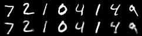
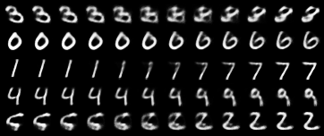

最近、機械学習の勉強を始めました。pythonも初学者です。

「たくさんの画像を元に、画像を滑らかに補間させる方法」を目指していて、geminiに壁打ちをしていたところVAEやCVAEが良さそうというところまで行きつきました。  
VAE = Variational Autoencoder、 CVAE = Conditional Variational Autoencoder のことです。

ただ、機械学習は完全に初学のため基礎理論や種類も何もわかっていない状態です。いろいろな資料やブログ、解説記事などを見たのですが、初見の用語が多かったりで今の知識だとどれもレベルが高く感じられました。

そこで、まずは<strong>VAEのサンプルを写経しながらフローを追って確認し、どういう流れで学習が進んでいくのかを確認してみることにしました。</strong>  
結果的にこの方法は良い学習となりました。<strong>「なぜこうなのか」は未だつかめていない</strong>ところは多いものの、<strong>「どうしてそうなるのか」はなんとなく掴むことができた</strong>と思います。

VAEのサンプルはこちらです。

[examples/vae/main.py at main · pytorch/examples](https://github.com/pytorch/examples/blob/main/vae/main.py)

10回学習が回った後に出力された画像です。上段が元データ、下が学習後に出力されたデータです。



※ 本文中の画像は上記サンプルから出力した画像です。つまり、MNIST データセットで学習したVAEの出力画像となります。

## コードを追う

※ 本文中のコードは PyTorch公式のサンプル（ライセンス: BSD-3-Clause）からの引用で、日本語のコメントは自分が入れています。

こちらのリポジトリに自分がコメントを書いたソースの全文が含まれています。  
[https://github.com/takumifukasawa/vae-cvae-practice:url](https://github.com/takumifukasawa/vae-cvae-practice:url)

### main関数

main関数では指定したループ分、学習と検証を繰り返します。学習ではモデルの更新を、検証では元データと出力の差分確認を行っています。

```python
if __name__ == "__main__":
  for epoch in range(1, args.epochs + 1):
    train(epoch) # 学習
    test(epoch) # 検証
```

### train関数

```python
def train(epoch):
  model.train() # 訓練モード
  train_loss = 0
  for batch_idx, (data, _) in enumerate(train_loader):
    data = data.to(device)
    optimizer.zero_grad()
    recon_batch, mu, logvar = model(data) # VAEの計算をする
    loss = loss_function(recon_batch, data, mu, logvar) # 間違い度合いを計算
    loss.backward() # 直す方向を計算
    train_loss += loss.item() # ログ表示用: loss値を加算し、あとで平均を出す
    optimizer.step() # 重みを直す
    if batch_idx % args.log_interval == 0:
      print(
        'Train Epoch: {} [{}/{} ({:.0f}%)]\tLoss: {:.6f}'.format(
          epoch,
          batch_idx * len(data),
          len(train_loader.dataset),
          100. * batch_idx / len(train_loader),
          loss.item() / len(data)
        )
      )
  print(
    '====> Epoch: {} Average loss: {:.4f}'.format(
      epoch,
      train_loss / len(train_loader.dataset)
    )
  )
```

`model()`でVAEの計算が行われ、`loss_function()` でデータのずれを計算しています。  
これがmain関数のループの中で処理され、学習が進んでいく構図になります。

### VAE

modelはVAEクラスから生成されています。

```python
class VAE(nn.Module):
  def __init__(self):
    super(VAE, self).__init__()

    # mu ... もやの中心（大体の座標）
    # logvar ... もやの広さ（曖昧さ）
    # reparameterize ... もやの中からランダムに1点(z)を選ぶ

    # fc = fully connected (全結合層) ... 数字を変換する箱
    self.fc1 = nn.Linear(784, 400) # 784個の数字を入れると400個の数字が出てくる
    self.fc21 = nn.Linear(400, 20) # mu: 400個 -> 20個
    self.fc22 = nn.Linear(400, 20) # logvar: 400個 -> 20個
    self.fc3 = nn.Linear(20, 400) # decode: 20個 -> 400個
    self.fc4 = nn.Linear(400, 784) # 400 -> 784

  def encode(self, x):
    h1 = F.relu(self.fc1(x))
    return self.fc21(h1), self.fc22(h1)

  # 「点」じゃなくて「もや」にすると潜在空間が滑らかになる
  # そうして生成されるzを連続的に動かすと画像が滑らかに変化する
  # ばらつきと標準偏差を操る = ガウス分布（正規分布）
  def reparameterize(self, mu, logvar):
    std = torch.exp(0.5 * logvar) # ばらつき -> 標準偏差
    eps = torch.randn_like(std) # ランダムなノイズ(サイコロ)
    return mu + eps * std # z = 中心 + ノイズ x ばらつき

  def decode(self, z):
    h3 = F.relu(self.fc3(z))
    return torch.sigmoid(self.fc4(h3)) # 784個の数字(0~1)を返す

  def forward(self, x):
    mu, logvar = self.encode(x.view(-1, 784)) # 画像 -> mu, logvar
    z = self.reparameterize(mu, logvar) # z(今回は20個の数字)が生まれる。zは中間データ（潜在変数）
    return self.decode(z), mu, logvar # z -> 画像に復元

model = VAE().to(device)
optimizer = optim.Adam(model.parameters(), lr=1e-3)
```

encode関数が「中心とばらつき」を算出し、reparameterize関数でそれを使ってzをサンプリングしています。 つまり実質的に正規分布のちらばりを計算していることになります。  
そのため「とある一点の誤差の比較」ではなく、<strong>「zを分布として表してサンプリングする」</strong>というアプローチのようです。

### loss\_function

reparameterize関数ではばらつきの計算を行なっていましたが、その<strong>「ばらつきが標準正規分布からどれぐらいずれているか」を測るのが loss\_function の中身</strong>で、具体的にはKLD変数となります。

```python
# ピクセルごとの復元ズレ(BCE)、潜在の散らかり度(KLD) を足した、1つの減点合計
# Reconstruction + KL divergence losses summed over all elements and batch
def loss_function(recon_x, x, mu, logvar):
  # BCEだけだと復元は正確だがzが散らかる -> 生成や補間がガタガタになる
  BCE = F.binary_cross_entropy(recon_x, x.view(-1, 784), reduction='sum')

  # KLDだけだとzは綺麗だが復元できない（ぼやける）
  # see Appendix B from VAE paper:
  # Kingma and Welling. Auto-Encoding Variational Bayes. ICLR, 2014
  # https://arxiv.org/abs/1312.6114
  # 0.5 * sum(1 + log(sigma ^ 2) - mu ^ 2 - sigma ^ 2)
  # これは実質的にガウス分布の間のKL divergence の式
  # 原点を中心として標準的なばらつきが理想 => 標準正規分布 N(0,1) に寄せる
  KLD = -0.5 * torch.sum(1 + logvar - mu.pow(2) - logvar.exp())

  return BCE + KLD # KLDがVAE独自の方法
```

binary cross entropy は分類問題の損失関数で、モデルが出力する確率と実際のラベルのずれを測る関数とのことです。  
（ラベル = 一つ一つのデータに対する正解を示す情報）  
（分類問題 = データが属するラベルなどを予測する機械学習の問題のこと？）

正確な理解はできていないのですが、「データ元と出力のずれ」を測定する関数、というイメージでいます。

### test関数

modelでばらつきを計算、loss\_functionで誤差を累積し、最終的に平均をとって「どれぐらい誤差があったか」を確認しています。

```python
def test(epoch):
  model.eval() # 評価モード
  test_loss = 0
  with torch.no_grad():
    for i, (data, _) in enumerate(test_loader):
      data = data.to(device)
      recon_batch, mu, logvar = model(data)
      test_loss += loss_function(recon_batch, data, mu, logvar).item()
      if i == 0:
        n = min(data.size(0), 8)
        comparison = torch.cat([data[:n], recon_batch.view(args.batch_size, 1, 28, 28)[:n]])
        save_image(comparison.cpu(), 'results/reconstruction_' + str(epoch) + '.png', nrow=n)

  test_loss /= len(test_loader.dataset)
  print('===> Test set loss: {:.4f}'.format(test_loss))
```

## フローの大枠

そもそも<strong>VAEの前身に当たるAEでは「潜在変数（z）を1点で表し、復元するときの誤差」で学習がなされます。これを改良したのがVAEです。</strong>  
AEとの違いは以下のように整理できます。  
エンコーダは画像を潜在変数（z）に圧縮し、デコーダはその潜在変数から画像に復元する役割となります。

```
普通のAE: 画像 -> エンコーダ -> z(1点) -> デコーダ -> 画像
VAE: 画像 -> エンコーダ -> mu,logvar(分布) -> サンプリング(ランダムに散らす) -> z -> デコーダ -> 画像
```

また、VAEの特徴をまとめると以下のようになります。

1.  エンコーダがmu,logvarを計算。AEのような1点ではなく「中心 + ばらつき」を返す（「こういう範囲のどこか」という正規分布として表す）
2.  reparameterize: その範囲からzをサイコロで決める（mu(中心)にランダムなブレを足して zを作る）。「毎回ちょっと違うzになる」のが肝の一つ
3.  損失に KLD を用いる。zの分布を原点周りの綺麗な形に保つ、という制約。普通のAEはBCE(復元誤差)だけでKLDが無い。

補間に関しては、

1,2により、zを点じゃなくて「ブレのある範囲」にすることにより、zが近い画像同士は似た画像になる（潜在空間が滑らかになっている）  
3により、KLDでzを原点周りに集約させる -> 空間に穴ができず、どこをサンプリングしても破綻の少ない画像が出る。  
この結果、**ランダムなzから生成できる/補間が滑らかになる**。

ということです。

試しに補間を確認してみた画像です。例えば一番上段は 3 <-> 8 を線形補間的に表しています。



## 最後に

機械学習でも乱数を使うというのが発見でした。ダイスを振って乱数を加えたりして「毎回ちょっと違う画像出力になる」というのが、どことなくレイトレーシングやAmbientOcclusionのノイズ計算を思い出して興味深かったです。
