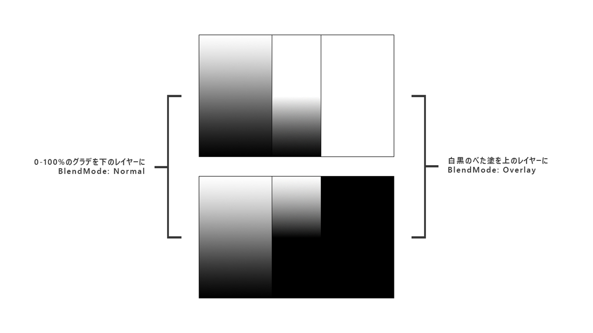
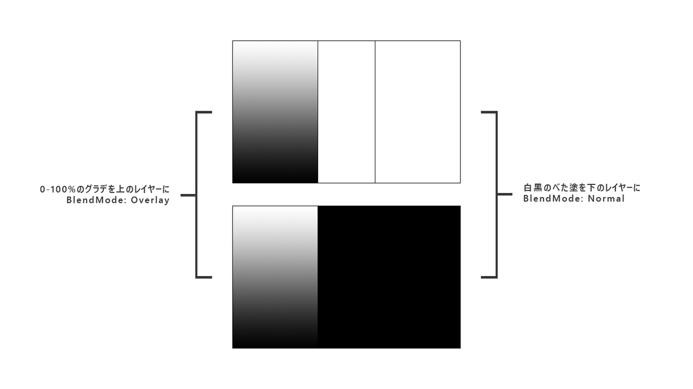

Photoshopのレイヤーモードには、加算、乗算など様々な種類があります。

下のレイヤーに対して上のレイヤーの色をどう重ねるかの方式の設定になります。

WebGLで言うところのBlendModeに近い処理ですね。

例えば加算を設定した結果どういう色になるかは、感覚的にも、BlendModeと比較した場合にもイメージがつきやすいのですが、オーバーレイに関してはどういうことをやっているのか良くわからなかったので、計算方法を調べてみました。

## 計算式

おそらく、各レイヤーモードの計算式はこちらにまとまっているものになるかと思います。

[How does photoshop blend two images together?](https://stackoverflow.com/questions/5919663/how-does-photoshop-blend-two-images-together)

stack overflow の記事に載っている計算式を一部抜粋します。

```c++
#define ChannelBlend_Overlay(A,B)    ((uint8)((B < 128) ? (2 * A * B / 255):(255 - 2 * (255 - A) * (255 - B) / 255)))
...
#define ChannelBlend_Multiply(A,B)   ((uint8)((A * B) / 255))
#define ChannelBlend_Screen(A,B)     ((uint8)(255 - (((255 - A) * (255 - B)) >> 8)))
```

どうやら、**下の色が128以上の場合はスクリーンを、128未満の場合は乗算を適用しているのがオーバーレイである**ようです。

スクリーンの計算方法については今回は言及せず、オーバーレイについてのみ焦点を当てます。

* * *

オーバーレイを使った時の見た目のサンプルと、計算結果のサンプルを2パターン作ってみたので、それぞれ記載していきます。

計算は、オーバーレイの式をjavascript向けに編集したものを使いました。

```javascript
// Aが下のレイヤーのピクセル色、Bが上のレイヤーのピクセル色（オーバーレイで重ねる色）
const overlay = (A, B) =>
  ((A < 128) ?
  (2 * B * A / 255) :
  (255 - 2 * (255 - B) * (255 - A) / 255));
```

## 1\. 白黒のグラデにべた塗のレイヤーをオーバーレイで重ねる

中央の矩形が重なっている部分です。



```javascript
// 白黒のグラデに真っ白のべた塗レイヤーをオーバーレイで重ねる（図上）

overlay(255, 255);
// 255
overlay(192, 255);
// 255
overlay(128, 255);
// 255
overlay(64, 255);
// 128
overlay(0, 255);
// 0

// 白黒のグラデのレイヤーに真っ黒のべた塗をオーバーレイで重ねる（図下）

overlay(255, 0);
// 255
overlay(192, 0);
// 129
overlay(128, 0);
// 1
overlay(64, 0);
// 0
overlay(0, 0);
// 0
```

傾向として、

-   真っ白をオーバーレイで重ねる場合、下のピクセル色が、
    
    -   128以上: 255になる
    -   128未満: 0~128の範囲が0~255に変換される
-   真っ黒をオーバーレイで重ねる場合、下のピクセル色が、
    
    -   128以上: 128~255の範囲が0~255に変換される
    -   128未満: 0になる

ということが分かりました。

見た目的には、白いレイヤーをオーバーレイで重ねると明るい部分の幅が広がり、黒いレイヤーをオーバーレイで重ねると暗い部分の幅が広がっていますね。

ざっくり書くと、**全体をより明るく、より暗くする処理の出し分け**、としてオーバーレイを使うことになるのかなと思いました。

（例えば、コントラストを部分的に強く、彩度を強くする使い方など？）

## 2\. べた塗のレイヤーの上に白黒のグラデをオーバーレイで重ねる



```javascript
// 真っ白のべた塗レイヤーに白黒のグラデをオーバーレイで重ねる（図上）

overlay(255, 255);
// 255
overlay(255, 192);
// 255
overlay(255, 128);
// 255
overlay(255, 64);
// 255
overlay(255, 0);
// 255

// 真っ黒のべた塗レイヤーに白黒のグラデをオーバーレイで重ねる（図下）

overlay(0, 255);
// 0
overlay(0, 192);
// 0
overlay(0, 128);
// 0
overlay(0, 64);
// 0
overlay(0, 0);
// 0
```

結果を見ると、オーバーレイで重ねる色に関わらず、下のピクセル色が0,255になっている場合はそのままの色（真っ黒か真っ白）になっています。

前述のように、<strong>「より明るく」「より暗く」することが目的</strong>のレイヤーモードだとすると、**重ねる元の色によっては全く変わらない見た目になる場合がある**ことは正しいと言えそうです。
