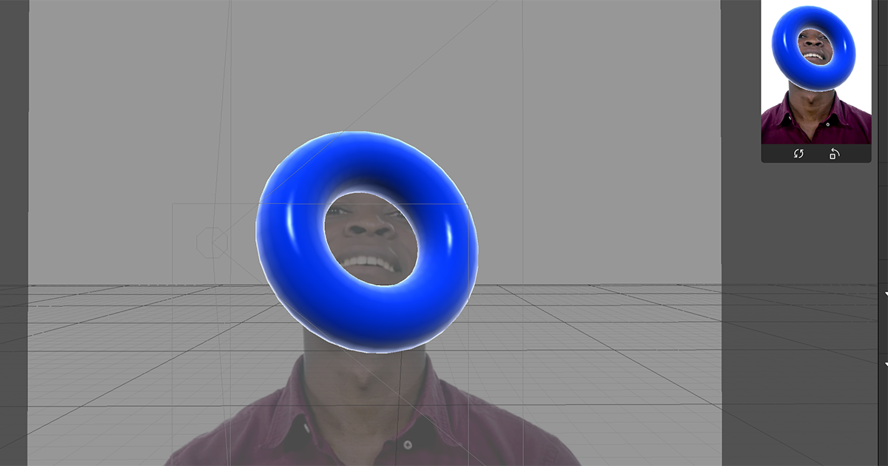

SparkARは、簡単なシェーディングであればパッチエディターでノードを組み合わせることで実現できるのですが、それだけでは難しい表現の場合はJSでスクリプトを書く必要があります。

なぜスクリプトかと言うと、SparkARではシェーダーを直接書くことができず、SparkARが提供しているモジュールを通してシェーダーの用な計算をスクリプトで書いていく必要があるためです。

リムライト風シェーダーもその一つだったので、メモとして残しておきたいと思います。



プロジェクトはこちらに置きました。SparkARのバージョンはv83です。

[takumifukasawa/SparkARSandbox](https://github.com/takumifukasawa/SparkARSandbox/tree/master/RimLight)

ソースの抜粋はこちらになります。

フレネルの計算や考え方はシェーダーで書くときと同じなのですが、ライトの向きをスクリプトで取得することができなさそうだったので、法線ベクトルと視線ベクトルの内積を使う形にしています。

```javascript
const Shaders = require('Shaders');
const Reactive = require('Reactive');
const Materials = require('Materials');

// vertexのattributeを取得
const localPosition = Shaders.vertexAttribute({ variableName: Shaders.VertexAttribute.POSITION });
const localNormal = Shaders.vertexAttribute({ variableName: Shaders.VertexAttribute.NORMAL });

// 座標変換用の行列を取得
const mvMatrix = Shaders.vertexTransform({ variableName: Shaders.BuiltinUniform.MV_MATRIX });
const normalMatrix = Shaders.vertexTransform({ variableName: Shaders.BuiltinUniform.NORMAL_MATRIX });

const normal = normalMatrix.mul(localNormal).normalize();

const position = Reactive.pack4(
  localPosition.x,
  localPosition.y,
  localPosition.z,
  1.
);

const mvPosition = mvMatrix.mul(position);

const viewPosition = mvPosition.mul(-1);
const viewDir = Reactive.normalize(Reactive.pack3(viewPosition.x, viewPosition.y, viewPosition.z));

const dotNV = Reactive.dot(viewDir, normal);
const fresnel = Reactive.pow(Reactive.sub(1, Reactive.clamp(dotNV, 0, 1)), 2);

const emissiveColor = Reactive.pack4(
  fresnel, fresnel, fresnel, 1.
);

// Emissiveスロットに色を割り当てる
const material = Materials.get('RimLight');
material.setTextureSlot(Shaders.DefaultMaterialTextures.EMISSIVE, emissiveColor);
```
