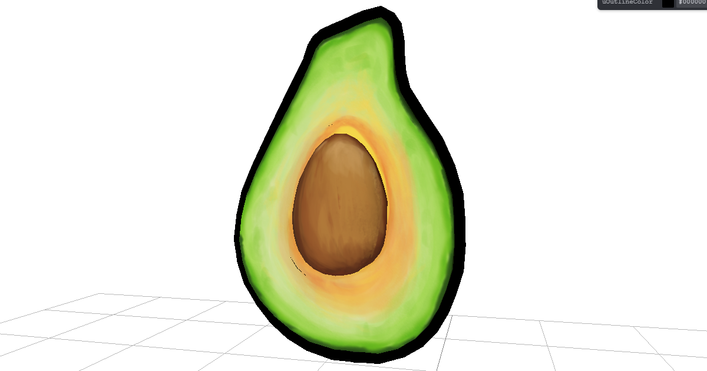
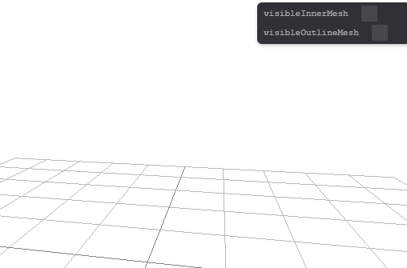
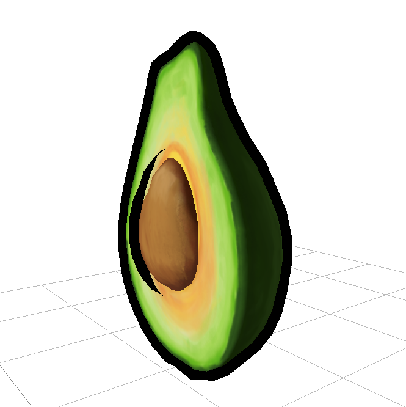

リアルタイムレンダリングにおいてアウトラインを生成する方法はいくつかあります。 **背面カリングを利用した方法や、ポストプロセスによる生成が主**かと思います。

今回は前者の、背面カリングを使ったアウトライン表現を行ってみたいと思います。

## デモ

最終的なデモはこちらになります。

↓ モデルを使った場合。色と境界線の太さを変えられるようにしています。

<div class="embed" data-embed-src="https://codepen.io/takumifukasawa/embed/wvaxqQP?default-tab=js%2Cresult&amp;theme-id=dark" style="height: 265px"><button type="button" aria-label="BackFace Culling Outline: Model を読み込む">▶</button><a href="https://codepen.io/takumifukasawa/pen/wvaxqQP" target="_blank" rel="noopener">BackFace Culling Outline: Model</a></div>

↓ three.jsのTorusGeometryを使った場合。境界線用のメッシュ・境界線内用のメッシュの表示非表示を切り替えられるようにしています。

<div class="embed" data-embed-src="https://codepen.io/takumifukasawa/embed/vYOrrWR?default-tab=js%2Cresult&amp;theme-id=dark" style="height: 265px"><button type="button" aria-label="BackFace Culling Outline を読み込む">▶</button><a href="https://codepen.io/takumifukasawa/pen/vYOrrWR" target="_blank" rel="noopener">BackFace Culling Outline</a></div>

## 手法と流れ

1.  描画したいモデルを複製する
2.  一つは、<strong>頂点シェーダーで各頂点を法線方向にオフセットし（膨らまし）</strong>、境界線につけたい色で背面を描画する。もしくはあらかじめ各頂点を法線方向にオフセット済みのモデルを用意する
3.  もう一つは、任意のマテリアル(境界線の内側に表示したいマテリアル)で通常通りレンダリング

このようにすることで、**境界線用に背面描画したモデルの上に、描画したいモデルが乗っかるように描画され、あたかも境界線がついたかのように見える**ということになります。

* * *

こちらのGIFは、境界線用のMeshと境界線の内側用のMeshの表示・非表示を切り替えてみたものです。

**境界線用のMeshは境界線のみを描画しているのではなくベタ塗りされ、その上に境界線内に描画したいMeshが乗っかっている**ようになっていることが分かるかなと思います。



## three.jsの場合

three.jsの場合はこのような流れで実現することができます。

1.  描画したいMeshを2つ用意する
2.  片方のMeshには境界線用に背面描画のMaterialを割り当てる。このマテリアルはシェーダーを書く
3.  もう片方のMeshは任意の見た目のMaterial（境界線の内側に描画させたい見た目のマテリアル）
4.  描画

## コード

こちらが境界線描画回りのコードになります。上のサンプルのTorusGeometryの方から抜粋しました。

コード中にコメントで説明を書いていきたいと思います。

```javascript
...

const outlineVertexShader = `
void main() {
  // 法線方向に頂点を膨らませる
  // .04 は任意の膨らませたい大きさ
  vec3 _position = position + normal * .04; 
  gl_Position = projectionMatrix * modelViewMatrix * vec4(_position, 1.);
}
`;

const outlineFragmentShader = `
precision mediump float;
void main() {
  // 境界線色として黒を指定
  gl_FragColor = vec4(0., 0., 0., 1.);
}
`;

// 境界線用の背面描画マテリアル
const outlineMaterial = new THREE.ShaderMaterial({
  vertexShader: outlineVertexShader,
  fragmentShader: outlineFragmentShader,
  side: THREE.BackSide,
});

// 境界線の内側に描画する用のPBRマテリアル
const surfaceMaterial = new THREE.MeshStandardMaterial({
  color: 0xff0000
});
  
// 描画したい形状
const torusGeometry = new THREE.TorusGeometry(1, 0.3, 16, 100);

// 境界線用のMeshを作成しSceneに追加
const outlineMesh = new THREE.Mesh(torusGeometry, outlineMaterial);
scene.add(outlineMesh);

// 境界線の内側用のMeshを作成しSceneに追加
const innerMesh = new THREE.Mesh(torusGeometry, surfaceMaterial);
scene.add(innerMesh);

...
```

こうしてみると、境界線用のコードはそこまで多くないことが分かります。

## 特徴・注意点

### モデルを2回描画する必要がある

-   **特に対策をしない場合は単純にポリゴン数が倍になる**
-   そのためポリゴン数が多いGeometryの場合には採用がしづらく、採用する場合はポリゴン数を減らしたモデルにするなどの対策が必要？になるのかなと思います

### カメラの位置によって太さが変わる

-   太さを変えたくない場合は、カメラの位置によって膨らませる大きさを調整するか、ポストプロセスによる境界線の方法を用いる必要があります
-   見せ方によっては、カメラの位置によって太さが変わっても問題ない場合もあるかと思います。

### 輪郭以外の境界線のディティールを出しづらい

-   下のスクショのように、アボガドを横から見たときは種と身の境目に境界線が生じていません。また、種の左側に浮くように境界線が表示されているかと思います
-   折り目がついているところや段差がある部分（このアボガドの場合は種と身の境目）に境界線をつけやすくしたい場合はポストプロセスの方が向いています
    -   **ポストプロセスであればシーン内の法線方向や色を用いた境界線の生成を行う方法をとることができる**からです


