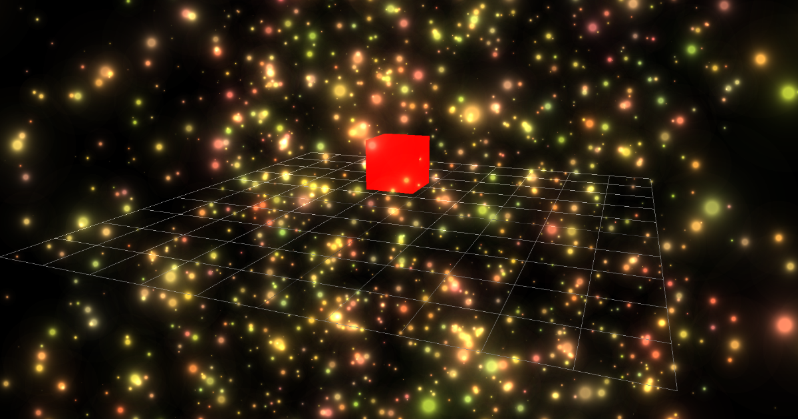
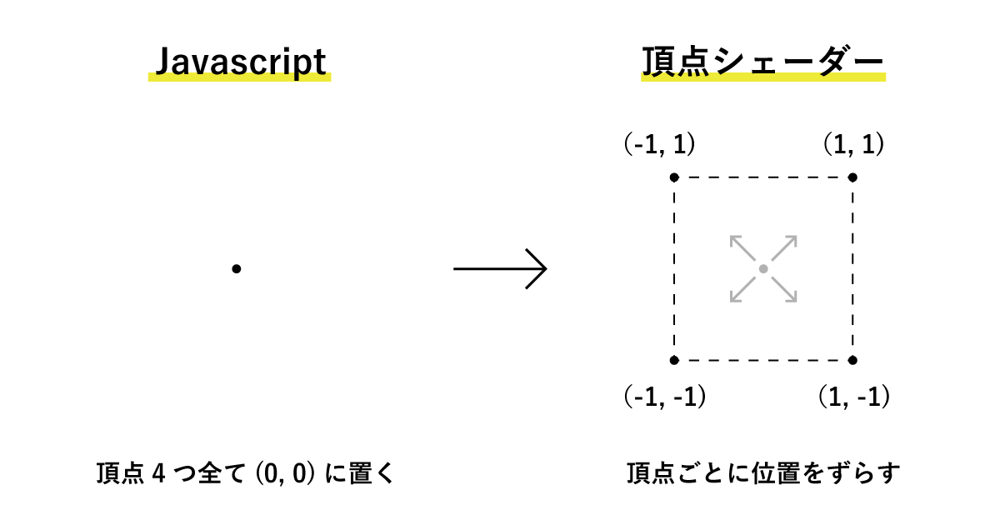
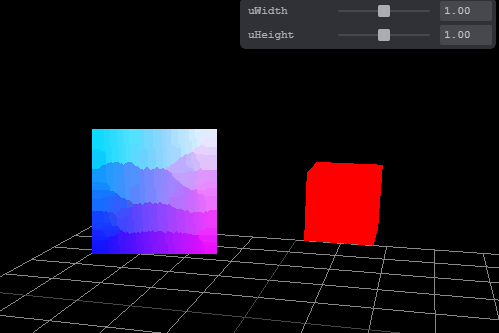

最終的なデモはこちらです。ビルボードの板ポリのパーティクルを生成しています。



<div class="embed" data-embed-src="https://codepen.io/takumifukasawa/embed/RwPQVzW?default-tab=js%2Cresult&amp;theme-id=dark" style="height: 265px"><button type="button" aria-label="【Threejs】Billboard Shader: Particles を読み込む">▶</button><a href="https://codepen.io/takumifukasawa/pen/RwPQVzW" target="_blank" rel="noopener">【Threejs】Billboard Shader: Particles</a></div>

* * *

## ビルボードとは

リアルタイムレンダリング におけるビルボードとは**常にカメラを向いているオブジェクトのこと**です。常に視点を向いていますが、2DレイヤーにUIとして乗っかっているオブジェクトではなく、<strong>3D空間にあるオブジェクト（ほとんどの場合は板ポリ）</strong>を指します。

## いつ使うか

エフェクトで頂点プリミティブの代わりとして使うことが多いかなと思います。草など視点が近づきやすいかつ大量に発生させたいオブジェクトにも向いているようです。

また、LODの代わりとして<strong>カメラから距離が離れている位置のオブジェクト（遠景など）</strong>をビルボードとして使うこともあるそうです。

## three.jsでビルボード

主な方法は2つです。

1.  **板ポリをCameraに対してLookAtする処理を毎フレーム行う**
2.  **シェーダーで常にカメラを向くようにする**

どちらにもメリットはありますが、今回は2番をやってみます。

パーティクルのようなエフェクトの用途の場合は、たいてい大量にオブジェクトを出現させたいので、その数が多ければ多くなるほど毎フレームCPU側で処理することは効率が悪くなります。常にカメラを向くような処理をシェーダーで行うことにより、Javascript側でカメラの方を向かせるよりも高速化を図ることができるので、2番が適しています。

当たり判定を行いたいときはCPU側で計算をとりまわしたいので、1番が適しています。

### 考え方・実装方法

1.  板ポリ用の頂点4つを全て同じ位置に置く
2.  頂点シェーダーで、ビュー座標系で頂点をxy方向に移動させて板ポリを作る（= カメラからの視点で頂点をずらし四角形を作る）
3.  フラグメントシェーダーで描画

1,2に関しては、この図のようなイメージです。原点を前提とし、横幅と縦幅の大きさを2とした場合です。



### メリット

プリミティブの頂点は常にカメラを向くオブジェクトですが Point\_Size の大きさの限界があり（かつ、端末によって限界値が違う）、それ以上の大きさを表現することができません。つまりカメラがどれだけそのオブジェクトに近づいていってもある一定のサイズよりは大きくなりません。

板ポリのビルボードであればポリゴンとして表現することができるので**Point\_Size の大きさの制限を気にする必要はなく、大きさを自由自在にコントロールすることができます**。

また、**頂点プリミティブの場合は描画領域は必ず正方形になりますが、板ポリは自由に縦横の比率を変えることができます**。

### デメリット

板ポリなので、ポリゴンは最低2枚必要です。つまり**頂点パーティクルと比べると頂点数は4倍になります**。

## 1\. 板ポリのデモ

まず、板ポリを作成してシェーダーでカメラを向かせるデモを作っていきます。

縦横の比率も自由に変更できていることが分かるかと思います。



<div class="embed" data-embed-src="https://codepen.io/takumifukasawa/embed/XWbZzpG?default-tab=js%2Cresult&amp;theme-id=dark" style="height: 265px"><button type="button" aria-label="【Threejs】Billboard Shader: Basic Plane を読み込む">▶</button><a href="https://codepen.io/takumifukasawa/pen/XWbZzpG" target="_blank" rel="noopener">【Threejs】Billboard Shader: Basic Plane</a></div>

こちらがコードの抜粋です。コメントをつけて説明を書いていきます。

### javascript

まず `板ポリ用の頂点4つを全て同じ位置に置く` Meshを用意します。

three.jsのBufferGeometyを使うことで、頂点ごとの値を自分で定義することができます。

```javascript
const geometry = new THREE.BufferGeometry();

// この順番でポリゴンを張っていく
// polygon indexes
// 3 -- 2
// |       |
// 0 -- 1

// 頂点を全て同じ位置（0）に
const vertices = [
  0, 0, 0,
  0, 0, 0,
  0, 0, 0,
  0, 0, 0,
];
const uvs = [
  0, 0,
  1, 0,
  1, 1,
  0, 1
];
// ビュー座標系にてオフセットする方向を頂点ごとに定める
const offsets = [
  -1, -1,
  1, -1,
  1, 1,
  -1, 1
];
const indices = [
  0, 1, 2,
  2, 3, 0
];
geometry.setIndex(indices);
geometry.setAttribute('position', new THREE.Float32BufferAttribute(vertices, 3));
geometry.setAttribute('uv', new THREE.Uint16BufferAttribute(uvs, 2));
geometry.setAttribute('offset', new THREE.Float32BufferAttribute(offsets, 2));

const material = new THREE.RawShaderMaterial({
  vertexShader,
  fragmentShader,
  uniforms: {
    // ビルボードの横幅・立幅
    uWidth: {
      value: 1,
    },
    uHeight: {
      value: 1,
    },
  },
});

// meshを作成
const billboardPlane = new THREE.Mesh(geometry, material);
billboardPlane.position.set(-1.5, 2, 0);
scene.add(billboardPlane);
```

### 頂点シェーダー

頂点シェーダーで頂点ごとに位置をずらします。

uniformで横幅縦幅の値を受け取るようにしていますが、パーティクルでビルボードを使う場合はオブジェクトごとに大きさを変えて違いを持たせたいと思うのでattributeで広げる横幅縦幅の値を受け渡しするようにしてあげるのがよいと思います。コードについては後述します。

```c
attribute vec3 position;
attribute vec2 uv;
attribute vec2 offset;
uniform mat4 modelViewMatrix;
uniform mat4 projectionMatrix;

// 拡大する大きさを変えられるようにuniformで値をjavascriptから受け取る
uniform float uWidth;
uniform float uHeight;

varying vec2 vUv;
void main() {
  vUv = uv;
  // ローカル座標をビュー座標に変換
  vec4 mvPosition = modelViewMatrix * vec4(position, 1.);
  // ビュー座標系を元に頂点位置を移動
  mvPosition.xy += offset * vec2(uWidth, uHeight);
  gl_Position = projectionMatrix * mvPosition;
}
```

### フラグメントシェーダー

こちらは特にビルボードの実装とは関係のない部分です。頂点シェーダーからUV座標を受け取り色を出力しています。

```c
precision mediump float;
varying vec2 vUv;
void main() {
  gl_FragColor = vec4(vUv, 1., 1.);
}
```

## 2\. パーティクルのデモ

それでは記事冒頭のパーティクルのデモに入っていきたいと思います。ビルボードそのものの実装は、基本的には板ポリ1枚の時と考え方は変わりません。

こちらもコード内にコメントを書いて補足していきたいと思います。また、デモをもう一度貼っておきます。

<div class="embed" data-embed-src="https://codepen.io/takumifukasawa/embed/RwPQVzW?default-tab=js%2Cresult&amp;theme-id=dark" style="height: 265px"><button type="button" aria-label="【Threejs】Billboard Shader: Particles を読み込む">▶</button><a href="https://codepen.io/takumifukasawa/pen/RwPQVzW" target="_blank" rel="noopener">【Threejs】Billboard Shader: Particles</a></div>

### javascript

前述のように、<strong>パーティクルで板ポリを扱う場合はそれぞれのオブジェクトに違いを持たせるためにattributeにデータを格納していくようにしておいた方が取り回しがよいです。</strong>

板ポリをBufferGeometryで2000個生成し、色の違いと大きさの違いはランダムに生成してattributeに登録し差をつけるようにしています。また、拡大・縮小するタイミングはインデックスを参照して少しずつずらすことでパーティクルっぽさを出しています。

```javascript
const geometry = new THREE.BufferGeometry();

// polygon indexes
// 3 -- 2
// |    |
// 0 -- 1
const index = [];
const vertices = [];
const uvs = [];
const offsets = [];
const indices = [];
const sizes = [];
const colors = [];

const particleNum = 2000;
const randomOffsetRange = 12;
const sizeRange = 1.1;
const sizeMin = 0.1;

// 頂点ごとにデータを生成
for(let i = 0; i < particleNum; i++) {
  // 座標をランダムに生成
  const px = Math.random() * randomOffsetRange - randomOffsetRange * 0.5;
  const py = Math.random() * randomOffsetRange - randomOffsetRange * 0.5;
  const pz = Math.random() * randomOffsetRange - randomOffsetRange * 0.5;

  // 大きさをランダムに生成
  const size = Math.random() * sizeRange + sizeMin;

  // 赤〜黄ぐらいの色をランダムに作成。
  const color = {
    x: Math.random() * .4 + .6,
    y: Math.random() * .4 + .4,
    z: Math.random() * .2 + .2,
  };
  
  // 頂点ごとにデータを格納
  for(let j = 0; j < 4; j++) {
    index.push(i);
    vertices.push(px, py, pz);
    sizes.push(size, size);
    colors.push(color.x, color.y, color.z);
  }
  uvs.push(
    0, 0,
    1, 0,
    1, 1,
    0, 1
  );
  offsets.push(
    -1, -1,
    1, -1,
    1, 1,
    -1, 1
  );

  // インデックスを貼る
  const vertexIndex = i * 4;
  indices.push(
    vertexIndex + 0, vertexIndex + 1, vertexIndex + 2,
    vertexIndex + 2, vertexIndex + 3, vertexIndex + 0
  );
}

geometry.setIndex(indices);

// attributeに登録
geometry.setAttribute('index', new THREE.Uint16BufferAttribute(index, 1));
geometry.setAttribute('position', new THREE.Float32BufferAttribute(vertices, 3));
geometry.setAttribute('uv', new THREE.Uint16BufferAttribute(uvs, 2));
geometry.setAttribute('offset', new THREE.Float32BufferAttribute(offsets, 2));
geometry.setAttribute('size', new THREE.Float32BufferAttribute(sizes, 2));
geometry.setAttribute('color', new THREE.Float32BufferAttribute(colors, 3));

const material = new THREE.ShaderMaterial({
  vertexShader,
  fragmentShader,
  transparent: true,
  blending: THREE.AdditiveBlending,
  alphaTest: 0.01,
  depthWrite: false,
  uniforms: {
    uTime: {
      value: 0, // 拡大縮小のアニメーション用に、毎フレームアニメーションループ内で経過時間を渡す
    },
  },
});

const billboardParticles = new THREE.Mesh(geometry, material);
scene.add(billboardParticles);
```

### 頂点シェーダー

```c
attribute float index;
attribute vec2 offset;
attribute vec2 size;
attribute vec3 color;
varying vec2 vUv;
varying vec3 vColor;
uniform float uTime;
void main() {
  vUv = uv;
  vColor = color;
  // ローカル座標をビュー座標に変換
  vec4 mvPosition = modelViewMatrix * vec4(position, 1.);
  // ビュー座標系を元に頂点位置を移動
  // 拡大縮小のアニメーションを係数として掛ける
  float anim = sin((uTime * 2. + index * 100.) / 1000.) * .5 + .5;
  mvPosition.xy += offset * vec2(size.x, size.y) * anim;
  gl_Position = projectionMatrix * mvPosition;
}
```

### フラグメントシェーダー

```c
precision mediump float;
varying vec2 vUv;
varying vec3 vColor;
void main() {
  vec4 diffuseColor = vec4(vColor, 1.);
  // 円形にフェードをつける
  vec2 p = vUv * 2. - 1.;
  diffuseColor.a = 1. - smoothstep(length(p), 0., .05);
  diffuseColor.a = clamp(diffuseColor.a, 0., 1.);
  // threejsのalphatestのコードをインクルードして引用
  #include <alphatest_fragment>
  gl_FragColor = diffuseColor;
}
```
