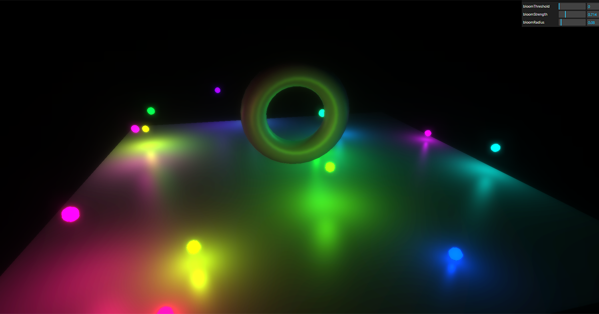
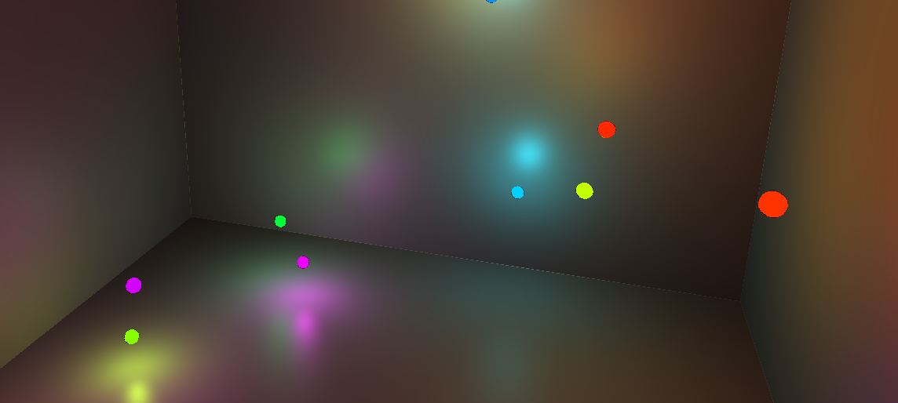

リポジトリとデモはこちらになります。

[GitHub - takumifukasawa/threejs-deferred-shading: threejs-deferred-shading](https://github.com/takumifukasawa/threejs-deferred-shading)

[https://takumifukasawa.github.io/threejs-deferred-shading/base.html](https://takumifukasawa.github.io/threejs-deferred-shading/base.html)

[https://takumifukasawa.github.io/threejs-deferred-shading/point-light.html](https://takumifukasawa.github.io/threejs-deferred-shading/point-light.html)

[https://takumifukasawa.github.io/threejs-deferred-shading/post-process.html](https://takumifukasawa.github.io/threejs-deferred-shading/post-process.html)

* * *

WebGL2がiOS15から有効になり、WebGL1までは拡張機能となっていた MRT（Multiple Render Target）が標準機能になりました。

MRTを使って実現しやすくなることの中に、DeferredShadingが含まれます。今回はthreejsでDeferredShadingを実現する方法を探りました。

threejsを使うことにしたのは、仕事を踏まえてどれぐらい使えそうかも確認したい展望もあったためです。

## Deferred Shading

解説している記事がたくさんあるので、ここでは簡単に説明を記載します。こちらの記事がわかりやすいです。

[【Unity】Deferred Shadingでライトを贅沢に使いたい！基本的な概念の説明とメリデメを考察 - LIGHT11](https://light11.hatenadiary.com/entry/2019/09/05/212345)

* * *

ディファードレンダリングだったり、遅延シェーディングと呼ばれたりもします。ここでは、 Deferred Shading と呼ぶことにします。

古典的なレンダリング方法である Forward Shading ではポリゴンを描画する際にライティングなどを加味した色も計算します。つまり、ポリゴン（メッシュ）が描画されるごとに色を決定していく方法です。 一般的にはこちらが使われていますね。

Deferred Shadingでは、ポリゴンを描画する際に色を決定する方法はとらず、深度や法線など色を決定するのに必要な情報群をバッファ群（G-Buffer）に一度格納し、そのバッファを元にライティングなどの色を決定させていく方法です。

<strong>G-BufferはGeometry Bufferと呼ばれます。メッシュのジオメトリ情報（法線やカラーなど）を格納するバッファです。</strong>後述しますが、**G-Bufferに入れる情報は自分で定義することができる**ので、ジオメトリ情報に限らずデータを入れていくことが可能です。

### メリット

Forward Shadingと比べて、多数のライトを置けること、ポストプロセスでG-Bufferの情報をあつかうことができる点です。SSAOやSSRは導入しやすくなるでしょう。

### デメリット

半透明描画はG-Bufferの色の計算のあとに行う必要があるので結局ForwardShadingを使うことになり複雑になる点です。

また、ポストプロセス的にピクセル数分ライティングの計算が走るので計算負荷がかかりすいこと、マテリアルの種類が多くなればなるほシェーダー内での分岐が必要になる・それがピクセル数分の計算になるためシェーダーが重くなりやすいことも欠点の内かなと思います。

## threejsでMRT

`MultipleRenderTarget` というクラスが用意されているのでそちらを使ってみます。

[three.js webgl - Multiple Render Targets](https://threejs.org/examples/webgl2_multiple_rendertargets.html)

ただ、中身を見るとRGBA32bit以外のフォーマットは選ぶことができないようになっていたので必要なG-Bufferの情報に合わせて自分で似たような仕組みを作ってあげてもよいと思います。

### G-Bufferに入れる情報

G-Bufferの中身は自分で定義することができます。つまり、アプリケーションごとに異なるということですね。

今回は2枚用意します。格納する情報は以下です。

```
index 0: RGBA32bit（RGB: メッシュの色、A: マテリアルのインデックス）
index 1: RGBA32bit（RGB: ワールド座標系の法線情報を0-1に変換したもの、A: 1
```

深度情報は MultipleRenderTarget.depthTexture でアクセスできるのでそちらを使います。

法線情報をワールド座標系にしているのはワールド座標基準でライティングを計算することに決めたためです。正規化された法線はxyzが-1~1に収まるので、0~1に直しておく点がポイントです。

MultipleRenderTargetsからMRTのテクスチャを渡すためには、textureが配列になっているのでuniformと紐づけて渡します。

```javascript
    const gBufferPaths = [
        {
            name: "diffuse",
        },
        {
            name: "normal"
        },
    ]

    // サイズは後で変更    
    const renderTarget = new THREE.WebGLMultipleRenderTargets(1, 1, gBufferPaths.length);
    renderTarget.texture.forEach(texture => {
        texture.minFilter = THREE.NearestFilter;
        texture.magFilter = THREE.NearestFilter;
    });
    gBufferPaths.forEach((({ name }, i) => {
        renderTarget.texture[i].name = name;
    }));

    ...

    const postprocessMaterial = new THREE.RawShaderMaterial({
        vertexShader: renderVertexShaderText,
        fragmentShader: renderFragmentShaderText,
        uniforms: {
            uDiffuse: {
                value: renderTarget.texture[0]
            },
            uNormal: {
                value: renderTarget.texture[1]
            },
            uDepth: {
                value: renderTarget.depthTexture,
            },

    ...
```

### MRTに情報を書く

Forward Shadingではピクセルシェーダーで出力するのは「0-1で表現された色」になります。

対してDeferred Shadingではピクセルシェーダーで各バッファに出力する情報群を書きだします。

生WebGLでの実装はwgld.orgの記事が分かりやすいです。

[wgld.org | WebGL: MRT(Multiple render targets) |](https://wgld.org/d/webgl/w084.html)

こちらは実際に今回書いたG-Bufferにデータを格納するピクセルシェーダーです。

本来は色だけを出力しているところが、out修飾子のついているgColorとgNormalの二つに値を渡していることがわかると思います。

```c
precision highp float;
precision highp int;
layout(location = 0) out vec4 gColor;
layout(location = 1) out vec4 gNormal;
in vec3 vNormal;
in vec2 vUv;
uniform float uMaterial;
uniform vec3 uBaseColor;

void main() {
    gColor = vec4(uBaseColor, uMaterial);
    vec3 normal = (normalize(vNormal) + 1.) * .5;
    gNormal = vec4(normal , 1.);
}
```

## shading

### ワールド座標

いよいよG-Bufferを元に色を決定していきます。G-Bufferや深度テクスチャを元に、法線・色・深度の情報はすでに揃っています。

しかし、ワールド座標基準でのライティングにはまだ足りないものがあります。それは該当ピクセルのワールド座標です。

G-Bufferに格納することも可能ですが、それではG-Bufferのバッファが一枚増えることになるので負荷も上がります。

ここでは、以下のようなシェーダーで深度からワールド座標を復元する方法をとります。

```c
// depth: depth buffer から読みだした値をそのまま渡す
vec3 getWorldPositionFromDepth(vec2 uv, float depth) {
    vec4 ndc = vec4(uv * 2. - 1., depth * 2. - 1., 1.);
    vec4 wp = uInverseViewMatrix * uInverseProjectionMatrix * ndc;
    wp.xyz /= wp.w;
    return wp.xyz;
}
```

やっていることは以下です。

1.  detphは0~1になっていることを踏まえ、正規化クリッピング座標の-1~1に直す
    
2.  1に、射影行列の逆行列と、ビュー行列の逆行列をかける
    
3.  射影行列はGPU向けのものなので、xyzをw除算をする
    

### ライティング計算

必要な情報が揃ったらライティングを計算します。疑似的なコードになりますが、最も単純なのはライトの数分ループを回しライティングを計算する方法です。

```c
vec4 color;

...

for(int i = 0; i < lightNum; i++)
{
    PointLight pointLight = uPointLights[i];
    color += calcPointLight(pointLight, surface, camera); // ポイントライトの数だけライティングの影響を計算をする
}
```

## 改善

画像のようにアーティファクトが出ています。どういう原因なのかがまだつかめていないのですが、隣接ピクセルが、他のポリゴンのピクセルが存在しないピクセルの場合、1pxだけ白くなってしまっています。

おそらくthreejsのrendererの設定かシェーダーの精度などが原因のように推察しているのですが、まだ未解決です。



## 参考

[three.js webgl - Multiple Render Targets](https://threejs.org/examples/webgl2_multiple_rendertargets.html)

[three.js/WebGLMultipleRenderTargets.js at master · mrdoob/three.js · GitHub](https://github.com/mrdoob/three.js/blob/master/src/renderers/WebGLMultipleRenderTargets.js)

[three.js webgl - Depth Texture](https://threejs.org/examples/webgl_depth_texture.html)

[G-Buffer の深度値からワールド空間の位置を復元した秋 2016 - Engine Trouble](https://enginetrouble.net/2016/10/reconstructing-world-position-from-depth-2016.html)

[opengl - GLSL Light (Attenuation, Color and intensity) formula - Game Development Stack Exchange](https://gamedev.stackexchange.com/questions/56897/glsl-light-attenuation-color-and-intensity-formula)
