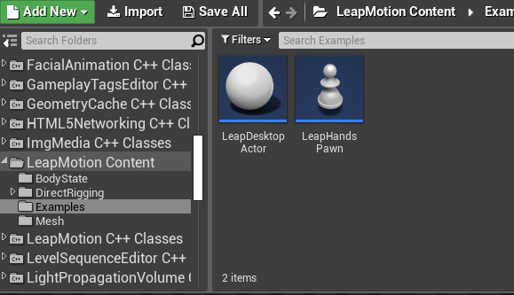
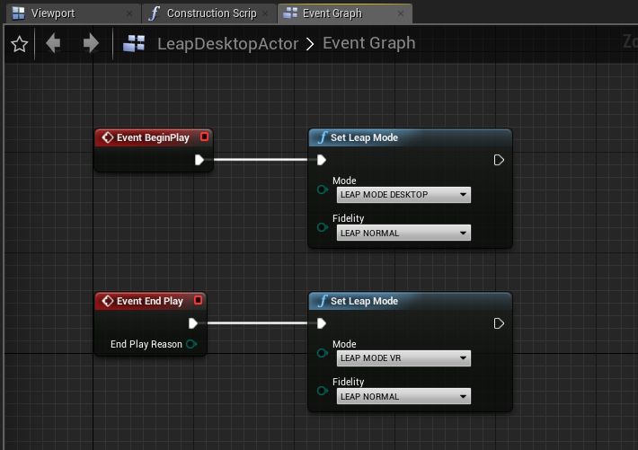
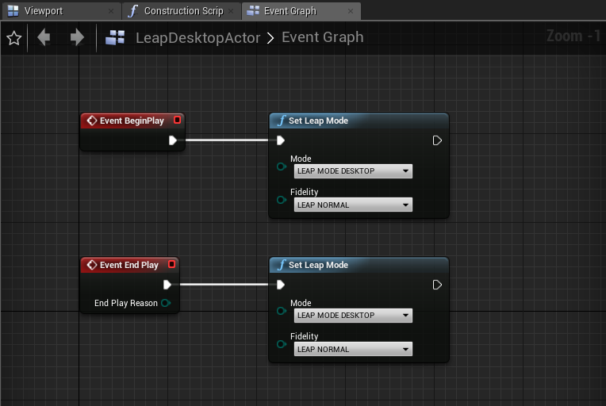

## 環境

-   Windows10
-   UE4.23.1

## 起こったこと

UE4 で LeapMotion を使うには、プラグインを有効にし、`LeapMotion Content / Examples`の`LeapDesktopActor`をLevelに配置するだけで手の動きに連動したメッシュの表示を行うことができます。

 

しかし、Actorを配置したあとに何回か実行を繰り返すとエディターが落ちるようになりました。再起動しても現象は変わらずでした。

## 解決策

LeapDesktopActor の Event Graph を開くと、Event End Play イベントの Set Leap Event のModeが`LEAP MODE VR`でした。

今回はデスクトップ向けで使っていたので、これを`Leap Mode DESKTOP`にします。自分の場合はこうすると落ちなくなりました。

↓

## 備考

github の readme で `Set Leap Event` の項目を見ると、`Set basic global leap tracking options. Useful for switching tracking fidelity or desktop/vr tracking mode.` と書いてありました。つまりこのメソッドはトラッキングの設定を変えるための用途のようです。

トラッキングの設定が`Event BeginPlay`と`Event EndPlay`で違っていた理由は調べてもよくわからなかったので、正しい解決法かは分かりません。ただ、開発するプラットフォーム向けに揃えておいた方がよさそうだと思ったので、設定を変更しました。

[leapmotion/LeapUnreal](https://github.com/leapmotion/LeapUnreal/#set-leap-mode)
