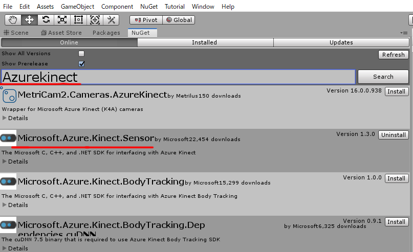
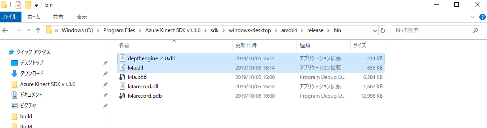
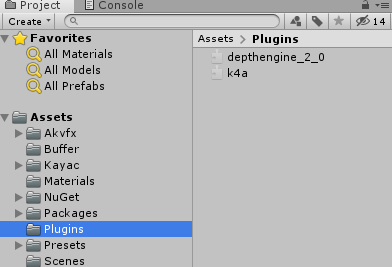

AzureKinectを使う機会があったので、セットアップとミニマムな疎通確認までをまとめておきたいと思います。

[Azure Kinect DK – AI モデルの開発 | Microsoft Azure](https://azure.microsoft.com/ja-jp/services/kinect-dk/)

3月18日現在、日本での発売はまだされていません。しかし、マイクロソフトの公式ブログによると3月中には発売可能になる予定とのことです。

[Azure Kinect Development Kit を日本、ドイツ、イギリスにて2020年3月より発売！ - Windows Blog for Japan](https://blogs.windows.com/japan/2019/11/11/azure-kinect-dk-announces-upcoming-market-availability/)

## 環境

-   Windows10
-   azure kinect sdk version 1.3.0
-   Unity 2019.2.18f

ハードウェア要件はこちらに記載されていました。

[Azure Kinect Sensor SDK system requirements](https://docs.microsoft.com/ja-jp/azure/Kinect-dk/system-requirements)

## 手順

### 1\. Azure Kinect SDK をダウンロード

-   [https://docs.microsoft.com/ja-jp/azure/Kinect-dk/sensor-sdk-download](https://docs.microsoft.com/ja-jp/azure/Kinect-dk/sensor-sdk-download)
-   Microsoft installer をクリックしてダウンロード

### 2\. SDKのインストール

ダウンロードしたインストーラーを開いてインストール手順に従います

### 3\. Unityプロジェクトを作成

Unity 2019.2.18f で作成しました。パイプラインはビルトインパイプラインにしました。

### 4\. NuGet をUnityPackageからインストール

-   ここから version 2.0 の UnityPackage を選択
    -   [https://github.com/GlitchEnzo/NuGetForUnity/releases](https://github.com/GlitchEnzo/NuGetForUnity/releases)
-   UnityPackage直リンクはこちら
    -   [https://github.com/GlitchEnzo/NuGetForUnity/releases/download/v2.0.0/NuGetForUnity.2.0.0.unitypackage](https://github.com/GlitchEnzo/NuGetForUnity/releases/download/v2.0.0/NuGetForUnity.2.0.0.unitypackage)

### 5\. Nuget UnityPackage を作成したプロジェクトにインストール

UnityPackageをドラッグ・ドロップでUnityにインストールします。

### 6\. NuGetでSDKのモジュールをインストール

-   menuの `NuGet -> Manage Nuget Packages` を開く
    
-   Nuget のインストール直後だと menuにNuGetが表示されない場合があったので、そのときはUnityを再起動してみます
    
-   `Microsoft.Azure.Kinect.Sensor` SDKをインストール
    
    -   検索バーで `AzureKinect` を入れると上の方に出てきます

### 7\. dllのインポート

1でインストールしたAzureKinectSDKからdllを2つ(`depthengine_2.0.dll, k4a.dll`)、unityの`Assets/Plugins`にドラッグ＆ドロップしてインポート

-   Assets 以下に Pluginsフォルダがなければ作成しておきます
    
-   dllのpathは、SDKのインストールのパスを特に変えていない場合はこちらになるはずです
    
    -   `C:\Program Files\Azure Kinect SDK v1.3.0\sdk\windows-desktop\amd64\release\bin`

### 8\. AzureKinectをPCにつなぐ

AzureKinectの使用には、ACアダプターと、PCとつなぐUSBの、2つを最低限つなぐ必要がなります。

複数台接続の際はデイジーチェーンでのタイムスタンプの同期のためオーディオケーブルをつなぐことになります。

### 9\. 接続確認用のスクリプトを作成

-   Playするとkinectを接続し、Playを止めるとkinectの接続を解除するスクリプトです
    
-   こちらを任意の名前で作成しGameObjectにアタッチします
    

### 10\. Playした時の挙動確認

エラーなどなくログが表示されている（`シリアル番号`と`Open`）かつ、LEDが赤く点灯することを確認します。

### 11\. 止めたときの挙動確認

`Close`というログが出るようになっています。

AzureKinectの接続を解除する際は、状態破棄のため Dispose 処理を忘れずに呼ぶ必要があるようです。

* * *

以上まで問題なく動作すれば、AzureKinectとUnityの接続はひとまず無事に上手くいっていることが分かります。

## 注意点

Playした際に `missing assembly reference` のエラーが出ることがあります。

その場合は AzureKinect SDK が依存している？モジュールが入っていないためなので、 エラーの出ているモジュールを Nuget でインストールします。
