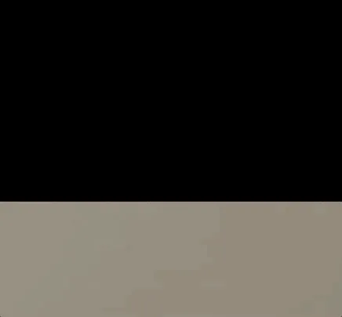
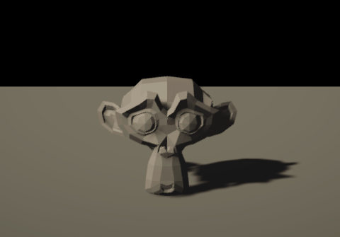
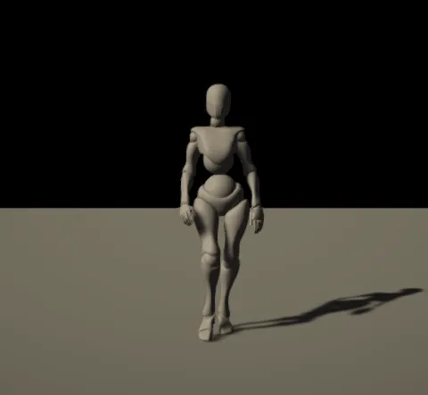
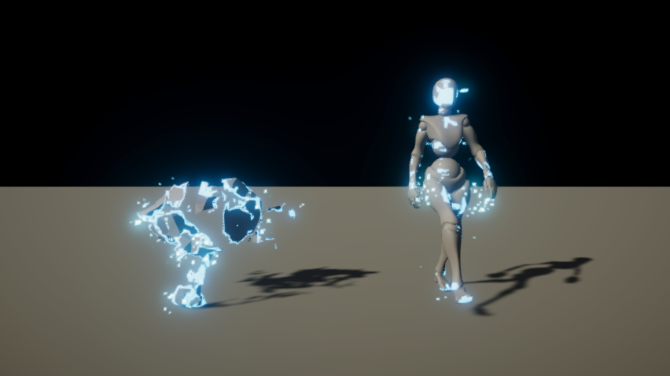
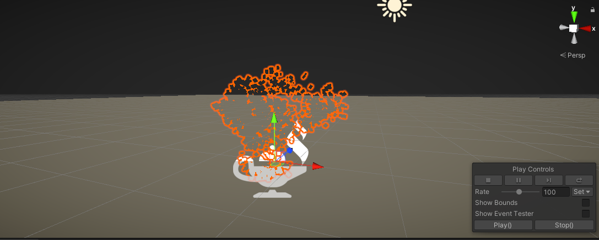
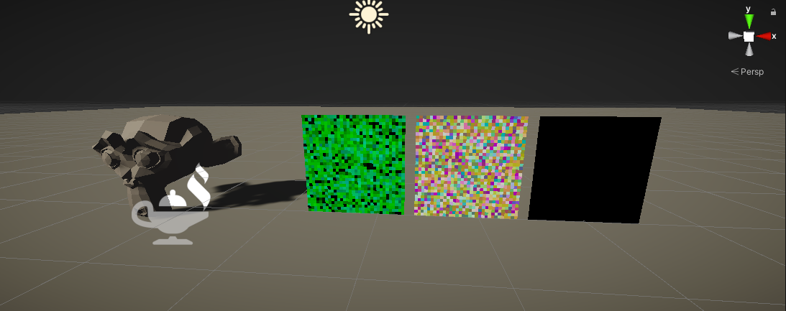
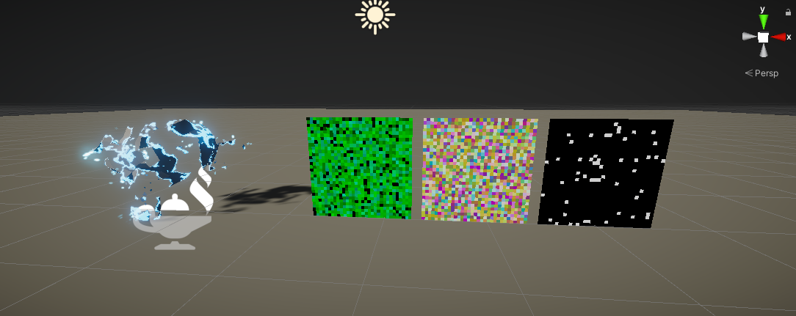
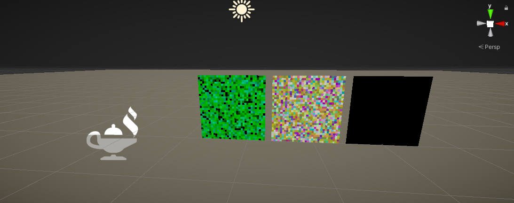

※ 「どういうアプローチで実装したか」を中心としたメモになるので、恐縮ですが具体的な実装はリポジトリを見ていただけると早いかもしれません。

↓ 作ったものをアップしたリポジトリになります。static な mesh と skinned mesh のどちらにも対応しています。

[GitHub - takumifukasawa/UnityDissolverVFX: ComputeShaderTestbedURP](https://github.com/takumifukasawa/UnityDissolverVFX)

紙に火をつけると、どんどん炎が広がり紙が燃えていき、やがて消えてなくります。

ディゾルブシェーダーの境界にあたる部分は、燃えている場所・焦げている場所にあたると思います。

その境界からなにかしらのパーティクルを出してみたいなと考えていて、今回その仕組みを実装してみました。

## 環境

-   unity version: 2020.3.6f1
    
-   pipeline: URP
    

## ポイント

<strong>VFX Graph でパーティクルを放出する位置はメッシュの頂点ではなく、ディゾルブの境界のワールド座標になるようにCompute Shaderで計算をしています。</strong>

放出する位置をメッシュの頂点位置にすると、頂点数が少ないときに「放出されている位置はメッシュの頂点」というのが分かりやすくなってしまう場合があります。

今回は「ディゾルブの境界からパーティクルを放出する」ことが目的なので、Compute Shaderで「ディゾルブの境界のワールド座標」を求める形にしました。

## 流れ

1.  ディゾルブの境界から放出する VFX Graph パーティクルは、Position from Mapを使って放出位置をテクスチャから参照する
    
2.  Compute Shader で、**ランダムにサンプルしたポリゴン内における、ランダムな位置のワールド座標・「ディゾルブの境界率（後述）」を計算**
    
3.  ワールド座標・「ディゾルブの境界率」をテクスチャに格納
    
4.  テクスチャを VFX Graph に渡す
    
5.  「ディゾルブの境界率」を透明度として用い、境界から放出されるパーティクルは見えるように、境界外から放出されるパーティクルは見えないように
    

Compute Shader の中身はこちらになります。

[DissolverVFX/BuildDissolverMap.compute at 0df08b3d2508f2c1aef9f9f4da0b2d3a7b92d0ce · takumifukasawa/DissolverVFX](https://github.com/takumifukasawa/DissolverVFX/blob/0df08b3d2508f2c1aef9f9f4da0b2d3a7b92d0ce/Assets/Resources/ComputeShaders/BuildDissolverMap.compute)

デモでは法線情報もテクスチャに格納して渡しています。

## テクスチャのデータ

もしディゾルブの境界になっている位置の情報**だけ**をすべてテクスチャに格納していく形だと、格納されるデータは必ずディゾルブの境界情報になっている必要があるので、再帰的な処理が必須です。

そこで、**テクスチャに格納するデータはメッシュのランダムな位置におけるパーティクル用の情報**としてしまいます。デモでは「ワールド座標」「法線」「ディゾルブの境界率」が格納された3つのテクスチャを作成しています。

こうすることでテクスチャのデータのすべてがディゾルブの境界ではなくなるデメリットはありますが、再帰的な計算をしなくてよくなるという計算負荷的なメリットがあります。

例えば各種テクスチャのサイズが64x64でもピクセル数が4096あるので、**ディゾルブの境界情報が必ず埋まるようにはなっていなくとも、ある程度の数のディゾルブの境界情報が埋まる状態を保つことができれば十分なはず**と考えました。

実際、こちらのキャプチャは各種テクスチャのサイズは32x32になっていて、情報の少なさ（データの足りなさ）は感じられませんでした。

## ディゾルブの境界率

では、これらのテクスチャを使ってどうやって境界からパーティクルを放出するように見せるのか。

まず、<strong>ディゾルブの境界率は一言でいうと「境界かどうか」</strong>です。今回の実装では「境界かどうか」ではなく「どれぐらい境界に近いか」を計算していて実際格納されるデータは0~1の間なので「境界率」という言い方をしています。

境界率がなぜ必要かというと、境界から**のみ**パーティクルを放出するように見せるためです。

<strong>実は、パーティクルはディゾルブの境界以外からも放出されていて、ディゾルブの境界率をテクスチャに格納してVFX Graphに渡し、境界率に応じて透明度を調整しています。</strong>

例えば下の画像のように、メッシュは消えているにも関わらず見えていないパーティクルがたくさん放出されています。

<strong>境界率によって透明度を調整することで、境界から放出されているパーティクルは見えて、境界以外から放出されているパーティクルは見えないというのを実現しています。</strong>

しかし、この方法には欠点があります。画像のように見えないパーティクルも放出されてしまっているのが無駄な点です。

## テクスチャとディゾルブの度合いの関係

前述のように、テクスチャに格納するデータはメッシュのランダムな位置におけるパーティクル用の情報になります。

どういうデータが格納されるかを可視化してみました。左から「ワールド座標」「法線」「ディゾルブの境界率」のテクスチャになります。

↓ 全体のディゾルブ度合い: 見えている状態 

↓ 全体のディゾルブ度合い: 半分ぐらい消えている状態 

↓ 全体のディゾルブ度合い: 完全に消えている状態 

このように、メッシュが消えているかどうかに関わらずワールド座標と法線は必ずテクスチャに格納されています。

* * *

最後に改めてリポジトリのリンクを貼っておきたいと思います。

[GitHub - takumifukasawa/DissolverVFX: ComputeShaderTestbedURP](https://github.com/takumifukasawa/DissolverVFX)
