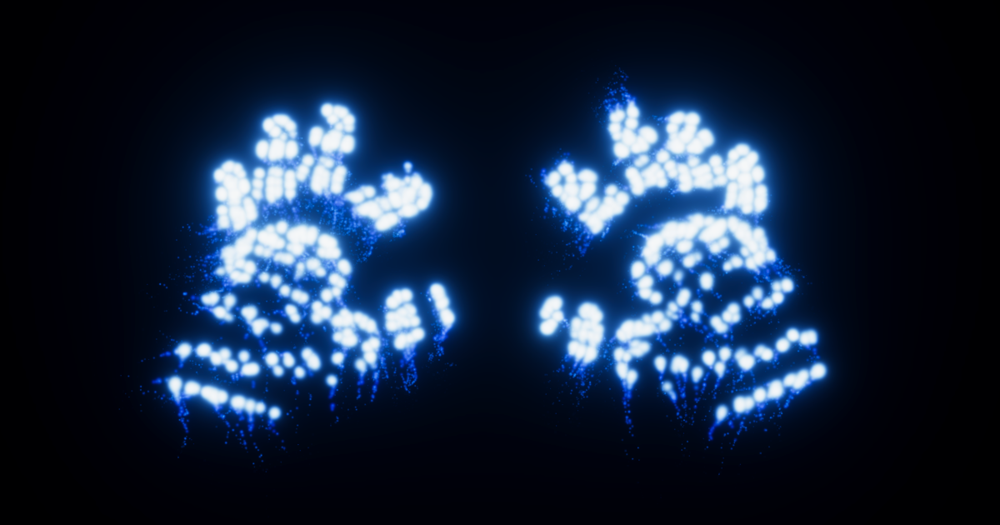

以前LeapMotionを入手した際に、UE4のNiagaraと連携させてみました。

[【UE4】LeapMotion と Niagara を連携させる - takumifukasawa’s blog](/blog/leapmotion-niagara/)

今回はUnityでVFXGraphと連携させてみたいと思います。

最終的にはこのようなものをつくっていきます。

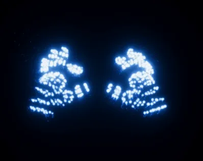

## 環境

-   windows10
-   Unity2019.2.17f1 HDRP
-   LeapMotion

## 方針

このような流れで実現していきたいと思います。

1.  **LeapMotionを使い、手のメッシュと手の動きを連動させる**
2.  **手のメッシュから頂点情報（位置など）を取得**
3.  **頂点情報に応じてVFXでパーティクルを生成**

## 1\. LeapMotionの導入

LeapMotionをPCで使えるようにツール群をインストールします。

以前書いた記事の `LeapMotionの導入` と同じ作業になりますので、こちらを参照いただければと思います。

[【UE4】LeapMotion と Niagara を連携させる - takumifukasawa’s blog](/blog/leapmotion-niagara/)

## 2\. Unityプロジェクトを作成

VFXGraphと連携させたいのでSRP環境を選択します。今回はHDRPを使いました。

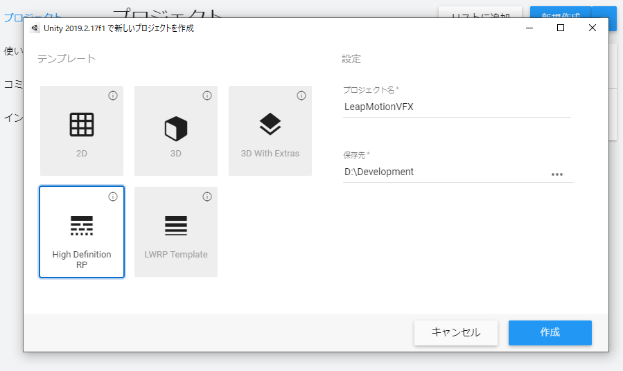

## 3\. LeapMotionのアセットをUnityプロジェクトにインストール

Unity上でLeapMotionを扱う際、PCにツール群をインストールするだけでは使うことができません。

こちらのURLからLeapMotionのアセットが入ったunitypackageをダウンロードし、プロジェクトに追加します。

自分がダウンロードした際のバージョンは `4.4.0` でした。

[Unity — Leap Motion Developer](https://developer.leapmotion.com/unity#5436356)

## 4\. LeapMotionとUnityを連動させる

まずはUnity上でLeapMotionと連携させた手のメッシュを表示させたいと思います。

最低限必要なのはこの3つです。

1.  **LeapMotionを扱うprefab**
2.  **手を管理するスクリプト**
3.  **両手それぞれを管理するprefab**

### 4-1. LeapMotionを扱うprefab

`Leap Motion Controller` をシーンに追加します。LeapMotionを制御するスクリプトがアタッチされたprefabです。

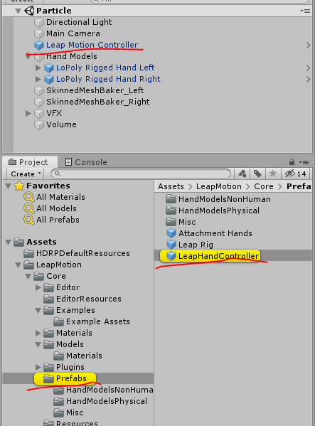

### 4-2. 手を管理するスクリプト

こちらはprefabがなかったので手動でスクリプトをつけました。

空のGameObjectを作成し（`Hand Models`としました）、`HandModelManager`スクリプトをアタッチします。設定は以下のようになっています。

`Rigged Hands`のleftとrightの参照先はそれぞれ、次に作成するprefabです。

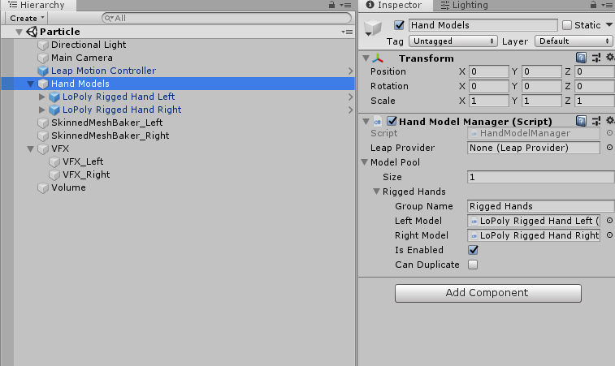

### 4-3. 両手それぞれを管理するprefab

`LoPoly Rigged Hand Left` と `LoPoly Rigged Hand Left` をシーンに追加します。それぞれ、手のメッシュを制御するprefabです。

これを2番で作成したGameObjectの子に入れておきます。

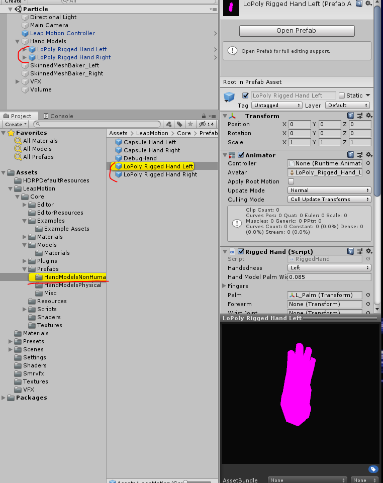

メッシュの色がピンクになっていますが、こちらはそのままで問題ありません。

アタッチされているのはビルトインパイプライン用のマテリアルで、HDRP下だとシェーディングの仕組みの違いでシェーダーのコンパイルエラーが起こるためです。

最終的なデモではメッシュは表示しないので、そのままでも問題ありません。

### 4-4. 実行

この状態でPlayを押して実行してみると、ピンク色の手が動きます。

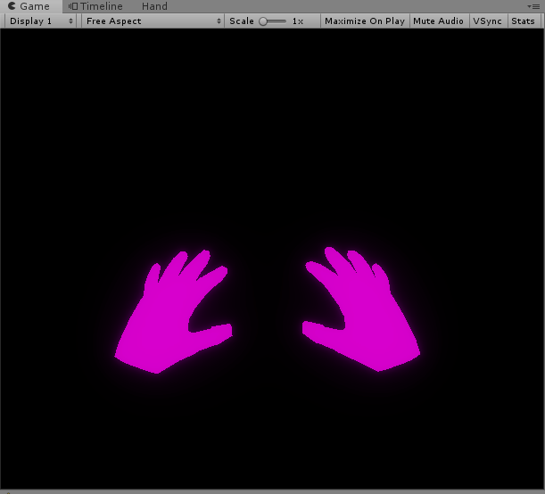

ここまで出来ていれば、無事にLeapMotionとUnityが連動できたことがわかります。

## 5\. 手の動きに応じてパーティクルを発生させる

いよいよVFXGraphを連携させるパートに入っていきます。最初に記載した方針の2,3の部分ですね。

1.  **手のメッシュから座標を取得**
2.  **座標に応じてパーティクルを生成**

LeapMotionの手のメッシュはSkinnedMeshとなっており、LeapMotionで検出した手の指の位置などを元に毎フレーム座標を更新することで、手の動きとメッシュが連動する仕組みとなっています。

しかし、**SkinnedMeshの座標を毎フレーム取得してVFXGraphと連携させる部分は自分で実装する必要があります**。

今回はkeijiroさんのこちらのリポジトリを使わせていただき、上記部分を実現します。

computeshaderを使ってSkinnedMeshの各頂点の座標・法線・速度をテクスチャに焼いてくれます（速度は、最後に更新された位置と現在位置との差分）。

[keijiro/Smrvfx](https://github.com/keijiro/Smrvfx)

## 6\. SkinnedMeshから頂点座標を取得する

上記リポジトリの `Assets/Smrvfx` の中にあるこの3つのファイルを、プロジェクトの `Assets/Smrvfx` に落としてきます。

リポジトリをダウンロードしてきてファイルをドラッグ&ドロップするのが一番簡単かな方法かと思います。

1.  SkinnedMeshBaker.compute
2.  SkinnedMeshBaker.cs
3.  Utility.cs

`SkinnedMeshBaker.cs`をGameObjectにアタッチすることで、SkinnedMeshの各頂点の情報（座標・法線・速度）をテクスチャに焼いてくれます。

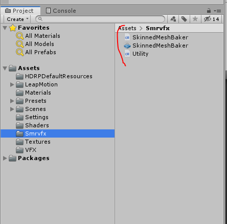

両手のSkinnedMeshの情報を取得したいので、`SkinnedMeshBaker.cs`をアタッチしたGameObjectを両手分作成します。

`source`にはテクスチャに焼きたいSkinnedMeshを割り当てる必要があります。手のprefabの直下にあるSkinnedMesh（`LoPoly_Hand_Mesh_Left`と`LoPoly_Hand_Mesh_Right`）をそれぞれアタッチします。

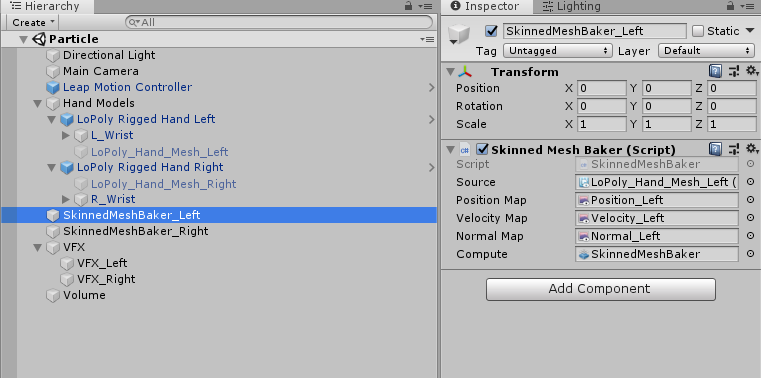

テクスチャも座標、法線、速度の3つ分作成する必要があります。今回は両手なので6つになります。

テクスチャの設定はこのようになっています。座標、法線、速度の3つとも同じにしました。

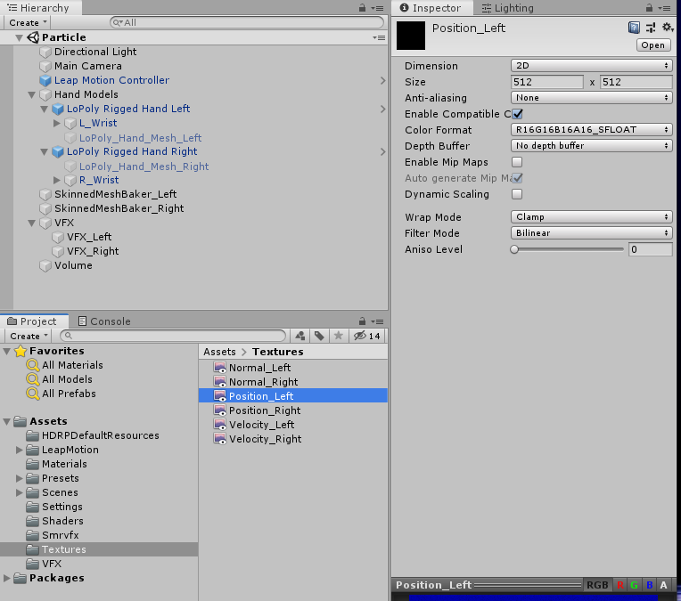

## 7\. 手のメッシュを非表示にする

<strong>VFXだけを表示させたいので、手のメッシュは非表示にします。</strong>非表示にするメッシュはこの2つです。

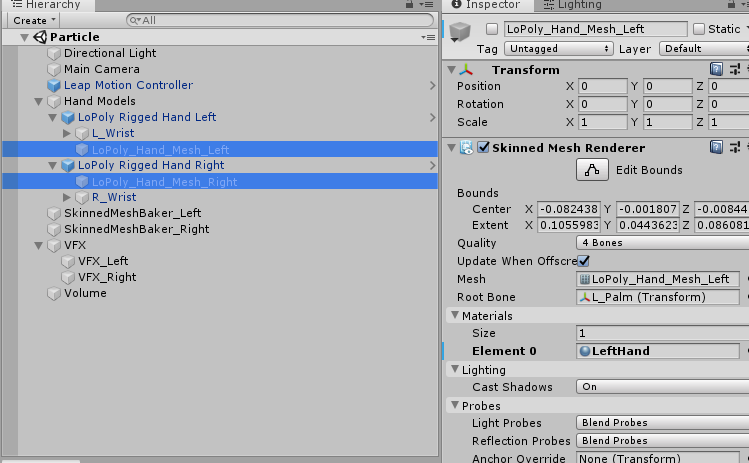

## 8\. VFX

両手から発生させるパーティクル群を作成していきます。VFXオブジェクトを作成し、GameObjectを2つ作成してそれらにVFXオブジェクトをアタッチします。

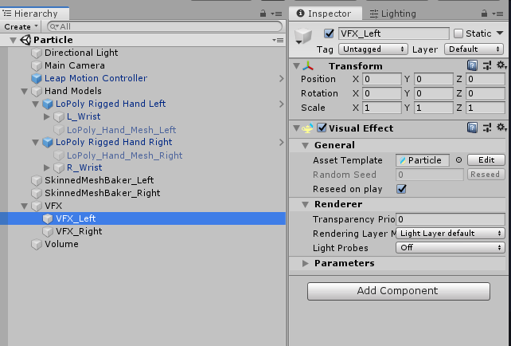

### 頂点情報をテクスチャから参照する

`Set Position from Map`ブロックに座標を焼いたテクスチャを渡すことで、座標をテクスチャから取得することができます。

また同様の方法で、`Set Velocity from Map`ブロックは速度を焼いたテクスチャから速度を参照することができます。

1つのVFXで両手ごと参照させるテクスチャを変えたいので、各テクスチャをパラメーター化し、Inspectorからアタッチできるようにしました。

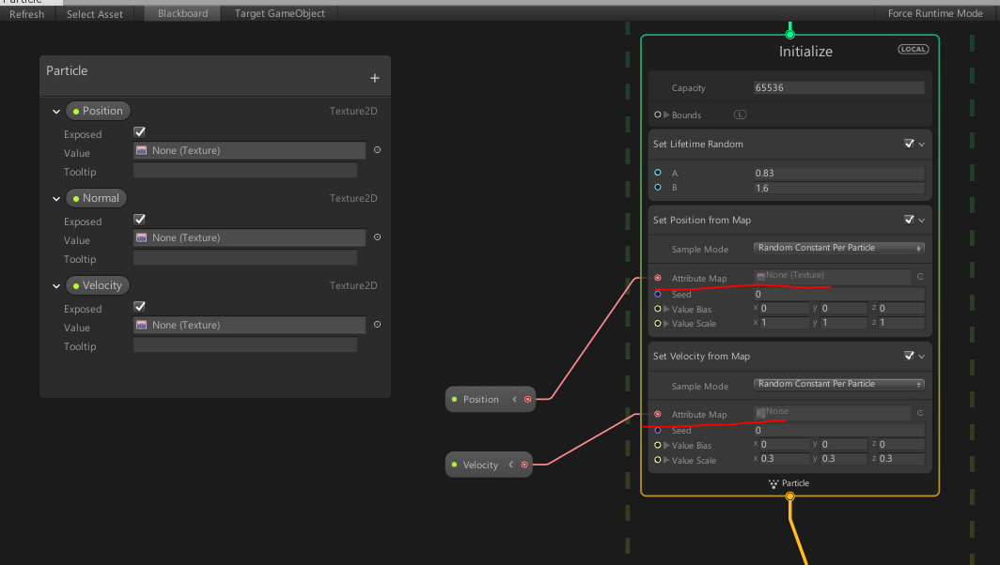

### 頂点情報を焼いたテクスチャをアタッチ

SkinnedMeshの頂点情報を焼いたテクスチャをInspectorからアタッチします。

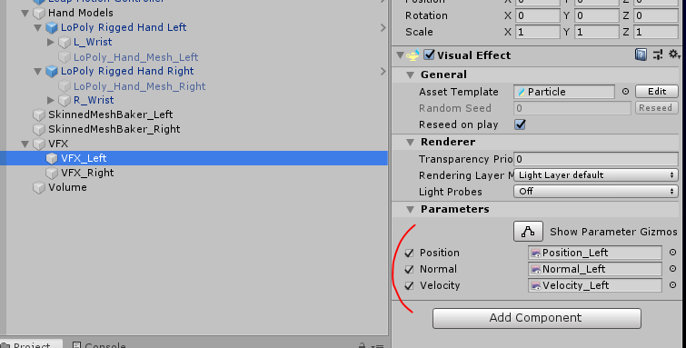

## 9\. VFXやポスプロの調整

好みの見た目に調整していきます。ポスプロでブルームを入れ発光感を出しました。

VFXのUpdateでは`Turbulance`ブロックを追加し、ランダムに乱気流のような動きをつけます。

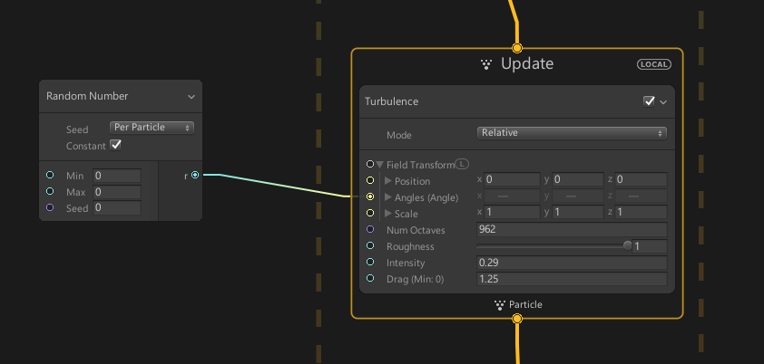

## 10\. 完成

## 最後に

手のメッシュの頂点数の関係で第三関節と付け根のあたりがスカスカになってしまっているのですが、これは元のメッシュのポリゴンを細分化して頂点数を増やすことで改善できそうです。
