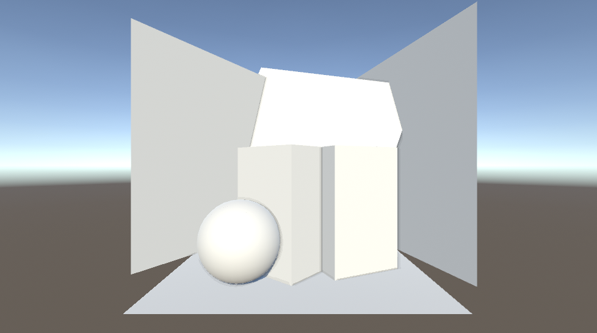
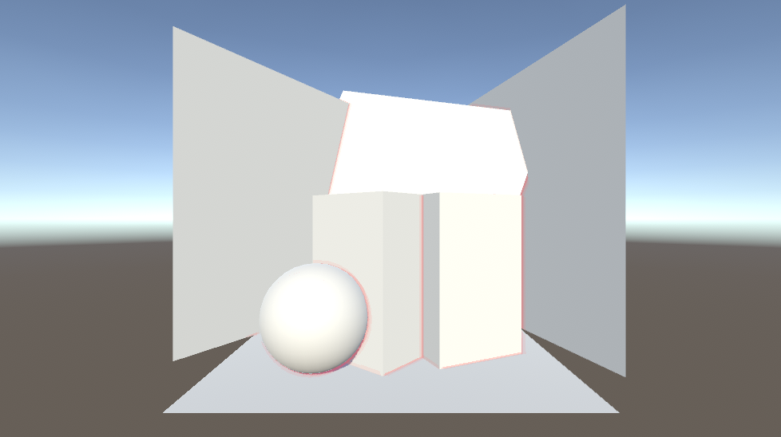
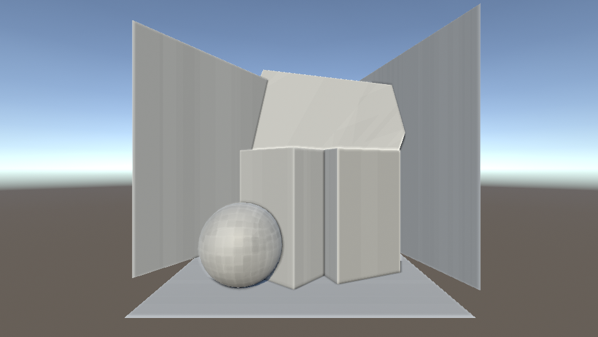
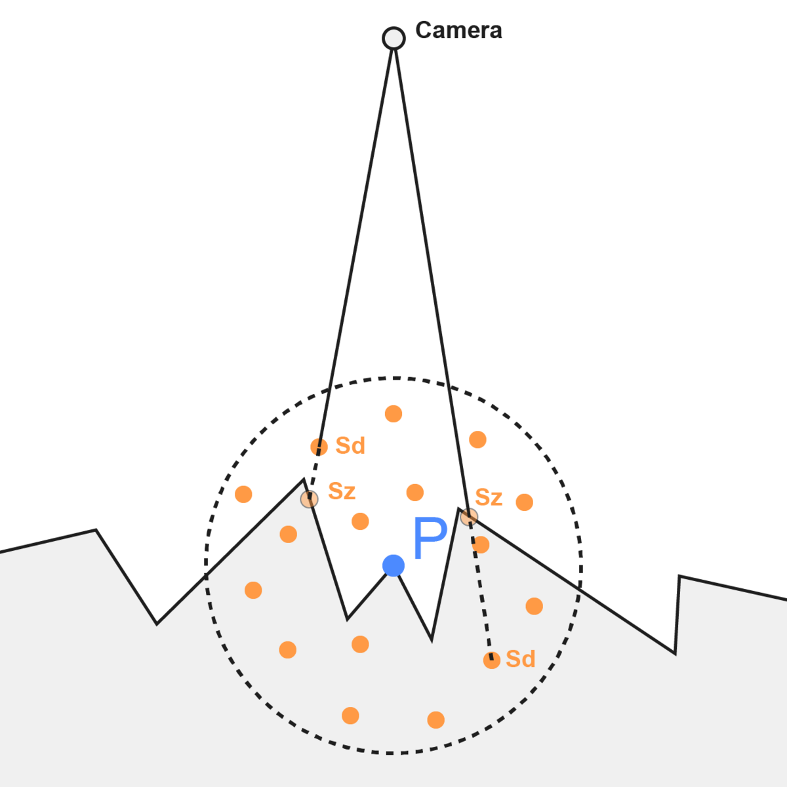
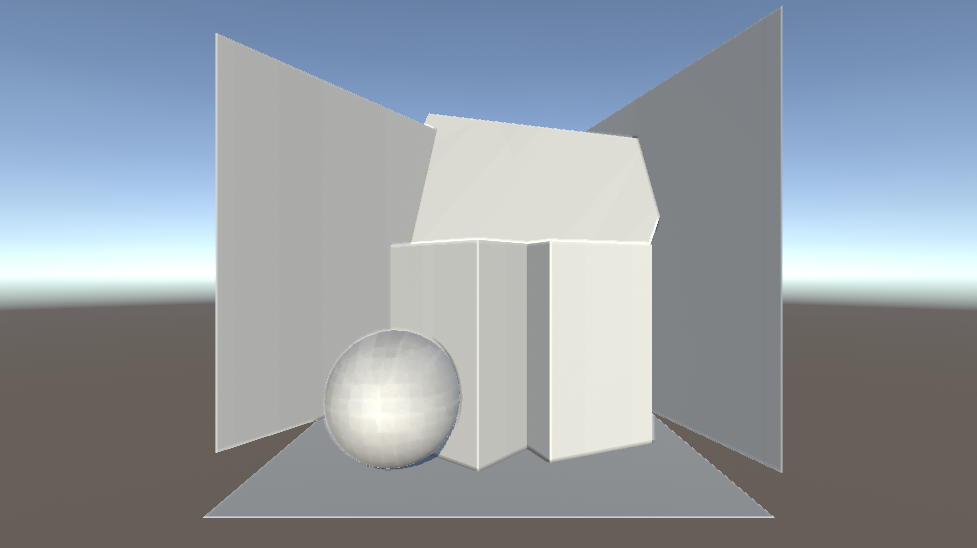
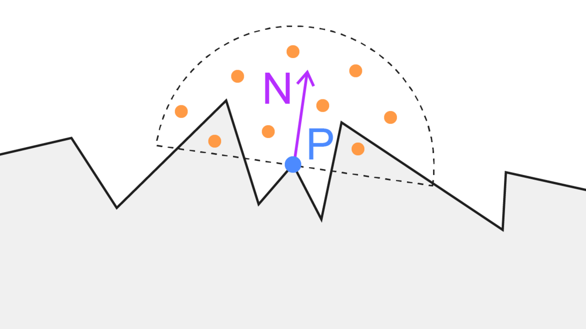
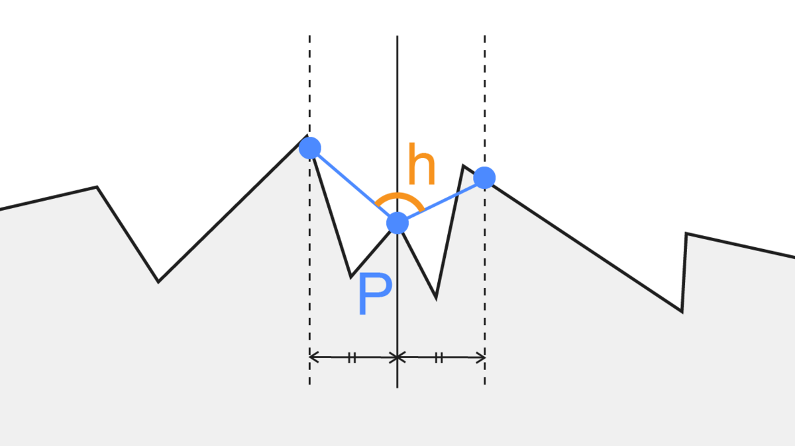
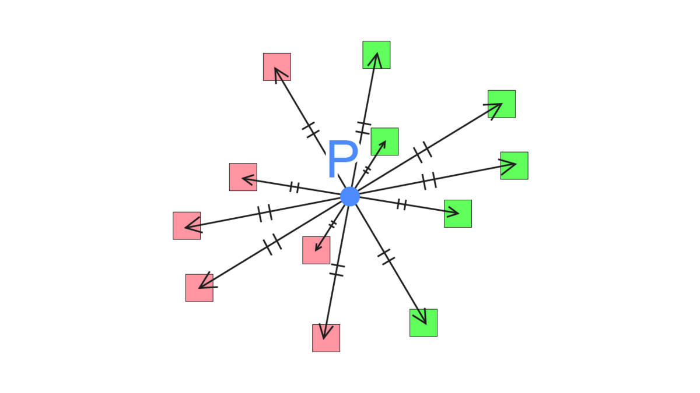
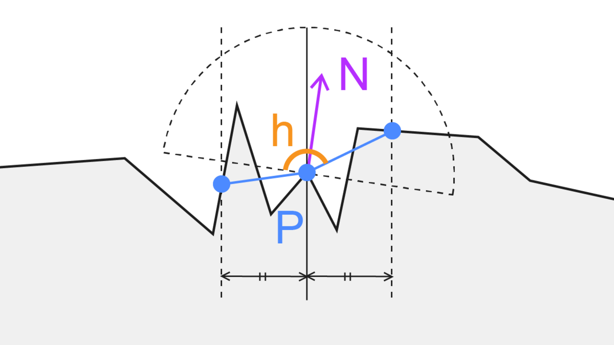

デモのgitはこちらです。

[GitHub - takumifukasawa/UnitySSAOBuiltinPipeline: unity ssao test](https://github.com/takumifukasawa/UnitySSAOBuiltinPipeline)

環境はこちらです。

```
Unity 2021.3.26f built-in pipeline
```

色も調整できるようにしてみています。



## 現実とリアルタイムグラフィクスの壁

Ambient Occlusion は直訳すると「環境遮蔽」です。

室内に目を向けると、天井と壁の継ぎ目の隅はちょっと暗くなっています。大雑把な理由は「光が届きにくいから」です。しかしこれがリアルタイムグラフィックスだととても厄介なものになります。

レイトレーシングやいわゆるシェーダー芸のレイマーチングはある程度光学的に正しいアプローチをとることができるので再現しやすいのですが、ラスタライズ手法の Forward Rendering, Deferred Rendering では再現に一苦労します。

それは、 Forward Rendering や Deferred Rendering のライティングは、どちらも基本的には「周囲のオブジェクト」は考慮しないものになっているからです。

forward rendering では一個一個のオブジェクトを塗る時に、そのオブジェクトと光源の情報から色を決定させているからです。deferred rendering はポストプロセス的にG-Bufferを用いてライティングを考慮した色を計算していますが、「周囲のオブジェクト」を考慮しないライティング計算になっている点は同じです。

しかし、直接光がもたらす影など陰影はオブジェクト同士の関係性の認識に大いに役立ちます。近距離にあるオブジェクト同士がもたらす影は、距離感の把握やリアリティさの向上につながります。

## SSAO (Screen Space Ambient Occlusion)

そこで登場するのが **Screen Space Ambient Occlusion、通称SSAO**です。文字の通り、**スクリーンスペース（ポストプロセス）のアプローチで環境遮蔽を実現する**方法です。

利点は動く物体にも適用できる点です。あらかじめBakeしている必要がありません。

欠点は、品質を求めれば求めるほど負荷が高くなりやすい点です。

その歴史はこちらのリンクがとてもわかりやすいです。ここ十数年ぐらいの話なんですね。

[https://ambientocclusion.hatenablog.com/entry/2013/10/15/223302](https://ambientocclusion.hatenablog.com/entry/2013/10/15/223302)

今回は、3種のSSAOの根本的な実装をやってみました。

1.  <strong>CryEngine2 の SSAO（全球サンプリング）</strong>
2.  <strong>StarCraft II の SSAO（半球サンプリング）</strong>
3.  **UE4 の SSAO（Angle Based）※ Angle Based という名前が一般的かは不明**

今回は実装していないのですが、本来は見た目の品質を綺麗にするためにAmbientOcclusionを計算した後にバイラテラルフィルターなどを使ってエッジのぼかしをかける場合が多いようです（Angled Based の場合はなくてもよい？）。ぼかすことによってAmbientOcclusionが効いているように見える範囲を広げることによって遮蔽の見た目をより強調する、という意味もあるかもしれません。

SSAOの原理的な部分を知りたかったため、ぼかし関連の品質向上的な処理は省いています。

ちなみにぼかし処理は基本的に重くなりやすいです。例えば縦横5px幅ずつのガウシアンブラーフィルターはそれだけで 10 \* 2 + 1 = 21回テクスチャサンプリングが走ってしまいます。そのため特にスクリーンスペースでぼかしをかける場合は注意が必要です。

また、「環境遮蔽」なので環境光にたいしてのみAO項を考慮するのが本来は正しいのですが、今回は Forward Rendring での実装なので環境光にのみAO項を作用させるのが難しいため、シーンの色と環境遮蔽によってもたらされる陰の色をブレンドするようにしています。

## 1\. CryEngine2 の SSAO（全球サンプリング）



<strong>「depth bufferを元に、とある点の周囲にどれぐらい遮蔽するものがあるか」</strong>を判断する手法です。

自分はビュー座標系を基準にして実装しました。

1.  depth buffer を元に、これから描画する点 P のビュー座標系における位置を求める
2.  点 P から、点 P を中心とする全球内のランダムな点 S のビュー座標を計算
3.  点 S の深度値（Sz）と、カメラから見た S の位置の depth buffer の深度値（Sd）を比較
4.  Sd > Sz なら点 S は遮蔽されているとみなす（ex. 画像の右の点）
5.  1~4を指定したサンプル数繰り返し、遮蔽率を計算



この方法の利点は、**depth buffer さえあれば計算可能**な点です。

欠点は、<strong>必要なサンプリング数が多くなりやすい（無駄なサンプリングが多くなりやすい）</strong>点です。今回のようなシンプルなシーンでは64個ぐらいでもある程度それっぽくなるのですが、複雑な形状のシーンの場合はもっとサンプル数が必要になるでしょう。いずれにしても、スペックの低いモバイル端末だとサンプル数64個でも厳しい可能性があります。

また、わりと全体的に暗くなりがちな点も欠点の一つでしょうか。

* * *

以下、該当するc#とシェーダーへのリンクです。

[https://github.com/takumifukasawa/UnitySSAOBuiltinPipeline/blob/master/SSAO\_BuiltinPipeline/Assets/Shaders/SSAO.shader](https://github.com/takumifukasawa/UnitySSAOBuiltinPipeline/blob/master/SSAO_BuiltinPipeline/Assets/Shaders/SSAO.shader) [https://github.com/takumifukasawa/UnitySSAOBuiltinPipeline/blob/master/SSAO\_BuiltinPipeline/Assets/Scripts/SSAO.cs](https://github.com/takumifukasawa/UnitySSAOBuiltinPipeline/blob/master/SSAO_BuiltinPipeline/Assets/Scripts/SSAO.cs)

実装を一部抜粋しながら見ていきます。

とある点のビュー座標系における位置はdepthから復元することができます。

```cpp
float3 ReconstructViewPositionFromDepth(float2 screenUV, float depth)
{
    float4 clipPos = float4(screenUV * 2.0 - 1.0, depth, 1.0);
    #if UNITY_UV_STARTS_AT_TOP
    clipPos.y = -clipPos.y;
    #endif
    float4 viewPos = mul(_InverseProjectionMatrix, clipPos);
    return viewPos.xyz / viewPos.w;
}

...

float3 viewPosition = ReconstructViewPositionFromDepth(i.texcoord, rawDepth);
```

サンプル数分のループ内で、「復元したビュー座標系における位置からランダムにずらした点」のクリッピング座標を求めます。

```cpp
        for (int j = 0; j < SAMPLE_COUNT; j++)
        {
            float4 offset = _SamplingPoints[j];
            offset.w = 0;

            float4 offsetViewPosition = float4(viewPosition, 1.) + offset * _OcclusionSampleLength;
            float4 offsetClipPosition = mul(_ProjectionMatrix, offsetViewPosition);

            #if UNITY_UV_STARTS_AT_TOP
            offsetClipPosition.y = -offsetClipPosition.y;
            #endif

            float2 samplingCoord = (offsetClipPosition.xy / offsetClipPosition.w) * 0.5 + 0.5;
            float samplingRawDepth = SampleRawDepth(samplingCoord);
            float3 samplingViewPosition = ReconstructViewPositionFromDepth(samplingCoord, samplingRawDepth);

            // 現在のviewPositionとoffset済みのviewPositionが一定距離離れていたらor近すぎたら無視
            float dist = distance(samplingViewPosition.xyz, viewPosition.xyz);
            if (dist < _OcclusionMinDistance || _OcclusionMaxDistance < dist)
            {
                continue;
            }

            // 対象の点のdepth値が現在のdepth値よりも小さかったら遮蔽とみなす（= 対象の点が現在の点よりもカメラに近かったら）
            if (samplingViewPosition.z > offsetViewPosition.z)
            {
                occludedCount++;
            }
        }

        float aoRate = (float)occludedCount / (float)divCount;

        // NOTE: 本当は環境光のみにAO項を考慮するのがよいが、forward x post process の場合は全体にかけちゃう
        color.rgb = lerp(
            baseColor,
            _OcclusionColor.rgb,
            aoRate * _OcclusionStrength
        );
```

sampling points は c# 側で単位球内にランダムに散らした点群をシェーダーに渡したものです。

```csharp
static Vector4[] GetRandomPointsInUnitSphere()
{
    var points = new List<Vector4>();
    while (points.Count < SAMPLING_POINTS_NUM)
    {
        var p = UnityEngine.Random.insideUnitSphere;
        points.Add(new Vector4(p.x, p.y, p.z, 0));
    }

    return points.ToArray();
}
```

## 2\. StarCraft II の SSAO（半球サンプリング）



全球サンプリングには無駄な部分があります。それは、法線方向の反対側はジオメトリの内側になっている可能性が高い点です。

そこで**サンプリングする点を法線方向を考慮した半球に限定する**ことにより最適化を進めた計算方法になります。

方法は全球サンプリングとほぼ変わりません。サンプルする対象の点が半球内になっただけです。

1.  depth buffer を元に、これから描画する点 P のビュー座標系における位置を求める
2.  点 P から、法線方向の半球内のランダムな点 S のビュー座標を計算
3.  点 S の深度値（Sz）と、カメラから見た S の位置の depth buffer の深度値（Sd）を比較
4.  Sd > Sz なら点 S は遮蔽されているとみなす
5.  1~4を指定したサンプル数繰り返し、遮蔽率を計算



利点はサンプリング回数の無駄が減ったことです。

欠点は**法線方向への考慮が必要なので法線情報が格納されたテクスチャが必要になる**点です。

Deferred Rendering を使う場合はほとんどの場合で G-Buffer に法線を含めているはずなので「どう用意するか」に関しては特に気にする必要はないのですが Forward Rendering の場合は一工夫必要です。

幸い、Unityには DepthTextureMode で法線が入ったテクスチャを焼くように指定することができます。

`camera.depthTextureMode |= DepthTextureMode.DepthNormals;`

名前の通り、depthと法線を一つのテクスチャに埋めているようですね。素直に実装すると2パス必要なところ、1パスで2つの情報を入れるようにしてくれているのでこれを使うことにします。

[Unity - Scripting API: DepthTextureMode.DepthNormals](https://docs.unity3d.com/ScriptReference/DepthTextureMode.DepthNormals.html)

* * *

以下、該当するc#とシェーダーへのリンクです。

[https://github.com/takumifukasawa/UnitySSAOBuiltinPipeline/blob/master/SSAO\_BuiltinPipeline/Assets/Shaders/SSAOHemisphere.shader](https://github.com/takumifukasawa/UnitySSAOBuiltinPipeline/blob/master/SSAO_BuiltinPipeline/Assets/Shaders/SSAOHemisphere.shader) [https://github.com/takumifukasawa/UnitySSAOBuiltinPipeline/blob/master/SSAO\_BuiltinPipeline/Assets/Scripts/SSAOHemisphere.cs](https://github.com/takumifukasawa/UnitySSAOBuiltinPipeline/blob/master/SSAO_BuiltinPipeline/Assets/Scripts/SSAOHemisphere.cs)

実装を一部抜粋しながら見ていきます。

まず、半球内にランダムに散らした点を生成します。法線方向への考慮はシェーダー内で行います。

```csharp
    static Vector4[] GetRandomPointsInUnitHemisphere()
    {
        var points = new List<Vector4>();
        while (points.Count < SAMPLING_POINTS_NUM)
        {
            var r1 = UnityEngine.Random.Range(0f, 1f);
            var r2 = UnityEngine.Random.Range(0f, 1f);
            var x = Mathf.Cos(2 * Mathf.PI * r1) * 2 * Mathf.Sqrt(r2 * (1 - r2));
            var y = Mathf.Sin(2 * Mathf.PI * r1) * 2 * Mathf.Sqrt(r2 * (1 - r2));
            var z = 1 - 2 * r2;
            z = Mathf.Abs(z);
            points.Add(new Vector4(x, y, z, 0));
        }

        return points.ToArray();
    }
```

法線方向の半球内にランダムにオフセットするために、法線を使った正規直交基底内を利用します。法線マップを実装するときの考え方に近いですね。

法線は \_CameraDepthNormalsTexture から取得します。

オフセットする位置を計算したらあとは全球サンプリングと同じ方法になります。

```cpp
    TEXTURE2D_SAMPLER2D(_CameraDepthNormalsTexture, sampler_CameraDepthNormalsTexture);

...

    float3 SampleViewNormal(float2 uv)
    {
        float4 cdn = SAMPLE_TEXTURE2D(_CameraDepthNormalsTexture, sampler_CameraDepthNormalsTexture, uv);
        return DecodeViewNormalStereo(cdn) * float3(1., 1., 1.);
    }

...

    float3x3 GetTBNMatrix(float3 viewNormal)
    {
        float3 tangent = float3(1, 0, 0);
        float3 bitangent = float3(0, 1, 0);
        float3 normal = viewNormal;
        float3x3 tbn = float3x3(tangent, bitangent, normal);
        return tbn;
    }

...

    float3 viewNormal = SampleViewNormal(i.texcoord);

...

    for (int j = 0; j < SAMPLE_COUNT; j++)
    {
        float3 offset = _SamplingPoints[j];
        offset.z = saturate(offset.z + _OcclusionBias);
        offset = mul(GetTBNMatrix(viewNormal), offset);

...
```

## 3\. UE4 の SSAO（Angle Based）


SIGGRAPH2012でUE4のデモに関する発表の中で紹介された手法です。

<strong>「とある点Pから等距離に伸ばした2点」の位置を計算し、「とある点Pと2点のそれぞれの角度の合計」で遮蔽具合を判断する</strong>、という方法です。サンプリング数は6x2で12点を必要としているようです。

つまり、「角度6種と長さ6種の設定」が鍵になります。これをいい具合にばらけさせるなど調整する必要があります。





この方法の利点は、**AmbientOcclusionの計算に使うテクスチャのサンプル数が最低12回**で済むという点です。全球を考慮した方法と比べると大きな差ですね。また、角度を遮蔽度合いとして捉えることができます。つまり、全球/半球サンプリングでは各サンプリング点において「遮蔽されているかどうか」しか判別できなかったのが、<strong>「角度の累積でどれぐらい遮蔽されているかの度合い」</strong>を考えることができるのでより近い近似になりそうです。また、サンプリング位置をできるだけ散らすために4x4pxの範囲内でさらに回転を加えているようですね。

~~サンプル数が「最低12回」と書いたのは、ピクセルベースの法線情報（ex. G-Bufferの法線情報やノーマルマップ）を考慮するかどうかでサンプル数が変わるからです。スライドによると**法線を考慮したいケースでは法線情報をもとに範囲を限定しつつさらにもう一回遮蔽度合いの計算を行う**ようです。そのため、サンプル数は計24回になりますね。~~

(2023.7.17修正) 上の法線方向を考慮した実装に関して改めて資料を読んでいたところ法線を踏まえつつ再度遮蔽度具合の計算を行うのではなく、法線の半球の裏側を隠れているとみなしてclampした角度をAO項の計算に使う、ということのようでした。



* * *

以下、該当するc#とシェーダーへのリンクです。

[https://github.com/takumifukasawa/UnitySSAOBuiltinPipeline/blob/master/SSAO\_BuiltinPipeline/Assets/Shaders/SSAOAngleBased.shader](https://github.com/takumifukasawa/UnitySSAOBuiltinPipeline/blob/master/SSAO_BuiltinPipeline/Assets/Shaders/SSAOAngleBased.shader) [https://github.com/takumifukasawa/UnitySSAOBuiltinPipeline/blob/master/SSAO\_BuiltinPipeline/Assets/Scripts/SSAOAngleBased.cs](https://github.com/takumifukasawa/UnitySSAOBuiltinPipeline/blob/master/SSAO_BuiltinPipeline/Assets/Scripts/SSAOAngleBased.cs)

実装を一部抜粋しながら見ていきます。

まず、c#でサンプリングする角度と距離を6つずつ作成します。

スライドでは角度と長さの情報をテクスチャで渡しているのか、Uniformな配列情報として渡しているのかがわかりませんでした。デモではUniformな配列情報として渡すことにします。

ランタイム実行の度に生成しているのですが、毎回良質なサンプリング点を生成できるとは限らないので、あらかじめ任意の点を設定できるようにする方が実際はよいと思います。

```csharp
            var rotList = new List<float>();
            var lenList = new List<float>();
            var sampleCount = 6;

            for (int i = 0; i < sampleCount; i++)
            {
                // 任意の角度. できるだけ均等にバラけていた方がよい
                var pieceRad = (Mathf.PI * 2) / sampleCount;
                var rad = UnityEngine.Random.Range(
                    pieceRad * i,
                    pieceRad * (i + 1)
                );
                rotList.Add(rad);

                // 任意の長さの範囲. できるだけ均等にバラけていた方がよい
                var baseLen = 0.1f;
                var pieceLen = (1f - baseLen) / sampleCount;
                var len = UnityEngine.Random.Range(
                    baseLen + pieceLen * i,
                    baseLen + pieceLen * (i + 1)
                );
                lenList.Add(len);
            }

            sheet.properties.SetFloatArray("_SamplingRotations", rotList.ToArray());
            sheet.properties.SetFloatArray("_SamplingDistances", lenList.ToArray());
```

「とある点Pから等距離に伸ばした2点」の位置を計算し、「とある点Pと2点のそれぞれの角度の合計」で遮蔽具合を判断する計算はこちらになります。

スライドやいろいろな記事を見ると2次元的に角度を計算しているようにみえる（おそらくxyのどちらかの次元を落としている）のですが、自分の実装ではビュー座標系において3次元的に角度を計算しています。

```cpp
        float occludedAcc = 0.;
        int samplingCount = 6;

        for (int j = 0; j < samplingCount; j++)
        {
            float2x2 rot = GetRotationMatrix(_SamplingRotations[j]);
            float offsetLen = _SamplingDistances[j] * _OcclusionSampleLength;
            float3 offsetA = float3(mul(rot, float2(1, 0)), 0.) * offsetLen;
            float3 offsetB = -offsetA;

            float rawDepthA = SampleRawDepthByViewPosition(viewPosition, offsetA);
            float rawDepthB = SampleRawDepthByViewPosition(viewPosition, offsetB);

            float depthA = Linear01Depth(rawDepthA);
            float depthB = Linear01Depth(rawDepthB);

            float3 viewPositionA = ReconstructViewPositionFromDepth(i.texcoord, rawDepthA);
            float3 viewPositionB = ReconstructViewPositionFromDepth(i.texcoord, rawDepthB);

            float distA = distance(viewPositionA, viewPosition);
            float distB = distance(viewPositionB, viewPosition);

            if (abs(depth - depthA) < _OcclusionBias)
            {
                continue;
            }
            if (abs(depth - depthB) < _OcclusionBias)
            {
                continue;
            }

            if (distA < _OcclusionMinDistance || _OcclusionMaxDistance < distA)
            {
                continue;
            }
            if (distB < _OcclusionMinDistance || _OcclusionMaxDistance < distB)
            {
                continue;
            }

            float3 surfaceToCameraDir = -normalize(viewPosition);
            float dotA = dot(normalize(viewPositionA - viewPosition), surfaceToCameraDir);
            float dotB = dot(normalize(viewPositionB - viewPosition), surfaceToCameraDir);
            float ao = (dotA + dotB) * .5;

            occludedAcc += ao;
        }

        float aoRate = occludedAcc / (float)samplingCount;
```

今回、遮蔽の度合いはこのように -1 ~ 1 の範囲と捉えて計算しています。プロジェクトごとに調整してよい部分かなと思います。例えば「ちょっとでも角度があったら遮蔽しているとみなしたい」時は 0 ~ 1 の範囲の方が適切です。

```cpp
            float ao = (dotA + dotB) * .5;

            occludedAcc += ao;
```

品質を高めたい場合はサンプリング回数を増やしてもよいと思います。作っているものによっては描画処理に余裕がある場合などですね。

実装の改善として、角度と長さはfloatの配列でそれぞれ要素数6になっていますがvector2な配列で\[0\]に角度, \[1\]に長さを入れ vector2の要素数6の配列にすると送る配列が一つ減るので節約になりそうですね。

[GitHub - takumifukasawa/UnitySSAOBuiltinPipeline: unity ssao test](https://github.com/takumifukasawa/UnitySSAOBuiltinPipeline)

## 参考

[https://zenn.dev/mebiusbox/articles/c7ea4871698ada](https://zenn.dev/mebiusbox/articles/c7ea4871698ada)

[https://ambientocclusion.hatenablog.com/entry/2013/11/07/152755](https://ambientocclusion.hatenablog.com/entry/2013/11/07/152755)

[https://de45xmedrsdbp.cloudfront.net/Resources/files/The\_Technology\_Behind\_the\_Elemental\_Demo\_16x9-1248544805.pdf](https://de45xmedrsdbp.cloudfront.net/Resources/files/The_Technology_Behind_the_Elemental_Demo_16x9-1248544805.pdf)

[https://marina.sys.wakayama-u.ac.jp/~tokoi/?date=20101122](https://marina.sys.wakayama-u.ac.jp/~tokoi/?date=20101122)

[https://developers.wonderpla.net/entry/2014/01/31/151540](https://developers.wonderpla.net/entry/2014/01/31/151540)

[https://inzkyk.xyz/ray\_tracing\_in\_one\_weekend/week\_3/3\_7\_generating\_random\_directions/](https://inzkyk.xyz/ray_tracing_in_one_weekend/week_3/3_7_generating_random_directions/)
