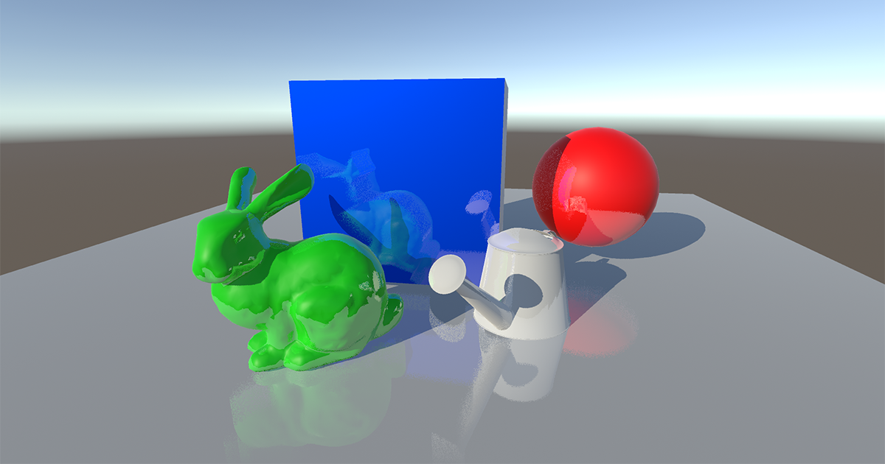

ポストプロセス的に反射表現を実現する方法である Screen Space Reflection を実装してみました。

サンプルリポジトリはこちらになります。

[GitHub - takumifukasawa/UnitySSRBuiltinPipelineForward: UnitySSRCustomPostProcess](https://github.com/takumifukasawa/UnitySSRBuiltinPipelineForward)

## 環境

Unity 2021.3.23f1 built-in pipeline

forward rendering

## 前段

リアルタイムレンダリングのラスタライズ法において反射は、特に負荷のかかりやすく工夫のいる表現の代表例だと思います。視点に依存したり、周囲の環境による部分が大きいですからね。「周りの写り込み」が入ることによって圧倒的に情報量と説得力が増しますが、どこまで反射を表現するかによってとる方法が大きく変わります。

<strong>「周囲の環境を踏まえた反射色の決定」の実現でまず思いつくのは、環境マップ</strong>です。なんとなく反射の情報量を増やしたい場合は環境マップで事足りるケースが多いと思います。しかし、**環境マップに「動くもの」も含めるのは骨が折れます**。端末のスペックが十分であれば環境マップをリアルタイムに生成し続けることで実現できます。しかし、特にモバイルではスペックが足りず厳しいでしょう。

また、解像度感も問題になります。綺麗な環境マップを生成するには解像度を高くすればよいのですが、環境マップ用に周囲の6面をテクスチャに焼き、環境マップを生成し...という過程を経るのでやはりランタイムでは相当な負荷が予想されます。負荷を考えると解像度は低くするべきですが、鏡面反射に近いようなマテリアルでは解像度不足感が否めない可能性があります。

<strong>Screen Space Reflection も高負荷な処理の一つですが、ポストプロセス的なアプローチで「動くもの」を反射に加えることができます。</strong>

## 実装

### 下準備

**シーンの深度情報と法線方向の情報、色情報が必要です**。deferred rendring は G-Buffer から法線などを参照することが可能ですが、builtin-pipeline の forward rendering の場合は一工夫が必要です。

具体的にはdepthTextureModeを操作し、シェーダー内で深度と法線情報を取得できるようにします。

```csharp
_camera.depthTextureMode |= DepthTextureMode.DepthNormals;
```

[https://docs.unity3d.com/Manual/SL-CameraDepthTexture.html](https://docs.unity3d.com/Manual/SL-CameraDepthTexture.html)

これを設定すると、テクスチャに深度と法線が一まとめに格納されます。frame debugger に表示されている `UpdateDepthNormalsTexture` が深度・法線をテクスチャに書き込んでいくパスです。

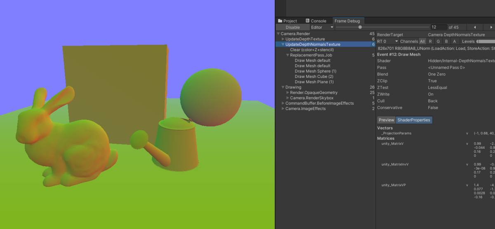

* * *

DepthNormalなテクスチャをシェーダー側からデコードして深度と法線を取り出すコードは下記です。深度は線形化されたもので、法線はビュー座標系になっています。

プロジェクトでは、デコードする関数の一部をUnityCG.cgincから参照してきています。UnityCG.cgincを参照していればこの関数の記述は必要ありません。

```c
    ...

    TEXTURE2D_SAMPLER2D(_CameraDepthNormalsTexture, sampler_CameraDepthNormalsTexture);

    ...

    // ------------------------------------------------------------------------------------------------
    // ref: UnityCG.cginc
    // ------------------------------------------------------------------------------------------------

    float DecodeFloatRG(float2 enc)
    {
        float2 kDecodeDot = float2(1.0, 1 / 255.0);
        return dot(enc, kDecodeDot);
    }

    void DecodeDepthNormal(float4 enc, out float depth, out float3 normal)
    {
        depth = DecodeFloatRG(enc.zw);
        normal = DecodeViewNormalStereo(enc);
    }

    ...

        float depth = 0;
        float3 viewNormal = float3(0, 0, 0);
        float4 cdn = SAMPLE_TEXTURE2D(_CameraDepthNormalsTexture, sampler_CameraDepthNormalsTexture, i.texcoord);
        DecodeDepthNormal(cdn, depth, viewNormal);
```

### レイを飛ばす

まずピクセルごとに、<strong>視点からジオメトリの座標までのベクトルを算出し、法線方向に反射したベクトルを求めます。</strong>

「ジオメトリの座標」はワールド座標でも、ビュー座標でもクリッピング座標でも問題ありません。任意の座標系で実装します。サンプルでは、後述するフェードの実装のしやすさなどの関係でビュー座標系を基本とします。

次に、**反射したベクトル方向に、等距離ずつサンプル点を移動させていきます**。レイマーチングやレイトレに馴染みのある方だと「反射方向にレイを進めていく」という表現が分かりやすいかなと思います。

レイを進めていきながら、「カメラから描画されたジオメトリまでの距離（青の点）」と「レイの位置までの距離（赤の点）」を比較します。

<strong>青の点が赤の点よりもカメラに近い場合、「反射してぶつかった場所」とみなします。</strong>

そして、反射してぶつかった場所の色をサンプルし、加算などブレンドをします。図ですと、青い点の中の一番上のものを反射で写りこむ色として捉えます。

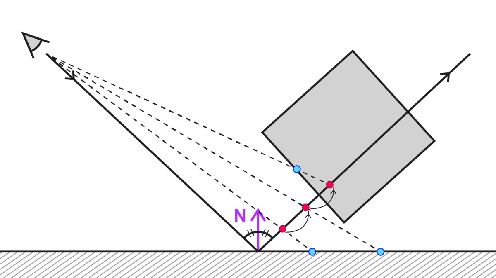

### 厚みを考慮する

見た目の精度を高めていく実装です。

前述のように「カメラから描画されたジオメトリまでの距離」と「レイの位置までの距離」を比較し前者の方が近ければ反射とみなすのですが、大きな問題が一つあります。

それは、この2つの距離が離れすぎているケースです。

近いかどうかだけを判断している場合、極論ですがカメラからジオメトリまでの距離が10m、カメラからレイの位置までが10000mとしたら、それも反射色をサンプルする対象になってしまいます。そのため、シーンによっては違和感のある反射が生まれます。

なので、**レイとジオメトリまでの距離も考慮し、反射でぶつかったとみなす範囲を制限する**実装にしてみます。例えば距離が0.1~5mまでの範囲内であれば反射してぶつかったとみなす、という具合ですね。

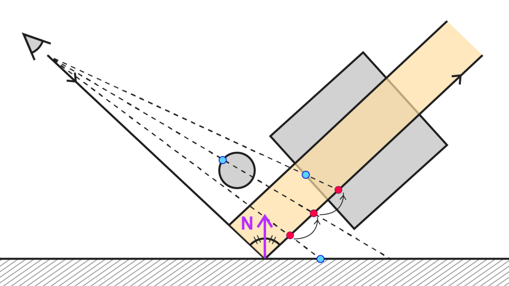

```c
        ...

        for (int j = 0; j < maxIterationNum; j++)
        {
            float stepLength = rayDeltaStep * (j + 1 + jitter * _ReflectionRayJitterSize) + _RayNearestDistance;
            currentRayInView = rayViewOrigin + rayViewDir * stepLength;
            float sampledRawDepth = SampleRawDepthByViewPosition(currentRayInView, float3(0, 0, 0));
            float3 sampledViewPosition = ReconstructViewPositionFromDepth(i.texcoord, sampledRawDepth);

            float4 currentRayInClip = mul(_ProjectionMatrix, float4(currentRayInView, 1.));
            currentRayInClip.xyz /= currentRayInClip.w;

            // クリッピング座標の外に出たら棄却
            // zは一旦考慮しない
            if(abs(currentRayInClip.x) > 1. || abs(currentRayInClip.y) > 1.)
            {
                break;
            }

            float dist = sampledViewPosition.z - currentRayInView.z;
            if (_RayDepthBias < dist && dist < _ReflectionRayThickness)
            {
                isHit = true;
                break;
            }
        }

        ...
```

thickness off 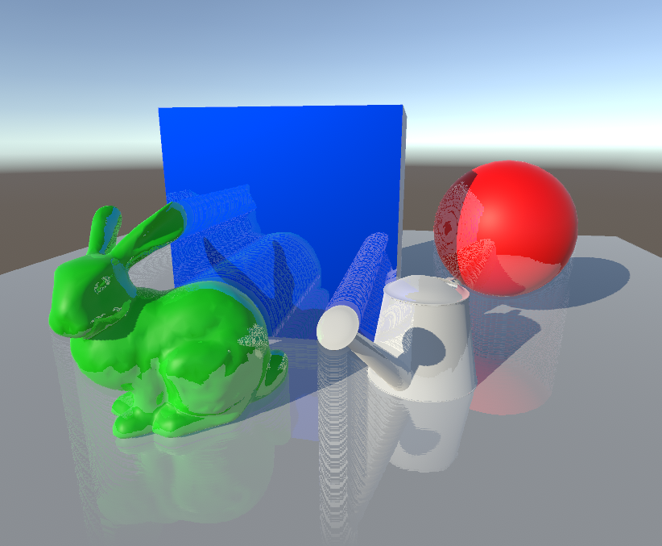

thickness on 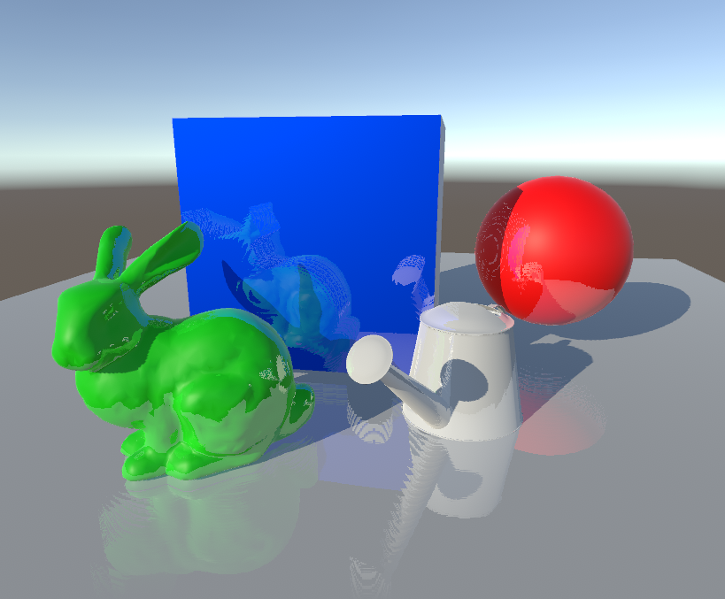

### 二分探索（バイナリサーチ）

いわゆるバイナリサーチの考え方の応用になります。レイを少しずつ進めていく実装では精度は「レイを進める回数」「進む間隔（ステップ）」に大きく依存します。しかし、精度を上げようとすればするほど計算が重くなります。たとえば64回レイを進めながら反射しているかどうかを確認する場合、1280x720の画面だったとしたら 1280x720x64 = 58982400 回分の探索が毎フレームで発生する計算になります。

また、ステップの間隔が広すぎるとマッハバンドのような段々が出来てしまいます。かといって、狭すぎると近い距離までの反射しか考慮できないので、物足りなさがあります。

そこで、バイナリサーチを使って探索回数を最適化していきます。実装としては、等距離で進む部分は変わりませんが、ヒットした場合に反射の色のサンプル位置をより詳細に探っていきます。

「大まかにステップを進め」、「ヒットしたら詳細に探索をしていく」ようなイメージです。

図のような手順を踏みます。

1.  **ヒットしたらバイナリサーチを開始。ステップ間隔を半分にして戻る**
    
2.  **ヒットしたかどうか確認**
    
3.  **ヒットしたらステップ感覚を半分に戻る / ヒットしなかったらステップ間隔を半分にして進む**
    
4.  **2,3を任意の数繰り返す**
    

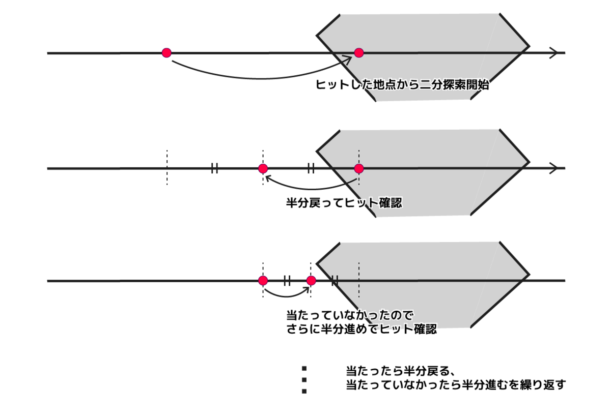

こうすることで、大まかなステップを30回・詳細なステップを8回とすると、レイを進める回数は30+8で38回になります。バイナリサーチを使うことで、レイを進める回数を減らしつつ段々になってしまう間隔を多少狭くすることができます。

```c
        if (isHit)
        {
            // stepを一回分戻す
            currentRayInView -= rayViewDir * rayDeltaStep;

            float rayBinaryStep = rayDeltaStep;
            float stepSign = 1.;
            float3 sampledViewPosition = viewPosition;

            for (int j = 0; j < binarySearchNum; j++)
            {
                // 衝突したら半分戻る。衝突していなかったら半分進む
                // 最初は stepSign が正なので半分進む
                rayBinaryStep *= 0.5 * stepSign;
                currentRayInView += rayViewDir * rayBinaryStep;

                float sampledRawDepth = SampleRawDepthByViewPosition(currentRayInView, float3(0, 0, 0));
                sampledViewPosition = ReconstructViewPositionFromDepth(i.texcoord, sampledRawDepth);

                float dist = sampledViewPosition.z - currentRayInView.z;
                stepSign = _RayDepthBias < dist ? -1 : 1;
            }

            float4 currentRayInClip = mul(_ProjectionMatrix, float4(currentRayInView, 1.));
```

binary search off 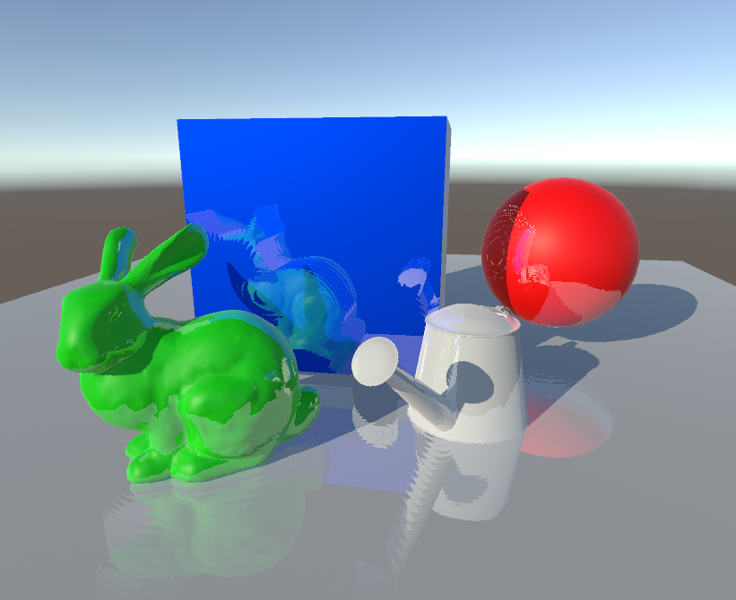

binary search 8 times 

### jitter

バイナリサーチを使ってレイを飛ばす回数の最適化をしても、レイを飛ばす間隔に依存してマッハバンドのような段差の軽減は限界があります。そこで、**レイを飛ばすときにレイの方向をちょっとずらして散らす**ことで、精度が低く感じる見た目を軽減させます。

レイトレーシングでは重点サンプリングをするために飛ばすレイを散らすことでノイズ軽減をする方法がありますがそのイメージが近いです。

また、ちょっとしたブラー的な効果を得ることができます。

欠点は、時間依存でランダムにノイズを足そうとするとカメラが止まっているときでもノイズが走り続けているような見た目になることです。カメラが止まっているときはノイズの散らし方を変えないようにしたり、後述するような平均化を行うと軽減されるはずです。

```c
    float noise(float2 seed)
    {
        return frac(sin(dot(seed, float2(12.9898, 78.233))) * 43758.5453);
    }

    ...

        float jitter = noise(i.texcoord + _Time.x) * 2. - 1.;
        float2 jitterOffset = float2(jitter * _ReflectionRayJitterSizeX, jitter * _ReflectionRayJitterSizeY);

        for (int j = 0; j < maxIterationNum; j++)
        {
            float stepLength = rayDeltaStep * (j + 1) + _RayNearestDistance;
            currentRayInView = rayViewOrigin + float3(jitterOffset, 0.) + rayViewDir * stepLength;
    ...
```

jitter off 

jitter on 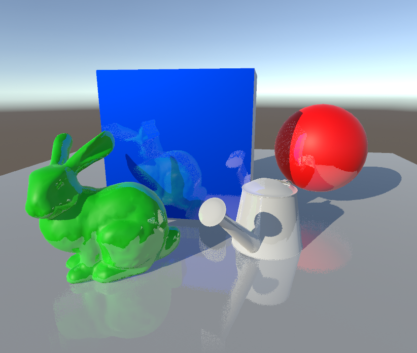

### 画面端のフェード

反射した先の色は、シーンの色情報を元に算出します。つまり、**もともとカメラの範囲に入っていないものを反射の色に含めることはできない**という欠点があります。 そのためシーンの構成によっては画面の端の反射が違和感に感じる場合があるので、画面の端にいくほど反射をフェードアウトさせるようにしてみます。

```c
            // screen edge fade
            
            float screenEdgeFadeFactorX = (abs(i.texcoord.x * 2. - 1.) - _ReflectionScreenEdgeFadeFactorMinX) / max(_ReflectionScreenEdgeFadeFactorMaxX - _ReflectionScreenEdgeFadeFactorMinX, eps);
            float screenEdgeFadeFactorY = (abs(i.texcoord.y * 2. - 1.) - _ReflectionScreenEdgeFadeFactorMinY) / max(_ReflectionScreenEdgeFadeFactorMaxY - _ReflectionScreenEdgeFadeFactorMinY, eps);

            screenEdgeFadeFactorX = saturate(screenEdgeFadeFactorX);
            screenEdgeFadeFactorY = saturate(screenEdgeFadeFactorY);

            screenEdgeFadeFactorX = 1. - screenEdgeFadeFactorX * screenEdgeFadeFactorX;
            screenEdgeFadeFactorY = 1. - screenEdgeFadeFactorY * screenEdgeFadeFactorY;
```

### 反射距離でのフェード

本来、素材によって映り込みの見た目が変わります。SSRにおいて、反射の範囲が広いと鏡面反射のような素材感に見える場合があるので、**ジオメトリの座標とレイの距離に応じてフェード**するようにしてみました。

deferredであればsmoothnessなど、マテリアルの素材に関わるようなパラメーターに応じてフェード具合などを調整するなどしてもいいかもしれません。

```
            float rayWithSampledPositionDistance = distance(viewPosition, sampledViewPosition);
            float distanceFadeRate = (rayWithSampledPositionDistance - _ReflectionFadeMinDistance) / max(
                _ReflectionFadeMaxDistance - _ReflectionFadeMinDistance, eps);
            distanceFadeRate = saturate(distanceFadeRate);
            distanceFadeRate = 1. - distanceFadeRate * distanceFadeRate; // 距離減衰
```

画面端のフェード・反射地点の距離フェードなし 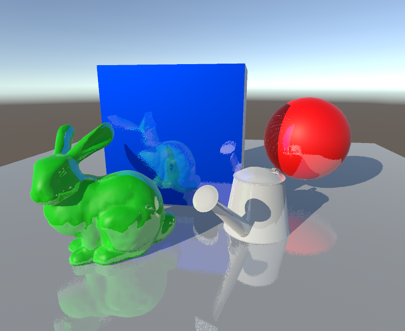

画面端のフェード・反射地点の距離フェードあり 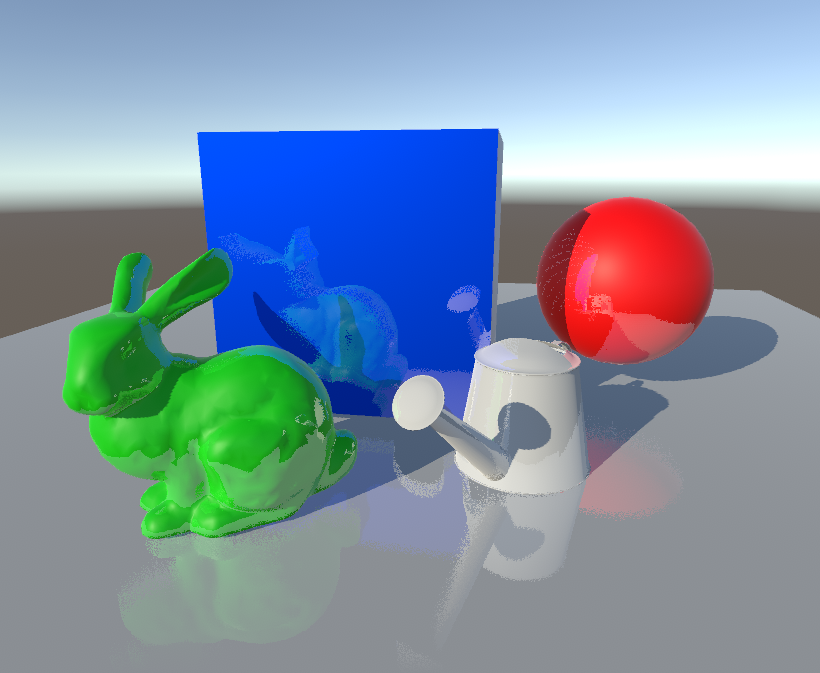

## SSRの欠点

ます、高負荷になりがちです。深度、法線情報が必要になり、精度を上げるためにはレイを飛ばす回数を増やす必要があるのが大きな理由です。

見た目的に大きな欠点は<strong>「裏側」を描画することができない・画面端のようにもともとカメラに映っていないものは反射に含めることができない</strong>、という点です。

裏側に関しては、カメラに映らない裏側が見える位置に別のカメラを置きRenderTextureに描画し、裏側の色を反射した先の色としてみなす場合はそのRenderTextureを参照するという方法も考えられますが、 Screen Space Reflection の基本的な実装部分の負荷がすでに高めになりがちなので、端末スペックやパフォーマンスに余裕があるときでないと採用は難しいはずです。

## 改善

今回は「ポストプロセスのパス」で計算する方法をとりました。実用をさらに踏まえると、

-   フル解像度ではなく1/2ぐらいの縮小バッファを使うことによる速度改善
    
-   複数フレーム間での平均化やブラーを入れることによる品質改善
    

が見込めるので、RenderTextureを使って計算する方がよいかもしれません。

## 参考

[https://tips.hecomi.com/entry/2016/04/04/022550](https://tips.hecomi.com/entry/2016/04/04/022550)

[https://zenn.dev/mebiusbox/articles/43ecf1bb12831c](https://zenn.dev/mebiusbox/articles/43ecf1bb12831c)

[http://www.kode80.com/blog/2015/03/11/screen-space-reflections-in-unity-5/](http://www.kode80.com/blog/2015/03/11/screen-space-reflections-in-unity-5/)

[https://hanecci.hatenadiary.org/entry/20140617/p8](https://hanecci.hatenadiary.org/entry/20140617/p8)

[https://i-saint.hatenablog.com/entry/2014/12/05/174706](https://i-saint.hatenablog.com/entry/2014/12/05/174706)

[https://jcgt.org/published/0003/04/04/paper-lowres.pdf](https://jcgt.org/published/0003/04/04/paper-lowres.pdf)
