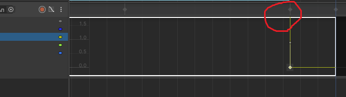
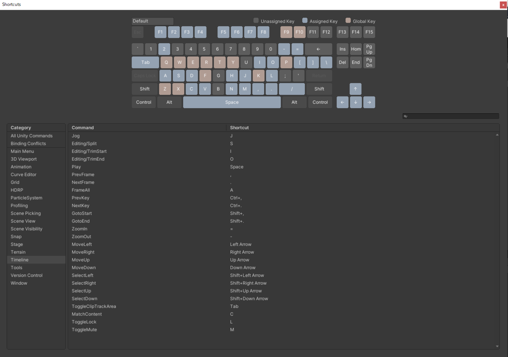
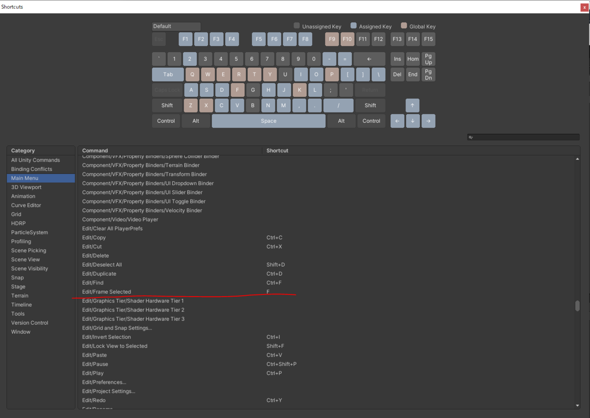

## 現象

Timeline の graph view で key の位置やイージングの調整をしたいとき、下の画像のようにカーブ全体が表示されないという現象が度々発生して困ることが多くありました。

\[Edit\] -> \[Shortcuts...\] を覗いてみても、カーブ全体を表示するようなショートカットはありませんでした。

## 解決

`F` キーを押すことでカーブの全体表示がされるようになります。

FキーはScene View などで特定のオブジェクトにフォーカスする用途で頻繁に使いますが、Timeline のカーブにも同様の処理がされるようです。

Timeline に限らず、VFX Graph などでも特定のノード・ブロックにフォーカスしたいときはFキーを使うので、どのTabかを問わず「何かが隠れている or 小さく表示されている」->「全体表示する or フォーカスする」という挙動をさせたいときにはひとまずFキーを押してみるのは有用かもしれません。
