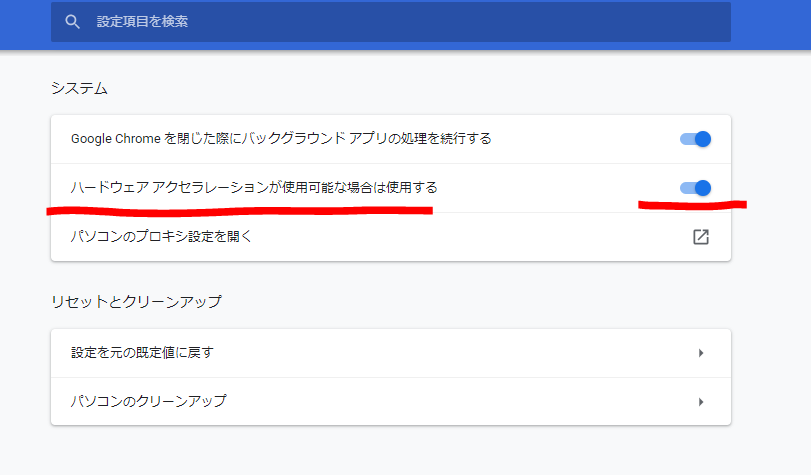
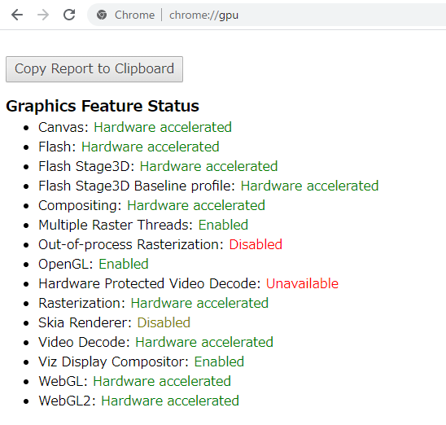
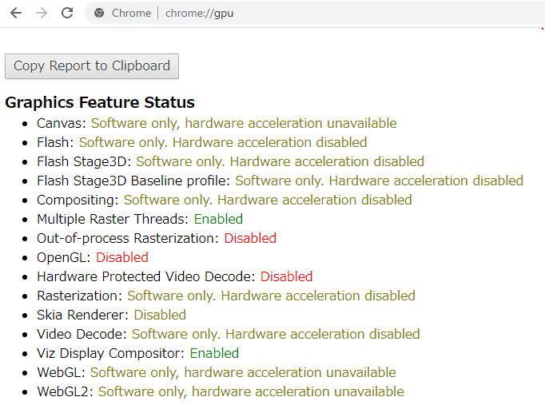
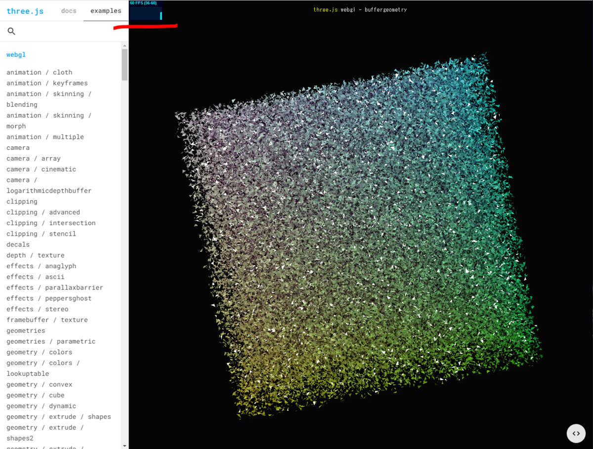
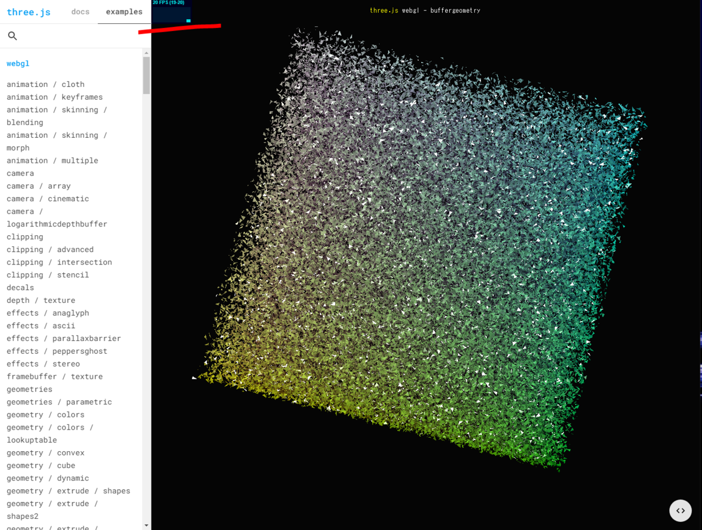

WebGL開発をする際に、Chromeのハードウェアアクセラレーションを無効にしたときでもWebGLコンテンツを動作させたい機会があり、挙動を調べる機会があったのでメモとして残しておきます。

## 設定方法の変更

Chrome の `設定` → `詳細設定` → `ハードウェア アクセラレーションが使用可能な場合は使用する` で切り替えることができます。

切り替える際はブラウザを再起動する必要があります。




## 有効・無効時のブラウザの機能の違い

`chrome://gpu` にアクセスすることでグラフィック回りの使える機能の状態を確認することができます。

↓ ハードウェアアクセラレーション有効時 

↓ ハードウェアアクセラレーション無効時 

無効時の`WebGL`部分を見ると`Software only, hardware acceleration unavailable`の状態になっています。ハードウェアアクセラレーションは使えなくなっていますが（= GPUを使わない）なんらかのソフトウェアは動作しているようで、そのソフトウェアとはSwiftShaderを指しています。

## Chrome と CPUレンダラー

ChromeにはSwiftShaderというCPUベースのレンダラーが組み込まれています。

[google/swiftshader](https://github.com/google/swiftshader)

```
SwiftShader is a high-performance CPU-based implementation of the Vulkan, OpenGL ES, and Direct3D 9 graphics APIs12. Its goal is to provide hardware independence for advanced 3D graphics.
```

つまり**SwiftShaderはVulkanやOpenGL ESなどのグラフィックAPI相当の処理をCPUで動作させてくれるソフトウェア**ということになります。

Googleのこちらの記事によると2009年から組み込まれているようです。

```
2009 年以来、Chrome はハードウェア アクセラレーションによるレンダリングを完全にはサポートしていないシステムでの 3D レンダリングに SwiftShader を使用しています。WebGL などの 3D コンテンツは GPU 向けに記述されていますが、ユーザーの端末にはこのようなコンテンツを実行できるだけのグラフィック ハードウェアが搭載されていない場合もあります。
```

[オープンソースとなった SwiftShader によるユニバーサル レンダリング](https://developers-jp.googleblog.com/2016/07/swiftshader.html)

## WebGLの挙動

ハードウェアアクセラレーションをオフにしてGPUが使えない状態でも SwiftShader が動作することにより、WebGLを使用したコンテンツも表示することができます。ただし、処理速度はどうしてもGPU動作時よりも劣ります。

### 処理速度

ハードウェアアクセラレーションのオプションを有効・無効にしたときのWebGLコンテンツのFPSを比較してみました。参考にしたのはthree.jsのこちらのサンプルです。

[https://threejs.org/examples/#webgl\_buffergeometry](https://threejs.org/examples/#webgl_buffergeometry)

-   環境
    -   OS: windows10
    -   CPU: Intel(R) Core(TM) i7-9700K
    -   GPU: GeForce RTX 2070 SUPER

↓ 有効時: 約60FPS 

↓ 無効時: 約20FPS 

処理の内容にももちろん大きく左右されると思いますが、ハードウェアアクセラレーションを無効にしてもWebGLが使われているページがCPUのみの動作で20FPS近く出るとは驚きでした。見た目にも違いは見受けられませんでした。

### 注意点

調べきれてはいないのですが、SwiftShaderはあくまでもCPUレンダリングなので<strong>処理によってはGPUで動作していたときと同じ挙動・見た目にならないものもあるかもしれません。</strong>特にWebGLの拡張機能回りを使いたいときはあらかじめ動作確認をしておいた方が安全、と思いました。
