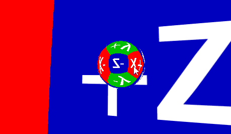
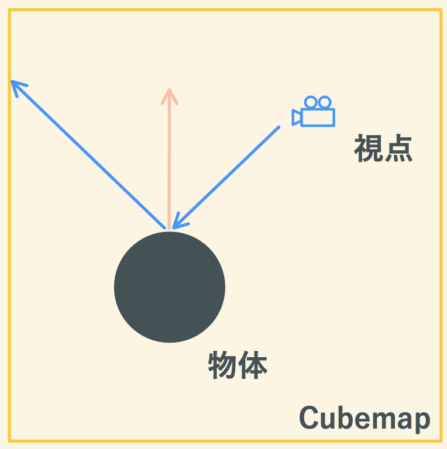
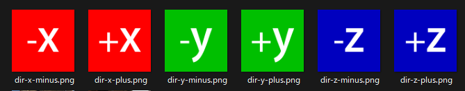
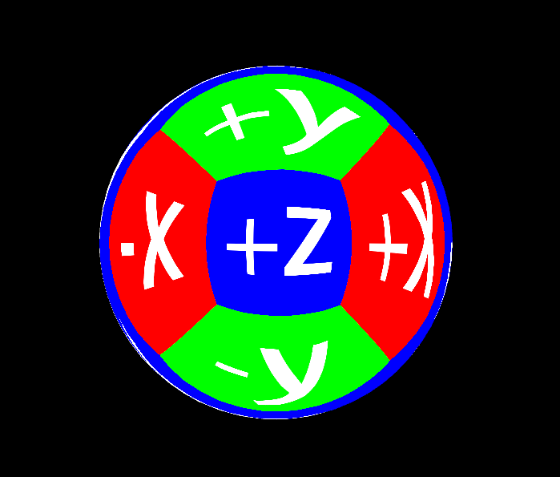
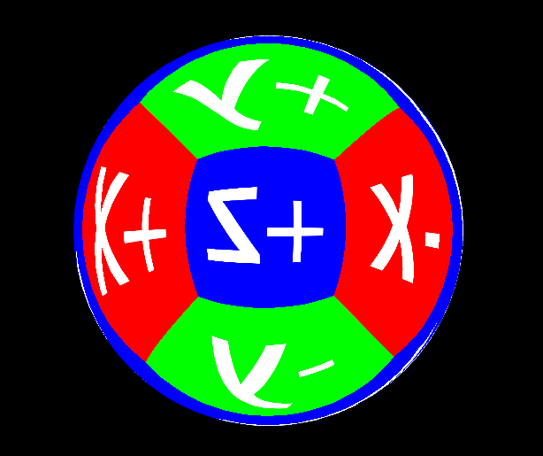
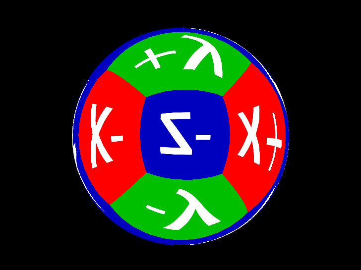

生のWebGLを書いているときにCubeMap（環境マップ）がサンプルされる軸についてややこしくなったので整理したいと思います。

具体的には、WebGL2においてCubeMapの色を取得するために `texture(samplerCube, vec3)` で呼び出す際、 「どうサンプルされるのが正しいのか」「渡したベクトルに対してCubeMapのどの軸がサンプルされるか？」というような内容になります。

skyboxも実装したサンプル図です（skyboxそのものの実装については割愛します）



こちらは開発中のWebGLの自作ライブラリになるのですが動作デモになります。

[https://takumifukasawa.github.io/PaleGL/workspace/011\_cube-mapping/](https://takumifukasawa.github.io/PaleGL/workspace/011_cube-mapping/)

## 目次

## CubeMapの考え方

この画像のように、シェーダー内ではカメラから物体の表面に対して、法線を軸に反射させたベクトルを使うのが基本的な考え方です。

映り込み（specular）に使うと、画像から色をサンプルしているかつ視点によってサンプルする色も変化するので情報量が増します。（ex. UnityのReflectionProbeや、Skyboxのreflection成分）



WebGLのAPIも踏まえた具体的な説明はこちらがとてもわかりやすいです。

[wgld.org | WebGL: キューブ環境マッピング |](https://wgld.org/d/webgl/w044.html)

## サンプルするベクトルを変えながら確認

以下のような状態で、球体を置いてCubeMappingを実装していきます。

-   球体に出力する色はCubeMappingからサンプルした色をそのまま出す
-   js側（各種行列など）は右手座標系で実装。z+が手前
-   球体の位置は(0,0,0)。カメラの位置は(0,0,5)で球体を向く。つまり-zを向く状態。
-   CubeMapに使う6面の画像は+x,-x,+y,-y,+z,-zが分かるような画像



### 1\. reflectしたものをそのまま使う

```c
// PtoE ... 描画する点のワールド座標 -> カメラのワールド座標 の正規化ベクトル
// N ... 正規化した法線
vec3 reflectDir = reflect(-PtoE, N);
vec3 cubeColor = texture(uCubeTexture, reflectDir).xyz;
```



どうやら軸は手前がz+になっているようです。しかし、「反転して鏡のように映る」期待は逆の結果になります。

### CubeMapの軸

このサイトによると、CubeMapの参照する軸についてこう書かれています。

[Pragmatic physically based rendering : HDR](http://marcinignac.com/blog/pragmatic-pbr-hdr/)

> Cubemaps spec comes from the time when RenderMap ruled the world and Renderman it's using Left-Handed Coordinate system so do the cubemaps. That means to we will need to flip the X axis in our shader whenever we sample from a CubeMap texture. Additionally you will need to point your camera towards +Z instead of the usual -Z in order to start at expected direction. Otherwise you might end up looking at the wall like in case of the Pisa texture we are using.

どうやら、**CubeMapはRenderMap（Autodesk製のソフト？ツール？）にならって左手座標系を基準としている**ようです。

しかしWebGLは右手座標系で設計されている（ポリゴンの正面判定など）ので、参照する軸が異なります。

つまり**CubeMapの考え方に沿って左手座標系に沿って実装するためには、まずx軸を反転する必要があり、場合によってはz軸も反転する必要がある**、ということのようです。

（↑ 解釈が間違っていたらすいません）

試しにx軸を反転させてみます。

## 2\. reflect & x軸を反転

```c
// PtoE ... 描画する点のワールド座標 -> カメラのワールド座標 の正規化ベクトル
// N ... 正規化した法線
vec3 reflectDir = reflect(-PtoE, N);
reflectDir.x *= -1.;
vec3 cubeColor = texture(uCubeTexture, reflectDir).xyz;
```



z+が手前、x+が左側になりました。両方反転させると左手座標系になるので、180度回転をさせます。

## 3\. reflect & x軸を反転 & xzを180度回転

```c
// PtoE ... 描画する点のワールド座標 -> カメラのワールド座標 の正規化ベクトル
// N ... 正規化した法線

mat2 rotate(float r) {
    float c = cos(r);
    float s = sin(r);
    return mat2(c, s, -s, c);
}

vec3 reflectDir = reflect(-PtoE, N);
reflectDir.x *= -1.;
reflectDir.xz *= rotate(3.14);
vec3 cubeColor = texture(uCubeTexture, reflectDir).xyz;
```



手前がz-、右がz+となっています。また、それぞれ反転しているので無事に左手座標系に直りました。

## 参考

[Pragmatic physically based rendering : HDR](http://marcinignac.com/blog/pragmatic-pbr-hdr/)

[WebGLでキューブマッピング - Qiita](https://qiita.com/aa_debdeb/items/57b805691efa27ff905e)

[wgld.org | WebGL: キューブ環境マッピング |](https://wgld.org/d/webgl/w044.html)
