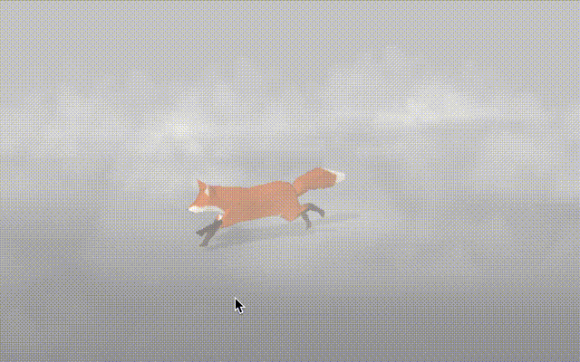
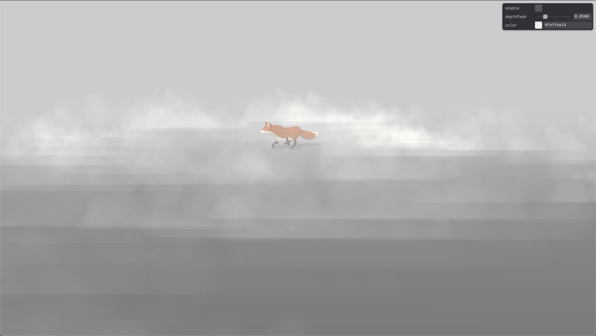
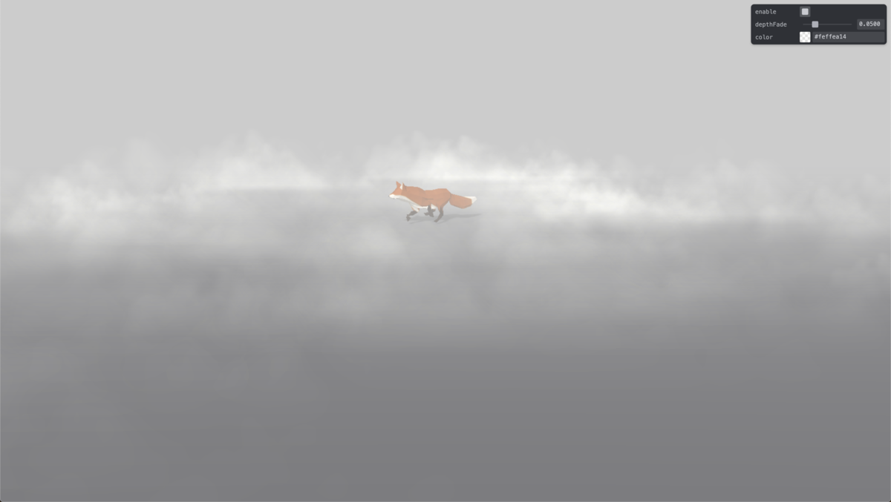
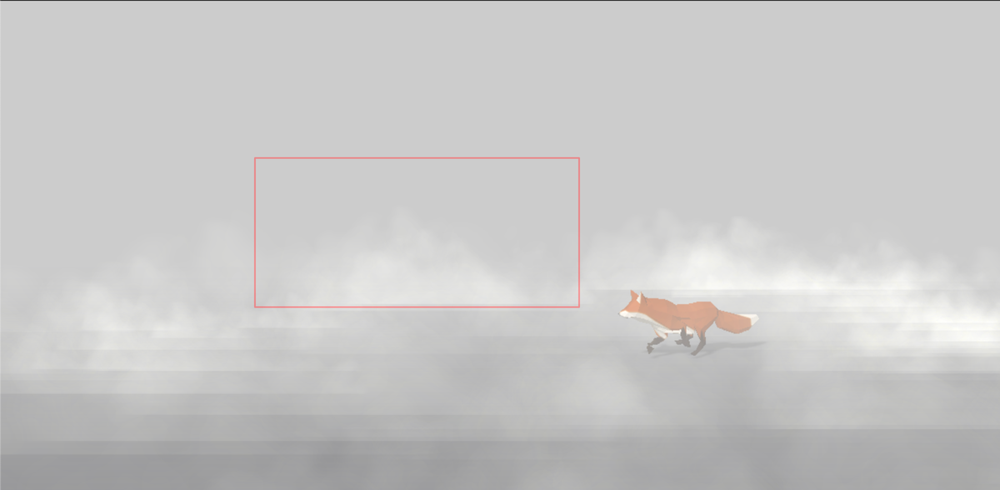
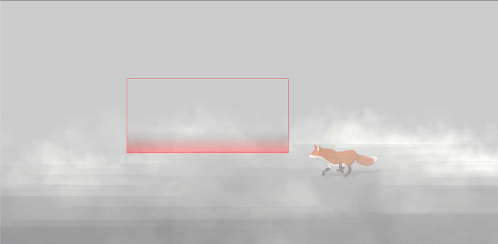
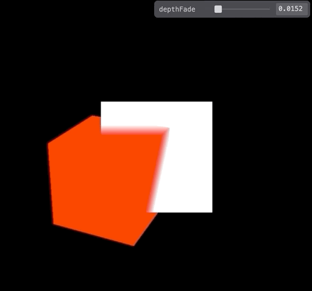
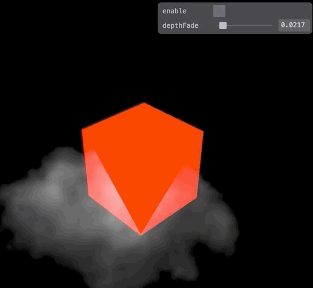
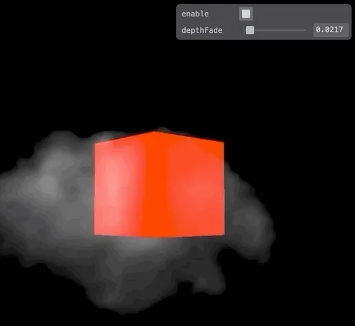
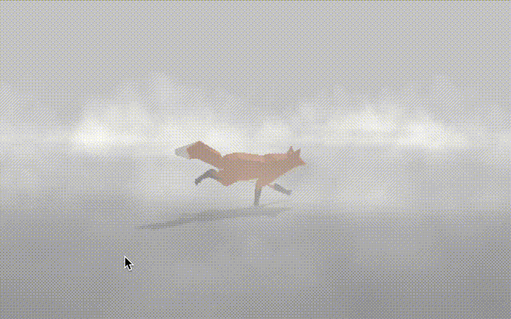

この投稿の内容は[会社のアドベントカレンダーにて書いた記事](https://techblog.kayac.com/webgl-threejs-soft-particle)と同じものになっています。

ですが、自分のブログにも同じ内容を残しておきたいので移植させていただいています。

* * *

three.js で soft particle （ソフトパーティクル）を実装する方法を紹介していきたいと思います。

ソフトパーティクルを使って、霧のような雰囲気の中をキツネが駆けるシーンを作ってみました。

この[動作デモはこちら](https://takumifukasawa.github.io/threejsSoftParticleDemo/)から、動作デモのソースは[こちらのリポジトリ](https://github.com/takumifukasawa/threejsSoftParticleDemo)からご覧いただくことができます。



## ソフトパーティクルについて

### ソフトパーティクルとは

おおまかに一言でまとめると<strong>「深度値の比較をして透過率・色を調整する」</strong>方法のことです。

### 特徴

まずはこちらの画像を比較してみます。





1枚目はソフトパーティクルを無効にしたもの、2枚目が有効にしたものです。 煙に着目すると1枚目は床（地面）との境界に線が入っており、2枚目は床に馴染んでいるという違いがあります。

煙は、霧感を出すためにキツネが走っている床のあたりに板ポリのビルボードにテクスチャを貼って散りばめています。ほとんどの煙の板ポリは床に突き抜けているような状態 = 板ポリと床は交差している状態にあるのですが、そのままだと1枚目の画像のように床の境界で煙のテクスチャが切れてしまうので不自然な見た目になります。

そこで、<strong>「他のオブジェクトとの重なりの境界を馴染ませる方法」</strong>としてソフトパーティクルを使います。

### 実装方針

カメラから見て床と煙の境界付近のピクセルに着目すると、カメラから床・煙それぞれへの距離はかなり近くなります。完全な境界の場合は、それぞれの距離はほぼ同じになっているはずです。この、距離が近い = 深度値が近いことを利用していきます。

まずは床を描画して床の深度値を取得します。その後、煙を描画する際に深度値を計算します。 その際、煙のピクセルシェーダー内で、床の深度値と煙の深度値を比較して近ければ近いほど透過するような処理をつけます。

すると、煙が描画されるピクセルのうち、床に遠い部分から近い部分にフェードアウトするような状態になります。

↓ 赤い枠線の範囲が板ポリゴンの床より上に見えている範囲だとしたら、



↓ 赤が濃い部分（床に近い部分）ほど透過をかけるようなイメージ



このように、<strong>深度値の比較をして透過率・色を調整することで他のオブジェクトとの重なりを馴染ませることができます。</strong>

ソフト「パーティクル」と呼ばれていますが、この後のデモのように、パーティクルのようなたくさん物量をばらまくようなオブジェクトでなくとも同じ見た目を表現することももちろん可能です。

## three.jsでの実装

簡易的なデモをこちらに用意しました。重なっている部分にフェードがかかっていることが分かるかなと思います。

赤い箱は赤単色を出力するマテリアルを、白い箱はソフトパーティクルのシェーダーを適用したマテリアルを割り当てています。マテリアルは RawShaderMaterial を使っています。

<div class="embed" data-embed-src="https://codepen.io/takumifukasawa/embed/vYXyavG?default-tab=js%2Cresult&amp;theme-id=dark" style="height: 265px"><button type="button" aria-label="[test] three.js : soft particle を読み込む">▶</button><a href="https://codepen.io/takumifukasawa/pen/vYXyavG" target="_blank" rel="noopener">[test] three.js : soft particle</a></div>

白い箱以外のオブジェクトも試してみました。

↓ ビルボードの白い板ポリ



↓ 煙のテクスチャを割り当てた板ポリのビルボード: ソフトパーティクル無効



↓ 煙のテクスチャを割り当てた板ポリのビルボード: ソフトパーティクル有効



### JavaScript

requestAnimationFrame で毎フレーム実行される関数の中身を抜粋してコメントをつけてみます。

```javascript
// RenderTarget の横幅縦幅は別途更新
const renderTarget = new THREE.WebGLRenderTarget(1, 1);
renderTarget.texture.format = THREE.RGBAFormat;
renderTarget.texture.minFilter = THREE.NearestFilter;
renderTarget.texture.magFilter = THREE.NearestFilter;
renderTarget.texture.generateMipmaps = false;
renderTarget.stencilBuffer = false;
renderTarget.depthBuffer = true;
renderTarget.depthTexture = new THREE.DepthTexture();
renderTarget.depthTexture.type = THREE.UnsignedShortType;
renderTarget.depthTexture.format = THREE.DepthFormat;

...

const tick = () => {
  ...

  const ctx = renderer.getContext();

  // ----------------------------------------------------------------------------
  // 1. ソフトパーティクル以外（= 赤い箱）の深度値を深度テクスチャに描画
  // ----------------------------------------------------------------------------

  // ソフトパーティクルのメッシュを非表示
  softParticleMesh.visible = false;

  // 深度値を描画する renderTarget を割り当て  
  renderer.setRenderTarget(renderTarget);
  
  // depth だけ renderTarget に描画するため、色情報は描画しないようにマスク
  ctx.colorMask(false, false, false, false);
  renderer.render(scene, camera);

  // ----------------------------------------------------------------------------
  // 2. ソフトパーティクルを含め全てのオブジェクトを描画
  // ----------------------------------------------------------------------------

  // 画面に表示させるために renderTarget の指定を解除
  renderer.setRenderTarget(null);

  // ソフトパーティクルのメッシュを表示  
  softParticleMesh.visible = true;

  // 深度値比較用の各種 uniform 値をシェーダーに渡す
  softParticleMesh.material.uniforms.tDepth.value = renderTarget.depthTexture;
  softParticleMesh.material.uniforms.cameraNear.value = camera.near;
  softParticleMesh.material.uniforms.cameraFar.value = camera.far;
  softParticleMesh.material.uniforms.depthFade.value = params.depthFade;
  softParticleMesh.material.uniforms.resolution.value = new THREE.Vector2(
    width * ratio, height * ratio
  );

  // 色情報のマスクを解除し描画
  ctx.colorMask(true, true, true, true);
  renderer.render(scene, camera);
};
```

流れをまとめると、

ソフトパーティクル以外のオブジェクトのz-bufferを深度テクスチャに焼く → 深度テクスチャなど必要な情報をソフトパーティクルのシェーダーに渡す → 全てのオブジェクトを描画

となっています。

z-buffer を深度テクスチャに焼く際、 gl.colorMask という WebGL API を直接叩いています。この関数は、フレームバッファーに書き込むチャンネルをフラグ形式で指定することができます。

深度情報のみ欲しい場合はRGBA情報は必要ないので、gl.colorMask(false, false, false, false) として色情報を書き込む処理を無効にし、負荷軽減対策をしています。

[WebGLRenderingContext.colorMask() - Web APIs | MDN](https://developer.mozilla.org/en-US/docs/Web/API/WebGLRenderingContext/colorMask)

### GLSL

ソフトパーティクルの処理を入れている白い箱の頂点シェーダーとフラグメントシェーダーの抜粋になります。 こちらもコメントをつけていきます。

```c
// ----------------------------------------------------------------------------
// 頂点シェーダー
// ----------------------------------------------------------------------------

attribute vec3 position;
attribute vec2 uv;

uniform mat4 projectionMatrix;
uniform mat4 modelViewMatrix;

varying vec4 vViewPosition;

void main() {
  // ビュー座標をフラグメントシェーダーに渡す
  vViewPosition = modelViewMatrix * vec4(position, 1.);

  gl_Position = projectionMatrix * modelViewMatrix * vec4(position, 1.);
}
// ----------------------------------------------------------------------------
// ピクセルシェーダー
// ----------------------------------------------------------------------------

precision highp float;
  
#include <packing>
  
varying vec4 vViewPosition;

uniform sampler2D uDepthTexture;
uniform float uCameraNear;
uniform float uCameraFar;
uniform float uDepthFade;
uniform vec2 uResolution;
  
// refs: https://threejs.org/examples/webgl_depth_texture.html
float readDepth(sampler2D depthSampler, vec2 coord) {
  float fragCoordZ = texture2D(depthSampler, coord).x;
  float viewZ = perspectiveDepthToViewZ(fragCoordZ, cameraNear, cameraFar);
  return viewZToOrthographicDepth(viewZ, cameraNear, cameraFar);
} 
  
void main() {
  // スクリーン上の座標を0~1で取得
  vec2 screenCoord = gl_FragCoord.xy / uResolution.xy;

  // 深度テクスチャから、現在のピクセルの他のオブジェクト（= 赤い箱）の深度値を取得
  float sceneDepth = readDepth(uDepthTexture, screenCoord);

  // 現在のピクセルの、これから描画するオブジェクト（= 白い箱）の深度値を取得
  float viewZ = vViewPosition.z;
  float currentDepth = viewZToOrthographicDepth(viewZ, uCameraNear, uCameraFar);

  // 深度値を比較して、一定の値以下の場合はフェードする
  // 0除算しないように調整 
  float eps = .0001;
  float fade = clamp(abs(currentDepth - sceneDepth) / max(uDepthFade, eps), 0., 1.);
 
  gl_FragColor = vec4(vec3(1.), fade);
}
```

ポイントは readDepth 関数です。この関数自体はthree.jsのサンプルから引用しました。

まず、深度テクスチャには z-buffer の値が入っているのですが、z-buffer の性質の関係で値は非線形ではありません。 そのため、取り出す際には camera の near clip と far clip を元に線形に直す作業が必要になります。それを行っているのが readDepth です。

z-buffer の性質についてはこちらの記事がとてもわかりやすかったです。

[その71 深度バッファの精度って？](http://marupeke296.com/DXG_No71_depthbuffer.html)

[LearnOpenGL - Depth testing](https://learnopengl.com/Advanced-OpenGL/Depth-testing)

readDepth 関数の中で呼んでいる `viewZToOrthographicDepth` , `perspectiveDepthToViewZ` はピクセルシェーダー冒頭の `#include <packing>` で展開される中身に含まれています。

`#include <...>` は three.js のGLSLのコードを挿入する記述です。fog など three.js の機能に絡むシェーダーを使いたい時に便利です。

```c
float viewZToOrthographicDepth( const in float viewZ, const in float near, const in float far ) {
  return ( viewZ + near ) / ( near - far );
}

float perspectiveDepthToViewZ( const in float invClipZ, const in float near, const in float far ) {
  return ( near * far ) / ( ( far - near ) * invClipZ - far );
}
```

## 改善点

-   iOS Safari, Chrome で見るとガタついているようなアーティファクトが発生していました。原因は、深度テクスチャの書き込み時もしくは読み取り時に精度が落ちていることにあるようです。
    
-   フェードする閾値だけを調整できるようにしているのですが、フェード開始地点・フェードする閾値の2つを調整できるようにするとより細かい調整が可能かなと思います。
    

## 霧の表現

キツネが駆けるデモでは霧のような雰囲気を出すためにソフトパーティクルを使っているのですが、煙のポリゴンをたくさん出して霧の雰囲気を出そうとするとその分透過の描画・重なりも増えるので描画が重くなりやすいです。

なので、霧のような雰囲気をより出すためにはパーティクルは控えめにしつつ（数を減らす・サイズを小さくするなど）、他の方法と組み合わせるのがよいと思います。例えば distance fog や height fog ですね。キツネが駆けるデモでは three.js の fog (distance fog) と組み合わせています。


